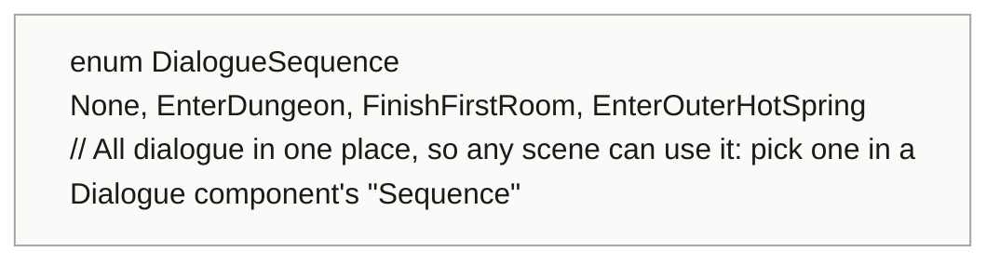
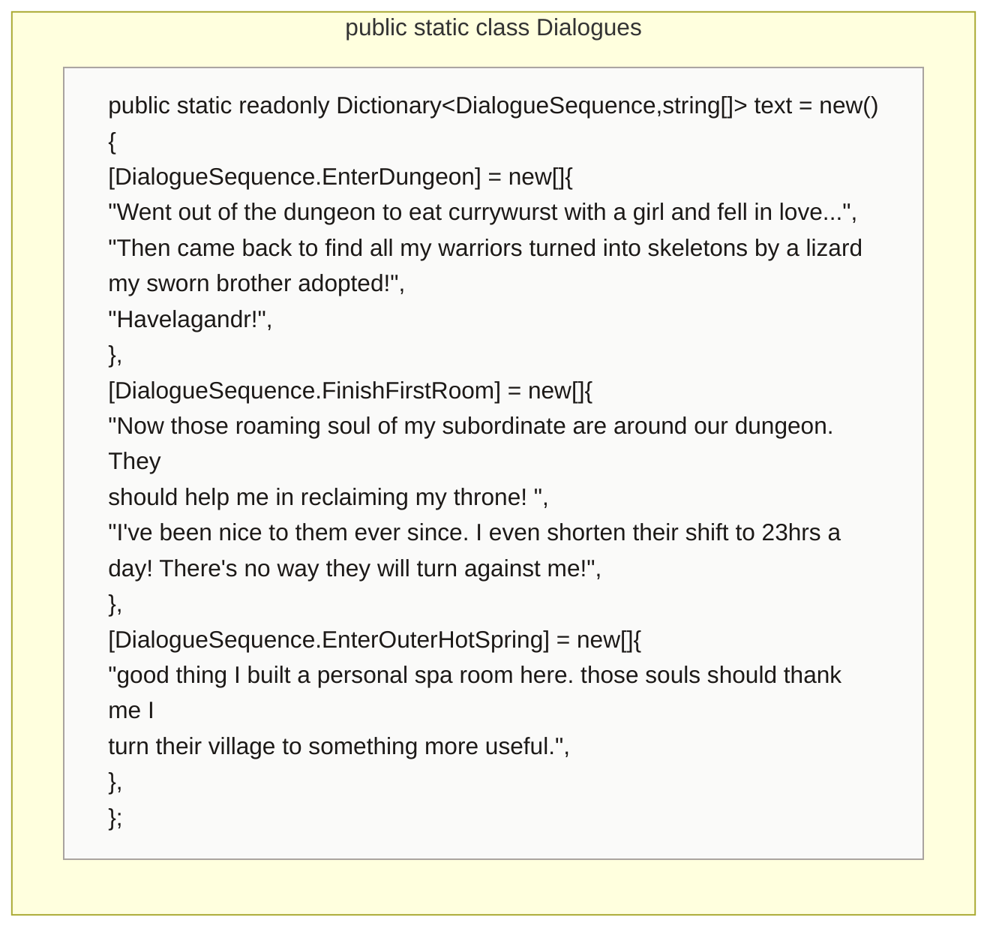
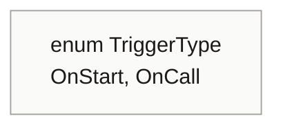
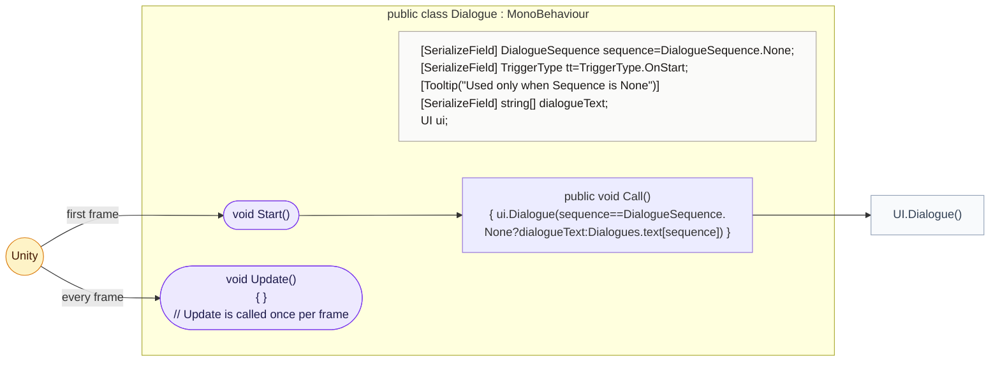
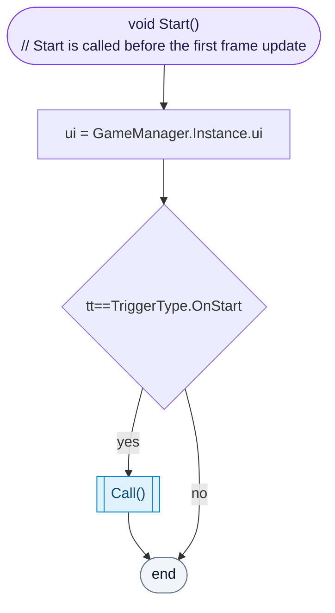

<!-- generated by CodeGraph~/codegraph.py from Dialogue.cs. Do not edit: run python "CodeGraph~/codegraph.py". Notes go in CodeGraph~/ai/Dialogue.cs.md -->
# Dialogue.cs

[overview](README.md) · [source](../../Dialogue.cs) · 46 lines · using `System.Collections`, `System.Collections.Generic`, `UnityEngine`

All story text in one table, and the component that shows a piece of it.

## enum DialogueSequence

## class Dialogues

The story lines, by sequence name.
Add a value to `DialogueSequence` and its lines here; any scene can then show it by picking it in a Dialogue component.

## enum TriggerType

## class Dialogue

Shows a dialogue sequence, on start or when called.
Its own `dialogueText` is used only when Sequence is None.

### Dialogue.Start

Finds the UI. With trigger OnStart the dialogue shows right away; with OnCall it waits for something (a UnityEvent, for example) to call `Call`.

[lines 31–35](../../Dialogue.cs#L31-L35) · called by Unity: first frame · calls [Dialogue.Call](Dialogue.cs.md#class-dialogue)
