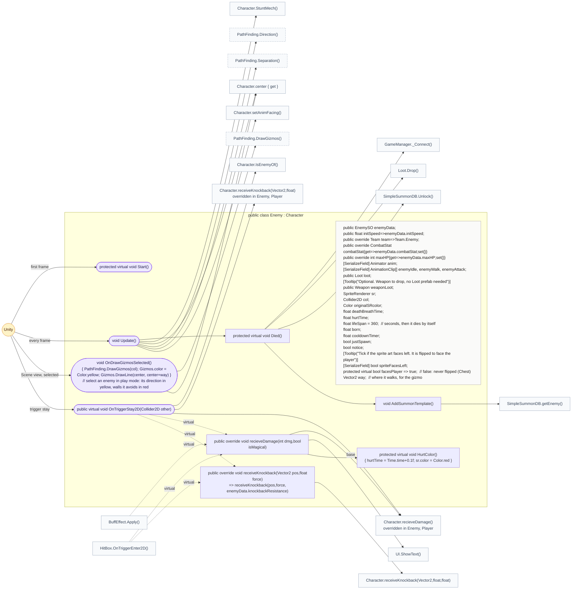
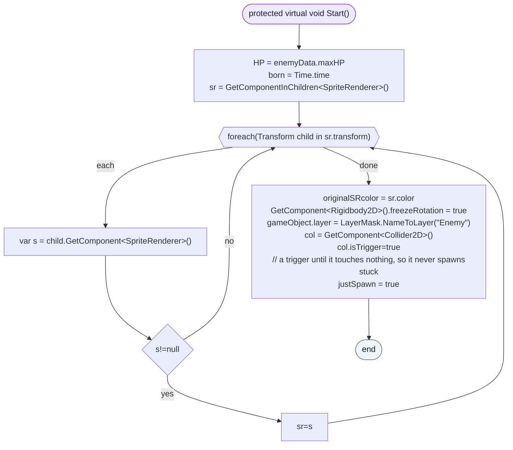
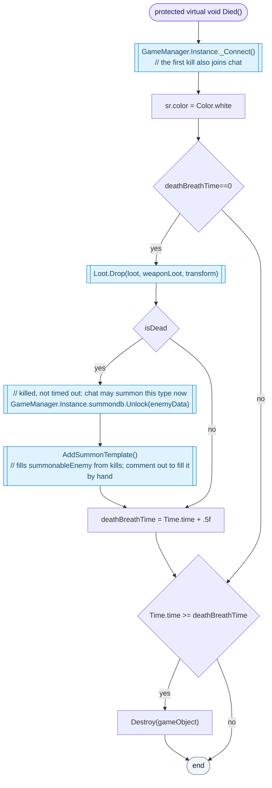
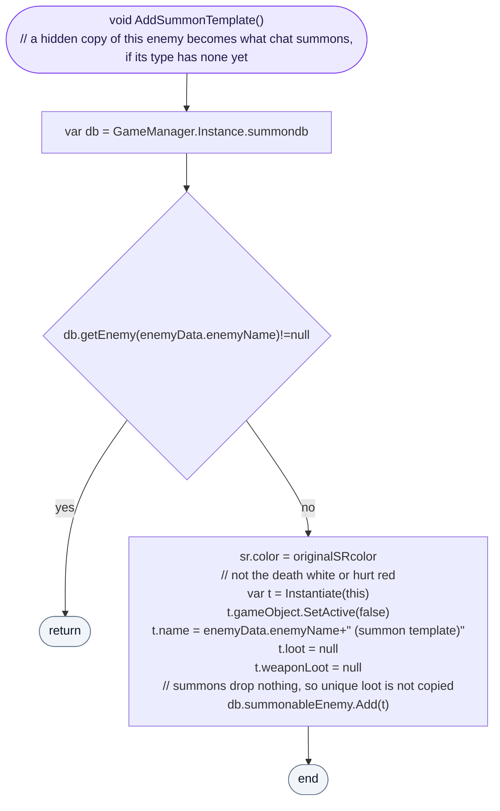
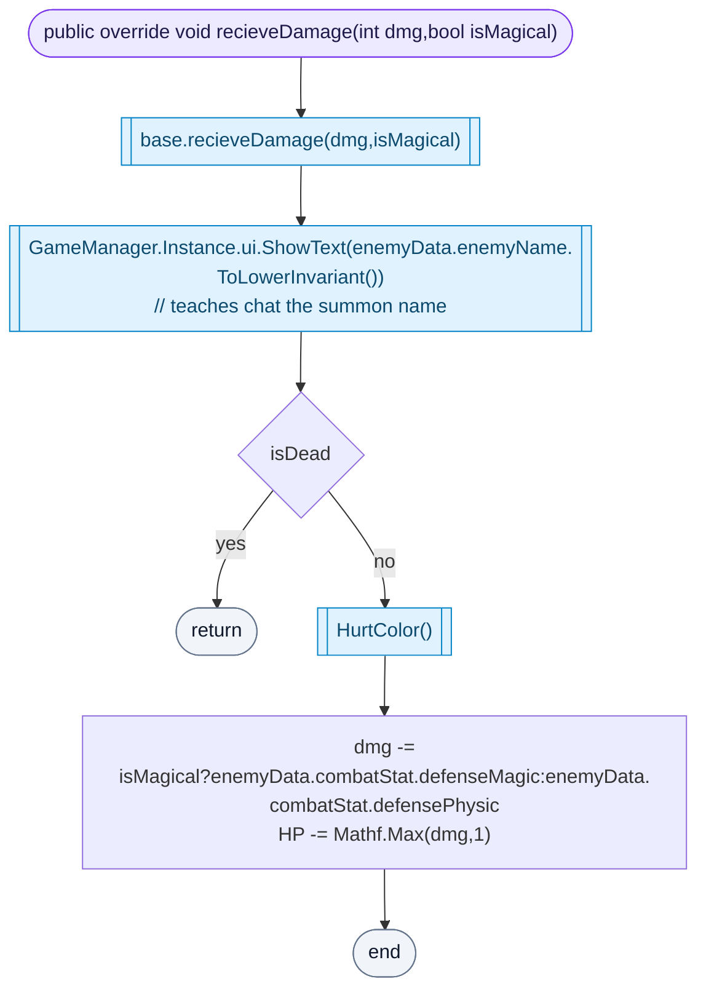
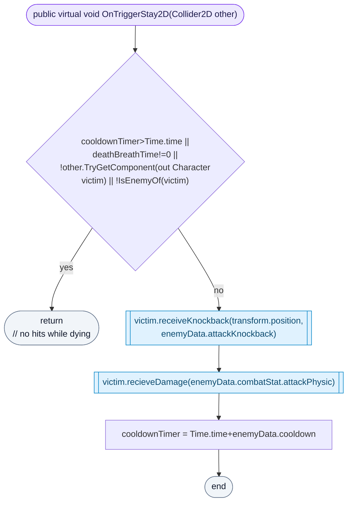

<!-- generated by CodeGraph~/codegraph.py from Enemy.cs. Do not edit: run python "CodeGraph~/codegraph.py". Notes go in CodeGraph~/ai/Enemy.cs.md -->
# Enemy.cs

[overview](README.md) · [source](../../Enemy.cs) · 109 lines · using `System.Collections`, `System.Collections.Generic`, `UnityEngine`

Every enemy: chases the player around walls, hurts on touch, drops loot, and once killed becomes something chat can summon.

## class Enemy

Chases the player, hurts on touch, unlocks chat summons.
Its numbers come from `enemyData` (an EnemySO asset). It lives at most `lifeSpan` (360 s), then dies by itself without unlocking anything. The clip arrays `enemyIdle`, `enemyWalk` and `enemyAttack` are not used by code.

### Enemy.Start

Full HP, remembers its sprite color, puts itself on the Enemy layer and starts as a trigger, so a fresh spawn never gets stuck inside a wall or another enemy.

[lines 32–46](../../Enemy.cs#L32-L46) · called by Unity: first frame

### Enemy.Update

Each frame: once it touches nothing it becomes solid (unless it flies); the hurt color fades; it dies when its time is up or HP is 0. Unless stunned, it faces the player and, after noticing them (within `noticeRange`, then for good), walks toward them: around walls with PathFinding, straight if it flies, kept apart from other enemies by Separation.

```mermaid
%%{init: {"flowchart": {"wrappingWidth": 520}}}%%
flowchart TD
  start(["void Update()"])
  n806d63{"justSpawn#38;#38;!col.IsTouchingLayers()"}
  n2f8198["col.isTrigger=enemyData.ignoreCollide<br>justSpawn=false<br>notice=false"]
  n8512f9{"hurtTime#60;Time.time"}
  n47c6d7["sr.color = originalSRcolor"]
  ne01a6f{"Time.time#62;lifeSpan+born"}
  na27b42[["Died()"]]
  nd15314{"isDead"}
  na27b42_2[["Died()"]]
  n250b73{"StuntMech(enemyData.knocbackRecovery)"}
  n1e134f(["return"])
  n33ea69["Vector2 target = GameManager.Instance.player.center<br>movement = target - center<br>// body to body, not feet to feet"]
  nf34c36{"facesPlayer #38;#38; Mathf.Abs(movement.x)#62;0.01f"}
  nc5fa7e["sr.flipX = (movement.x#60;0) != spriteFacesLeft<br>// face the player (left/right)"]
  naa3824{"movement.magnitude#60;enemyData.noticeRange"}
  n1d300c["notice=true"]
  n43f128{"notice"}
  n5a39ea["way = enemyData.ignoreCollide ? movement.normalized :<br>PathFinding.Direction(center,target,<br>GameManager.Instance.currentRoom.bounds,col)<br>// ghosts go straight<br>rb.velocity = Vector2.ClampMagnitude(way +<br>PathFinding.Separation(col, LayerMask.GetMask(#34;Enemy#34;)), 1)<br>* enemyData.initSpeed<br>// AI/PathFinding.cs"]
  nbbdfe8[["setAnimFacing(movement.normalized)"]]
  stop(["end"])
  start --> n806d63
  n806d63 -->|"yes"| n2f8198
  n2f8198 --> n8512f9
  n806d63 -->|"no"| n8512f9
  n8512f9 -->|"yes"| n47c6d7
  n47c6d7 --> ne01a6f
  n8512f9 -->|"no"| ne01a6f
  ne01a6f -->|"yes"| na27b42
  na27b42 --> nd15314
  ne01a6f -->|"no"| nd15314
  nd15314 -->|"yes"| na27b42_2
  na27b42_2 --> n250b73
  nd15314 -->|"no"| n250b73
  n250b73 -->|"yes"| n1e134f
  n250b73 -->|"no"| n33ea69
  n33ea69 --> nf34c36
  nf34c36 -->|"yes"| nc5fa7e
  nc5fa7e --> naa3824
  nf34c36 -->|"no"| naa3824
  naa3824 -->|"yes"| n1d300c
  n1d300c --> n43f128
  naa3824 -->|"no"| n43f128
  n43f128 -->|"yes"| n5a39ea
  n5a39ea --> nbbdfe8
  n43f128 -->|"no"| nbbdfe8
  nbbdfe8 --> stop
  classDef calls fill:#e0f2fe,stroke:#0284c7,color:#0c4a6e
  classDef start fill:#ede9fe,stroke:#7c3aed,color:#1e1b4b
  classDef stop fill:#f1f5f9,stroke:#64748b,color:#0f172a
  class na27b42,na27b42_2,nbbdfe8 calls
  class start start
  class n1e134f,stop stop
```

[lines 47–62](../../Enemy.cs#L47-L62) · called by Unity: every frame · calls [Enemy.Died](Enemy.cs.md#enemydied), [Character.StuntMech](Character.cs.md#characterstuntmech), [Character.center.get](Character.cs.md#class-character), [PathFinding.Direction](../../AI/PathFinding.cs#L48), [PathFinding.Separation](../../AI/PathFinding.cs#L156), [Character.setAnimFacing](Character.cs.md#class-character)

### Enemy.Died

Runs every frame from the moment it dies. The first call joins chat (the first kill starts the stream connection), drops loot and, if it was killed rather than timed out, unlocks its type for chat and stores a summon template. Half a second later it is destroyed.

[lines 70–82](../../Enemy.cs#L70-L82) · called by [Enemy.Update](Enemy.cs.md#enemyupdate) · calls [GameManager._Connect](GameManager.cs.md#gamemanager_connect), [Loot.Drop](Loot.cs.md#lootdrop), [SimpleSummonDB.Unlock](Connector/SummonDB.cs.md#simplesummondbunlock), [Enemy.AddSummonTemplate](Enemy.cs.md#enemyaddsummontemplate)

### Enemy.AddSummonTemplate

If chat has nothing to clone for this type yet, makes a hidden, inactive copy of this enemy (normal color, no loot) and adds it to the summonable list.

[lines 83–90](../../Enemy.cs#L83-L90) · called by [Enemy.Died](Enemy.cs.md#enemydied) · calls [SimpleSummonDB.getEnemy](Connector/SummonDB.cs.md#simplesummondbgetenemy)

### Enemy.recieveDamage

Shows the enemy's name on screen, so chat learns what to type. A living enemy flashes red and loses the damage minus its defense (magic or physical), at least 1.

[lines 91–98](../../Enemy.cs#L91-L98) · called by [BuffEffect.Apply](BuffEffect.cs.md#buffeffectapply) (virtual), [Enemy.OnTriggerStay2D](Enemy.cs.md#enemyontriggerstay2d) (virtual), [HitBox.OnTriggerEnter2D](HitBox.cs.md#hitboxontriggerenter2d) (virtual) · calls [Character.recieveDamage](Character.cs.md#class-character) (base), [UI.ShowText](UI.cs.md#uishowtext), [Enemy.HurtColor](Enemy.cs.md#class-enemy)

### Enemy.OnTriggerStay2D

Touch damage: a Character of another team touching it is knocked back and hurt, at most once per `cooldown`, and never while it is dying.

[lines 103–108](../../Enemy.cs#L103-L108) · called by Unity: trigger stay · calls [Character.IsEnemyOf](Character.cs.md#class-character), [Character.receiveKnockback(Vector2,float)](Character.cs.md#class-character), [Character.recieveDamage](Character.cs.md#class-character)
