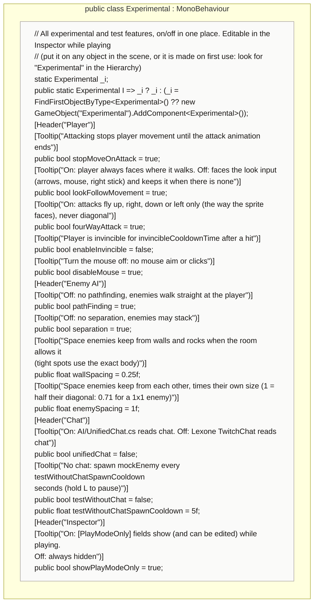

<!-- generated by CodeGraph~/codegraph.py from Experimental.cs. Do not edit: run python "CodeGraph~/codegraph.py". Notes go in CodeGraph~/ai/Experimental.cs.md -->
# Experimental.cs

[overview](README.md) · [source](../../Experimental.cs) · 41 lines · using `UnityEngine`

Every experimental and test switch in one Inspector component, editable while playing.

## class Experimental

On/off switches for features in testing, in one place.
Read through `Experimental.I`, which finds the component in the scene or makes one. Player, Controller, GameManager, PathFinding, UnifiedChat and PlayModeOnly read it.

