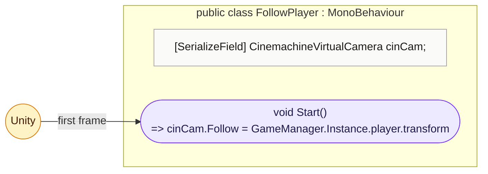

<!-- generated by CodeGraph~/codegraph.py from FollowPlayer.cs. Do not edit: run python "CodeGraph~/codegraph.py". Notes go in CodeGraph~/ai/FollowPlayer.cs.md -->
# FollowPlayer.cs

[overview](README.md) · [source](../../FollowPlayer.cs) · 10 lines · using `Cinemachine`, `System.Collections`, `System.Collections.Generic`, `UnityEngine`

Makes the Cinemachine camera follow the player.

## class FollowPlayer

Points the Cinemachine camera at the player on start.

