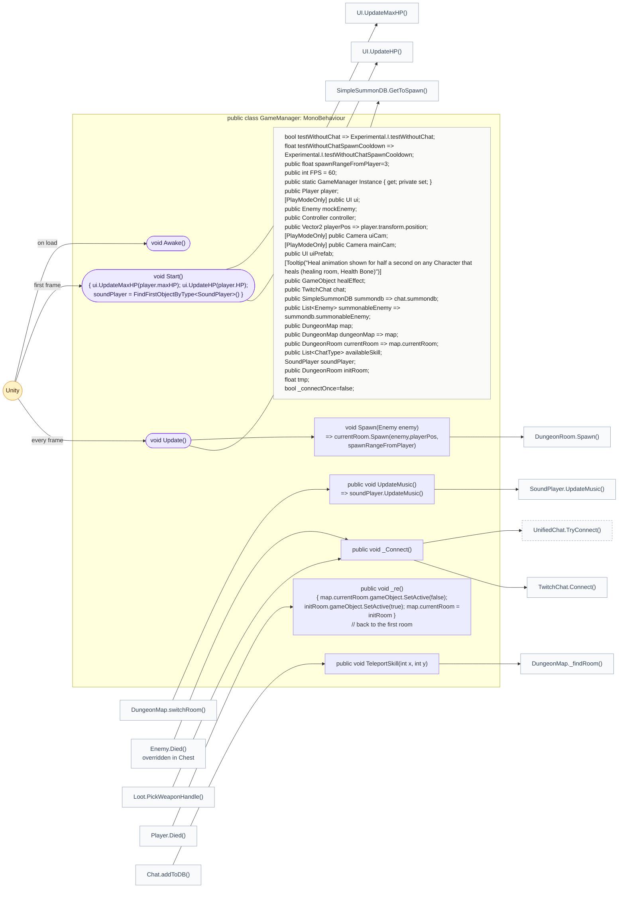
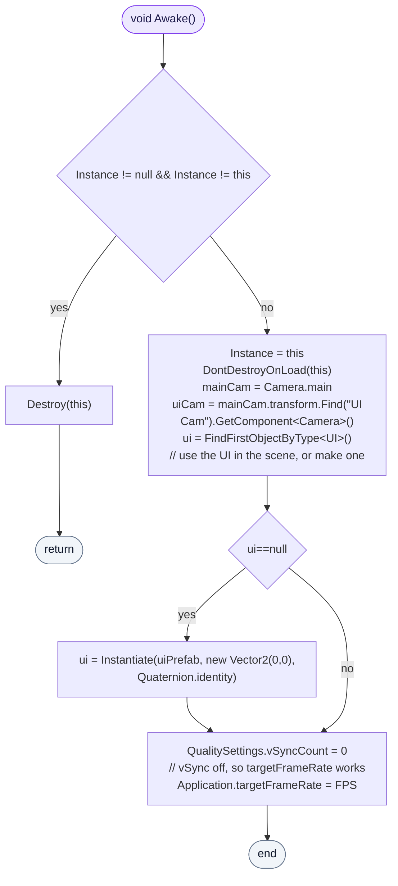
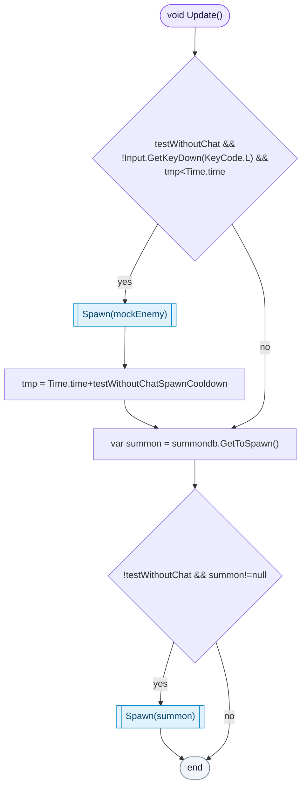
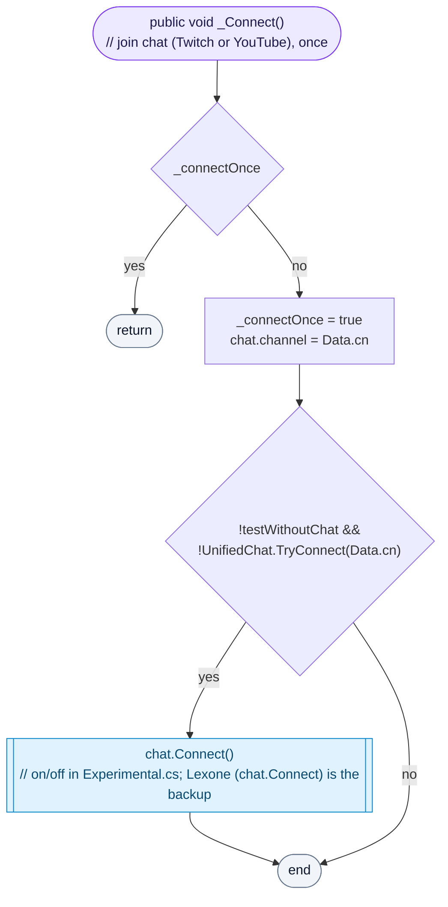
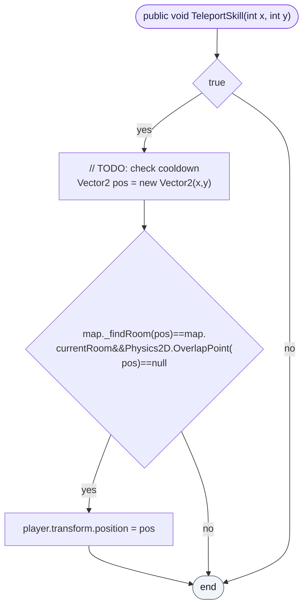

<!-- generated by CodeGraph~/codegraph.py from GameManager.cs. Do not edit: run python "CodeGraph~/codegraph.py". Notes go in CodeGraph~/ai/GameManager.cs.md -->
# GameManager.cs

[overview](README.md) · [source](../../GameManager.cs) · 74 lines · using `UnityEngine`, `UnityEngine.SceneManagement`, `System.Collections.Generic`

The one object everything else talks to: player, UI, input, map, chat, and the spawning of what chat summons.

## class GameManager

Hub: holds the main objects, spawns chat's summons.
Reached through `GameManager.Instance` and kept across scene loads. Its fields connect the parts: `player`, `ui`, `controller`, `chat`, `map`.

### GameManager.Awake

Keeps only one GameManager, finds the cameras, uses the UI in the scene or makes one, and sets the frame rate (vSync off so it applies).

[lines 34–44](../../GameManager.cs#L34-L44) · called by Unity: on load

### GameManager.Update

Testing without chat (Experimental.testWithoutChat): spawns `mockEnemy` every few seconds unless L is held. Otherwise spawns whatever chat summoned once the cooldown allows it.

[lines 50–54](../../GameManager.cs#L50-L54) · called by Unity: every frame · calls [GameManager.Spawn](GameManager.cs.md#class-gamemanager), [SimpleSummonDB.GetToSpawn](Connector/SummonDB.cs.md#simplesummondbgettospawn)

### GameManager._Connect

Joins chat once, on the first kill or weapon pickup: the channel from Data.cn goes to UnifiedChat when Experimental.unifiedChat is on, otherwise to the Lexone TwitchChat. Not in test mode.

[lines 57–62](../../GameManager.cs#L57-L62) · called by [Enemy.Died](Enemy.cs.md#enemydied), [Loot.PickWeaponHandle](Loot.cs.md#lootpickweaponhandle) · calls [UnifiedChat.TryConnect](../../AI/UnifiedChat.cs#L19), [TwitchChat.Connect()](Connector/TwitchChat.cs.md#class-twitchchat)

### GameManager.TeleportSkill

The chat teleport command: moves the player to (x, y) if that point is in the current room and nothing stands there. The cooldown check is still a TODO (`if(true)`).

[lines 68–73](../../GameManager.cs#L68-L73) · called by [Chat.addToDB](Connector/Chat.cs.md#chataddtodb) · calls [DungeonMap._findRoom](Map/DungeonMap.cs.md#dungeonmap_findroom)
