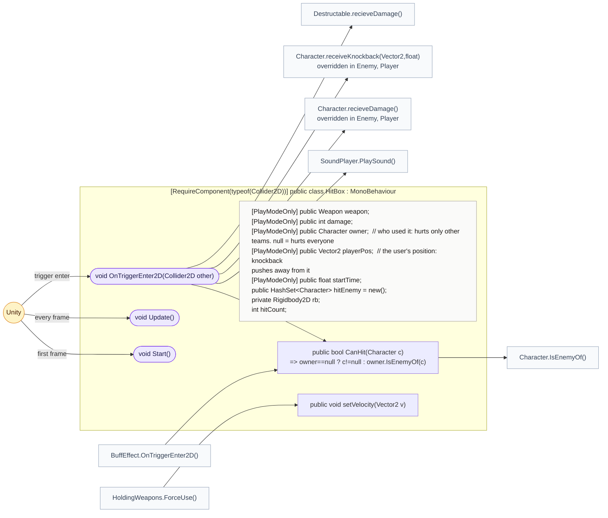
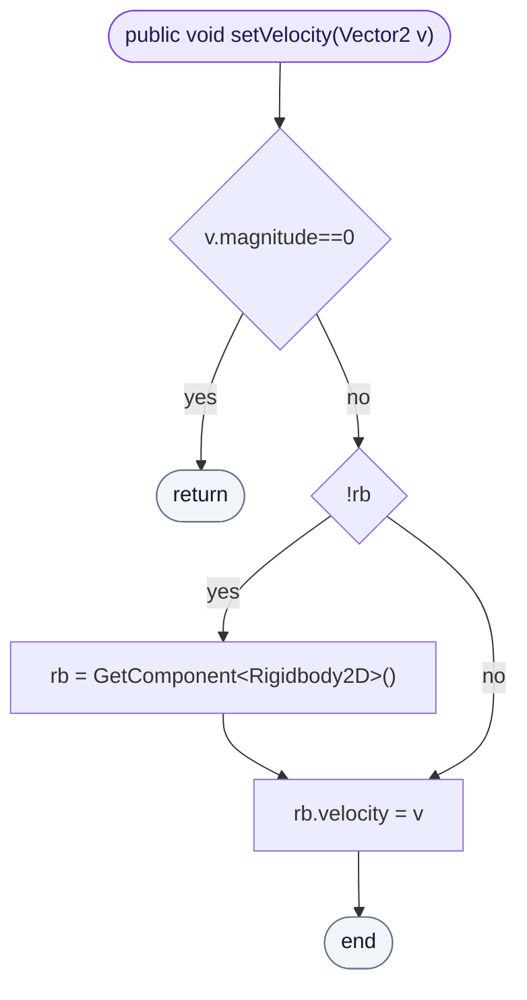
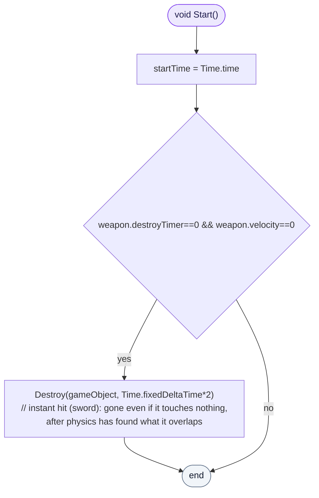
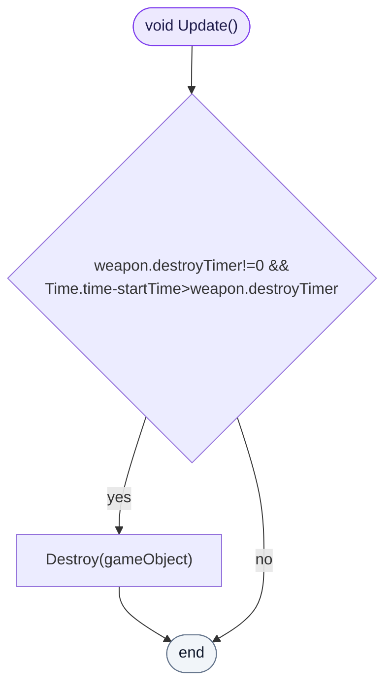
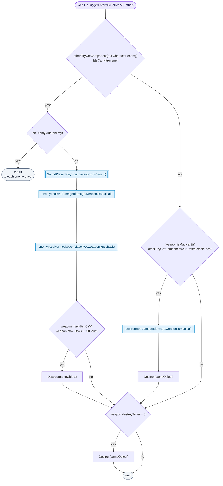

<!-- generated by CodeGraph~/codegraph.py from HitBox.cs. Do not edit: run python "CodeGraph~/codegraph.py". Notes go in CodeGraph~/ai/HitBox.cs.md -->
# HitBox.cs

[overview](README.md) · [source](../../HitBox.cs) · 42 lines · using `System.Collections`, `System.Collections.Generic`, `UnityEngine`

The area an attack spawns: it hurts what it touches, flies if the weapon says so, and disappears by time, by hits, or on touch.

## class HitBox

An attack's damage area: hurts other teams, breaks crates.
Spawned and filled in by `HoldingWeapons.ForceUse`. Hurts each target once (`hitEnemy`). With no owner it hurts everyone.

### HitBox.setVelocity

Makes it fly at that velocity; 0 leaves it in place.

[lines 18–22](../../HitBox.cs#L18-L22) · called by [HoldingWeapons.ForceUse](Player.cs.md#holdingweaponsforceuse)

### HitBox.Start

An instant hit (no timer and no speed, like a sword swing) lasts two physics steps: long enough for physics to find what it overlaps, gone even if it touches nothing.

[lines 23–26](../../HitBox.cs#L23-L26) · called by Unity: first frame

### HitBox.Update

Disappears after the weapon's `destroyTimer`, if it has one.

[lines 27–27](../../HitBox.cs#L27-L27) · called by Unity: every frame

### HitBox.OnTriggerEnter2D

A character it may hit: hit sound, damage and knockback away from the user, once per character; gone after `maxHits`. A Destructable takes the hit from non-magic weapons and the hitbox is gone. With no timer, touching anything at all removes it.

[lines 29–41](../../HitBox.cs#L29-L41) · called by Unity: trigger enter · calls [HitBox.CanHit](HitBox.cs.md#class-hitbox), [SoundPlayer.PlaySound](SoundPlayer.cs.md#class-soundplayer), [Character.recieveDamage](Character.cs.md#class-character), [Character.receiveKnockback(Vector2,float)](Character.cs.md#class-character), [Destructable.recieveDamage](DestructableObj.cs.md#destructablerecievedamage)
