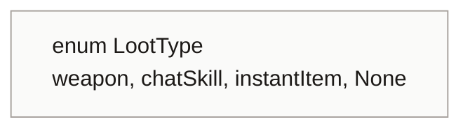
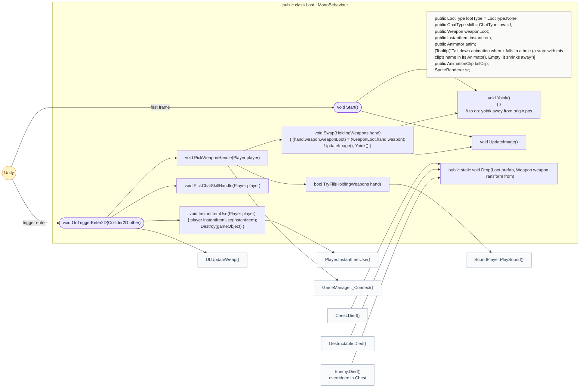
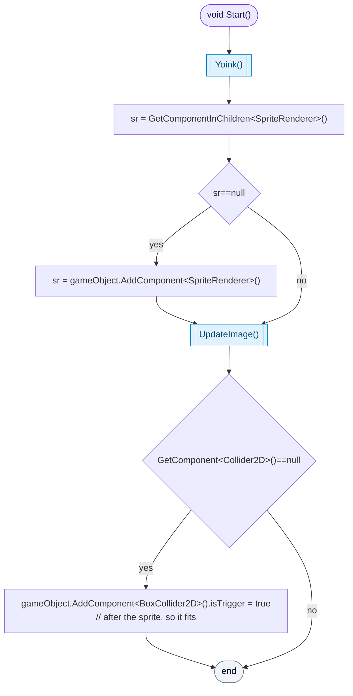
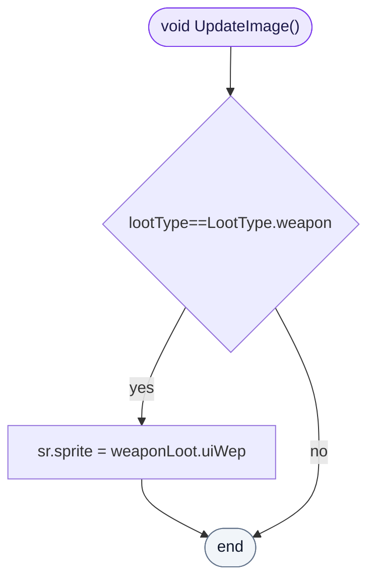
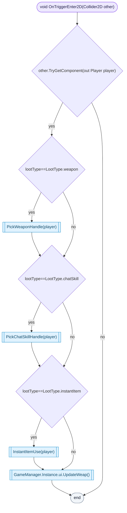
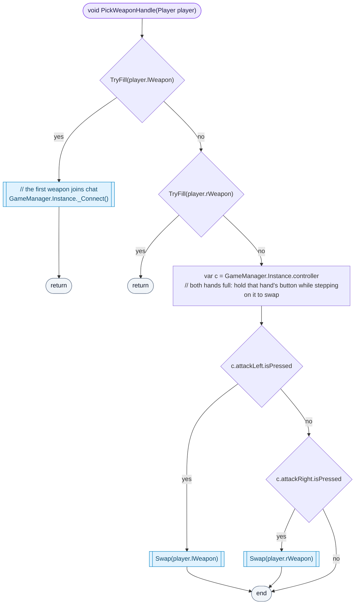
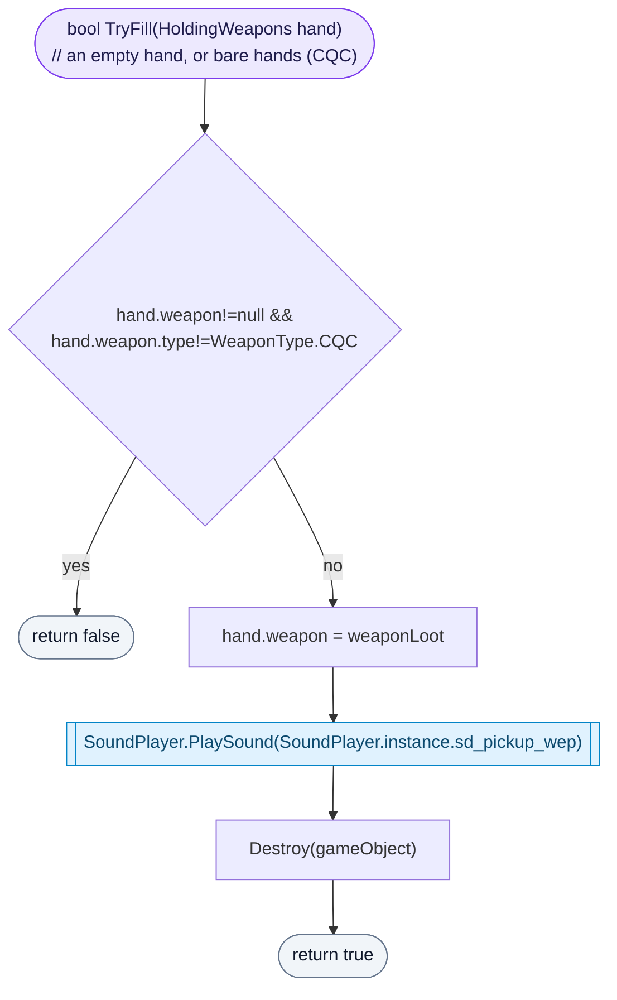
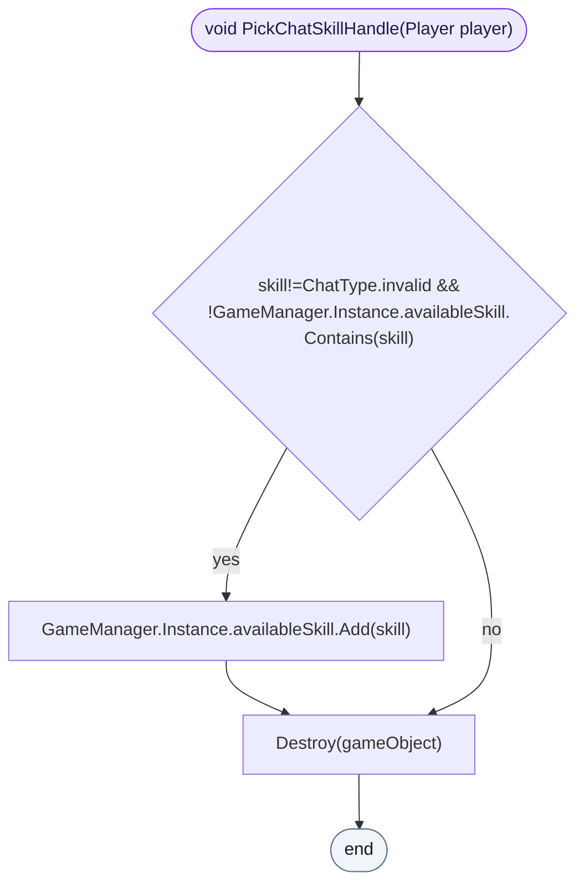
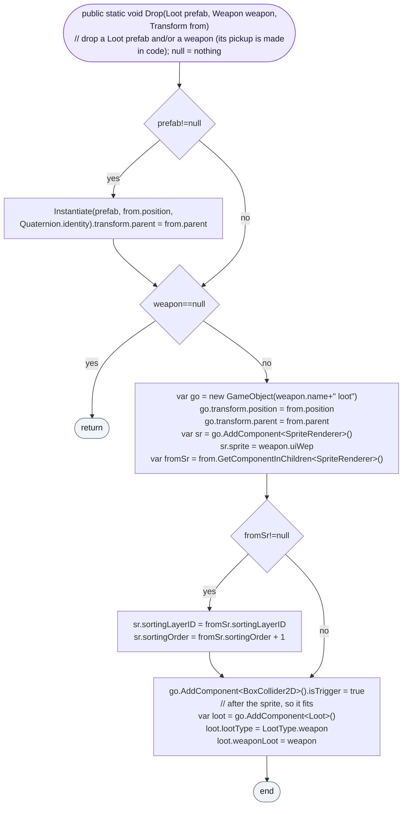

<!-- generated by CodeGraph~/codegraph.py from Loot.cs. Do not edit: run python "CodeGraph~/codegraph.py". Notes go in CodeGraph~/ai/Loot.cs.md -->
# Loot.cs

[overview](README.md) · [source](../../Loot.cs) · 79 lines · using `System.Collections`, `System.Collections.Generic`, `UnityEngine`

Pickups on the floor: weapons, chat skills and instant items, and the code that drops them.

## enum LootType

## class Loot

A pickup: weapon, chat skill or instant item.
Dropped by enemies, chests and crates (`Drop`). A weapon pickup can be swapped with a full hand.

### Loot.Start

Makes sure it can be seen and touched: adds a sprite renderer and a trigger collider if missing (the collider after the sprite, so it fits it).

[lines 19–25](../../Loot.cs#L19-L25) · called by Unity: first frame · calls [Loot.Yoink](Loot.cs.md#class-loot), [Loot.UpdateImage](Loot.cs.md#lootupdateimage)

### Loot.UpdateImage

A weapon pickup shows the weapon's icon.

[lines 27–27](../../Loot.cs#L27-L27) · called by [Loot.Start](Loot.cs.md#lootstart), [Loot.Swap](Loot.cs.md#class-loot)

### Loot.OnTriggerEnter2D

The player steps on it: it is picked up the way its type says, and the weapon icons in the UI refresh.

[lines 29–37](../../Loot.cs#L29-L37) · called by Unity: trigger enter · calls [Loot.PickWeaponHandle](Loot.cs.md#lootpickweaponhandle), [Loot.PickChatSkillHandle](Loot.cs.md#lootpickchatskillhandle), [Loot.InstantItemUse](Loot.cs.md#class-loot), [UI.UpdateWeap](UI.cs.md#uiupdateweap)

### Loot.PickWeaponHandle

Fills the left hand, then the right (bare hands count as empty). The first weapon picked up also joins chat. With both hands full, hold that hand's attack button while stepping on it to swap.

[lines 43–49](../../Loot.cs#L43-L49) · called by [Loot.OnTriggerEnter2D](Loot.cs.md#lootontriggerenter2d) · calls [Loot.TryFill](Loot.cs.md#loottryfill), [GameManager._Connect](GameManager.cs.md#gamemanager_connect), [Loot.Swap](Loot.cs.md#class-loot)

### Loot.TryFill

Puts the weapon in an empty or bare hand, plays the pickup sound and removes the pickup.

[lines 50–56](../../Loot.cs#L50-L56) · called by [Loot.PickWeaponHandle](Loot.cs.md#lootpickweaponhandle) · calls [SoundPlayer.PlaySound](SoundPlayer.cs.md#class-soundplayer)

### Loot.PickChatSkillHandle

Adds the chat skill to the available list (once) and removes the pickup. Nothing reads `availableSkill` yet.

[lines 58–61](../../Loot.cs#L58-L61) · called by [Loot.OnTriggerEnter2D](Loot.cs.md#lootontriggerenter2d)

### Loot.Drop

Drops a Loot prefab and/or a bare weapon at a position. A weapon gets a pickup made in code: its icon drawn just above the dropper's sprite, a trigger box, and a Loot of type weapon.

[lines 64–78](../../Loot.cs#L64-L78) · called by [Chest.Died](Map/Chest.cs.md#chestdied), [Destructable.Died](DestructableObj.cs.md#destructabledied), [Enemy.Died](Enemy.cs.md#enemydied)
