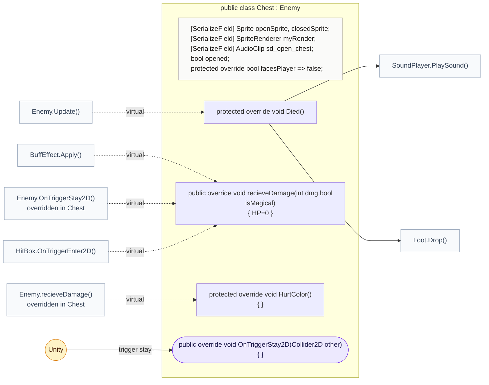
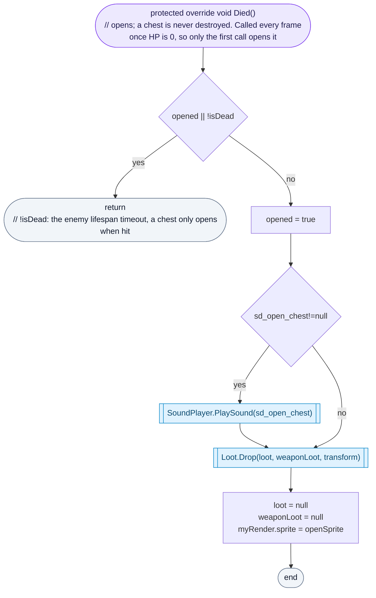

<!-- generated by CodeGraph~/codegraph.py from Map/Chest.cs. Do not edit: run python "CodeGraph~/codegraph.py". Notes go in CodeGraph~/ai/Map/Chest.cs.md -->
# Map/Chest.cs

[overview](../README.md) · [source](../../../Map/Chest.cs) · 24 lines · using `System.Collections`, `System.Collections.Generic`, `UnityEngine`

A chest is an enemy that never moves or attacks: any hit opens it and it drops its loot.

## class Chest

An "enemy" that opens when hit and drops its loot.
Being an Enemy gives it HP, loot and the hit handling for free. It overrides the parts that don't fit: no touch damage, no hurt color, no facing, never destroyed. PathFinding treats chests as walls.

### Chest.Died

Called every frame once HP is 0, so only the first call opens it: open sound, loot, open sprite. The enemy lifespan timeout also calls it, but a chest only opens when it was really hit.

[lines 12–19](../../../Map/Chest.cs#L12-L19) · called by [Enemy.Update](../Enemy.cs.md#enemyupdate) (virtual) · calls [SoundPlayer.PlaySound](../SoundPlayer.cs.md#class-soundplayer), [Loot.Drop](../Loot.cs.md#lootdrop)
