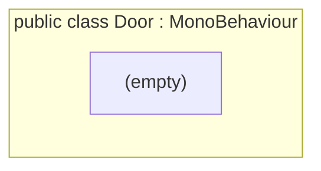

<!-- generated by CodeGraph~/codegraph.py from Map/Door.cs. Do not edit: run python "CodeGraph~/codegraph.py". Notes go in CodeGraph~/ai/Map/Door.cs.md -->
# Map/Door.cs

[overview](../README.md) · [source](../../../Map/Door.cs) · 8 lines · using `System.Collections`, `System.Collections.Generic`, `UnityEngine`

An empty marker component. Room switching is done by RoomTrigger, and doors open through the room events.

## class Door

Empty marker; doors work through RoomTrigger and events.

