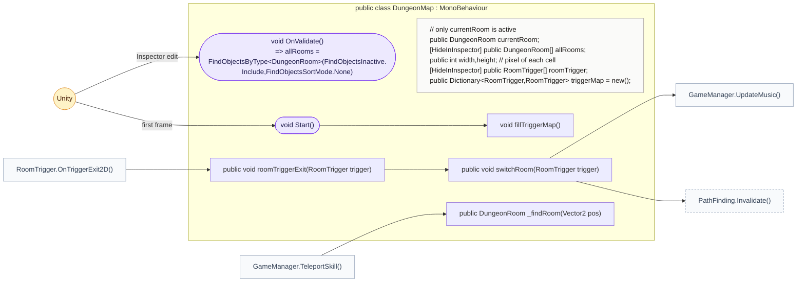
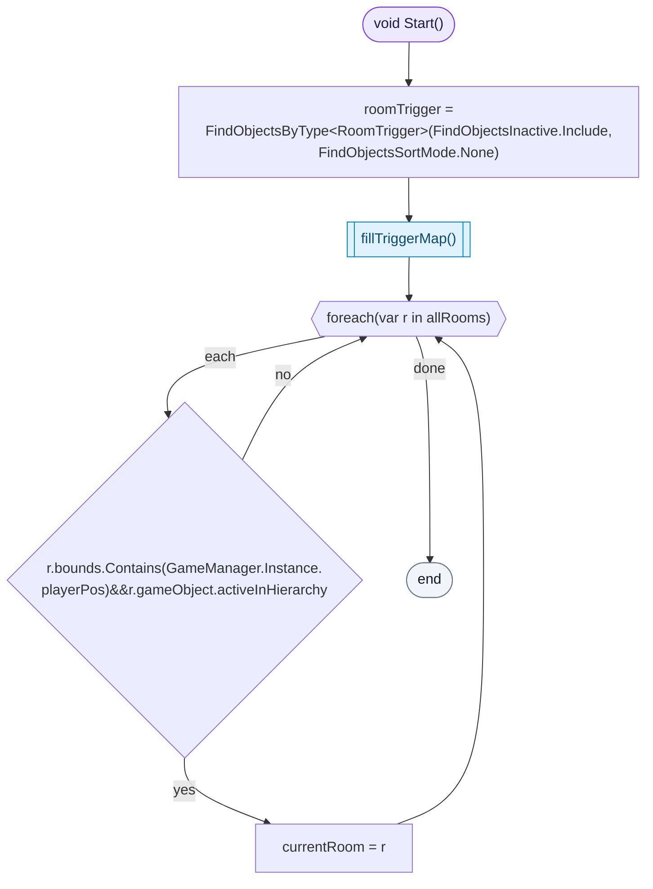
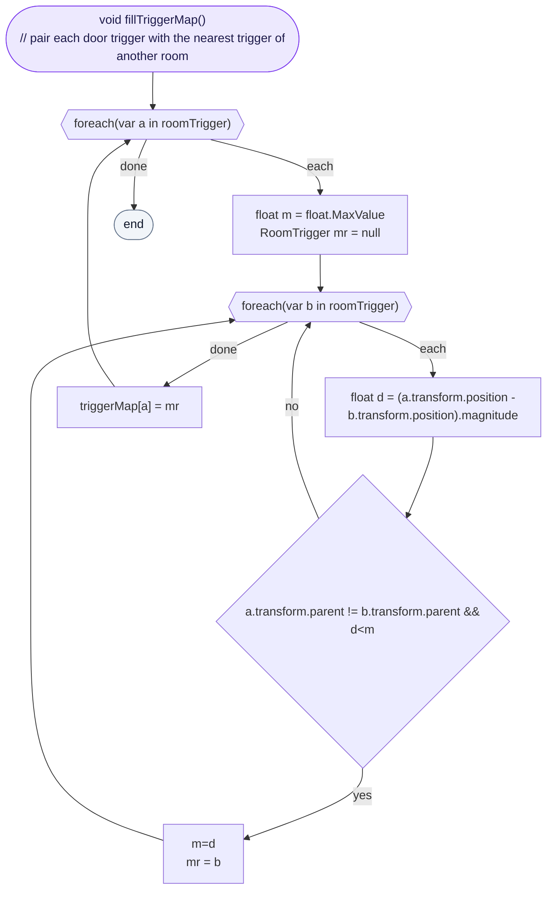
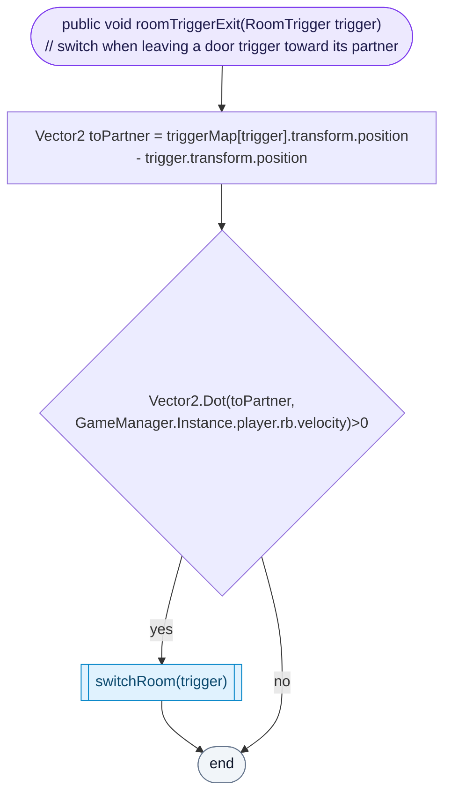
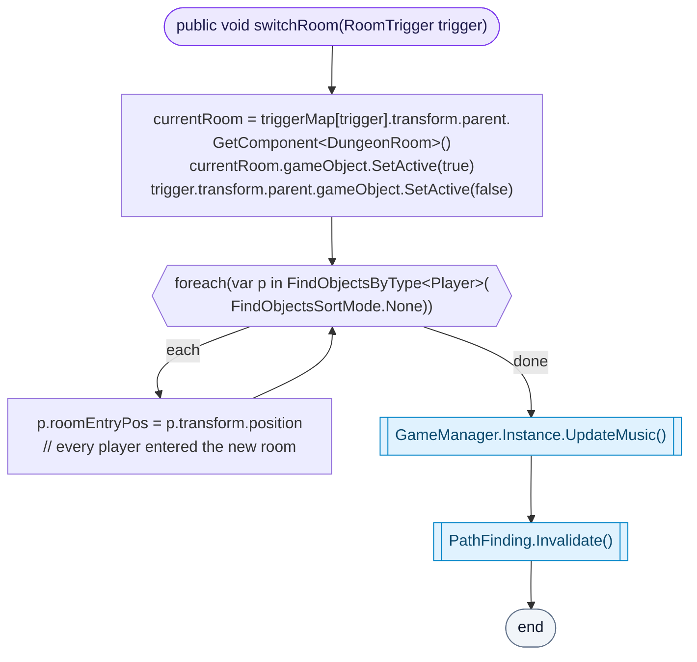
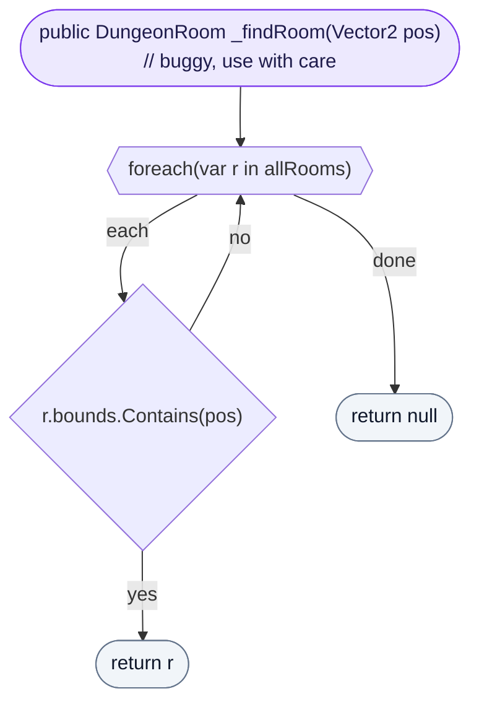

<!-- generated by CodeGraph~/codegraph.py from Map/DungeonMap.cs. Do not edit: run python "CodeGraph~/codegraph.py". Notes go in CodeGraph~/ai/Map/DungeonMap.cs.md -->
# Map/DungeonMap.cs

[overview](../README.md) · [source](../../../Map/DungeonMap.cs) · 47 lines · using `System.Collections`, `System.Collections.Generic`, `UnityEngine`

The dungeon: all rooms, which one is active, and how door triggers lead from one room to the next.

## class DungeonMap

All rooms; only the current one is active.
Each door trigger is paired with the nearest trigger of another room; walking out of a trigger toward its partner switches rooms.

### DungeonMap.Start

Finds every door trigger (inactive rooms included), pairs them, and makes the active room that contains the player the current room.

[lines 15–19](../../../Map/DungeonMap.cs#L15-L19) · called by Unity: first frame · calls [DungeonMap.fillTriggerMap](DungeonMap.cs.md#dungeonmapfilltriggermap)

### DungeonMap.fillTriggerMap

Pairs each door trigger with the closest trigger that belongs to a different room.

[lines 20–30](../../../Map/DungeonMap.cs#L20-L30) · called by [DungeonMap.Start](DungeonMap.cs.md#dungeonmapstart)

### DungeonMap.roomTriggerExit

The player left a door trigger. If they were moving toward its partner, they went through the door: switch rooms.

[lines 31–34](../../../Map/DungeonMap.cs#L31-L34) · called by [RoomTrigger.OnTriggerExit2D](RoomTrigger.cs.md#roomtriggerontriggerexit2d) · calls [DungeonMap.switchRoom](DungeonMap.cs.md#dungeonmapswitchroom)

### DungeonMap.switchRoom

Turns the partner's room on and this one off, records where each player entered (falling in a hole brings them back there), changes the music, and clears the pathfinding cache.

[lines 35–42](../../../Map/DungeonMap.cs#L35-L42) · called by [DungeonMap.roomTriggerExit](DungeonMap.cs.md#dungeonmaproomtriggerexit) · calls [GameManager.UpdateMusic](../GameManager.cs.md#class-gamemanager), [PathFinding.Invalidate](../../../AI/PathFinding.cs#L35)

### DungeonMap._findRoom

The first room whose bounds contain a point. The code marks it "buggy, use with care"; only TeleportSkill uses it.

[lines 43–46](../../../Map/DungeonMap.cs#L43-L46) · called by [GameManager.TeleportSkill](../GameManager.cs.md#gamemanagerteleportskill)
