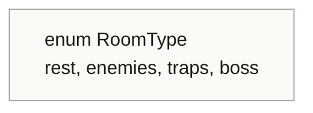
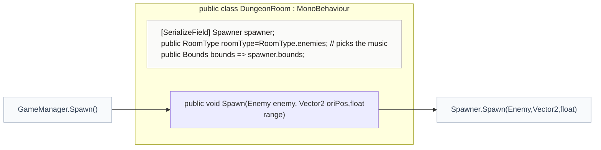
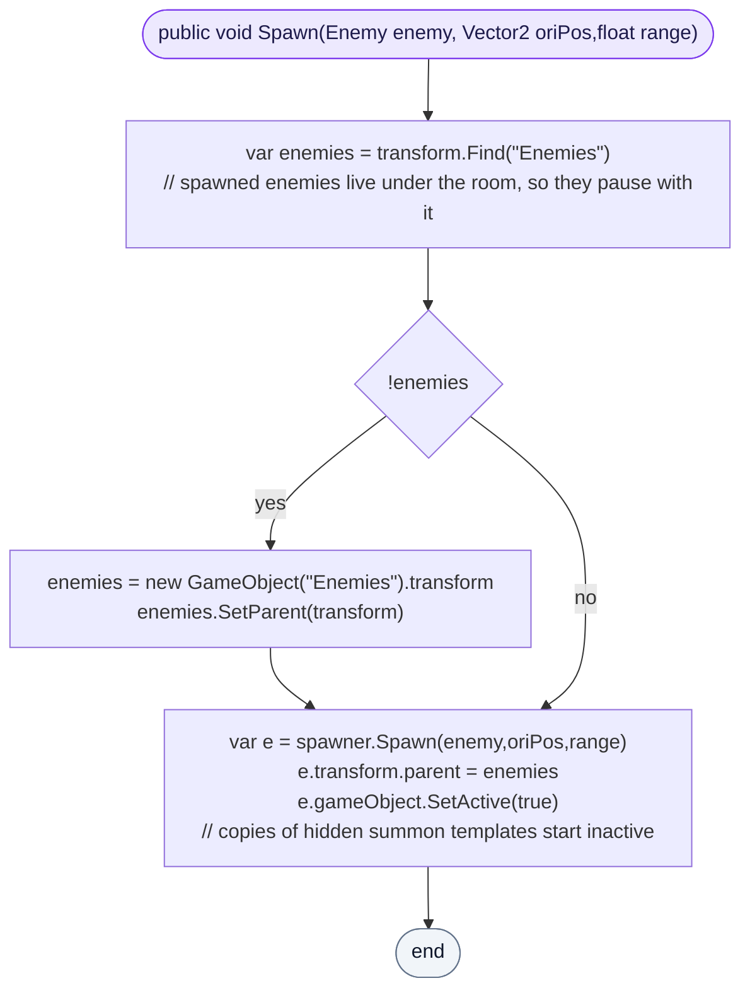

<!-- generated by CodeGraph~/codegraph.py from Map/DungeonRoom.cs. Do not edit: run python "CodeGraph~/codegraph.py". Notes go in CodeGraph~/ai/Map/DungeonRoom.cs.md -->
# Map/DungeonRoom.cs

[overview](../README.md) · [source](../../../Map/DungeonRoom.cs) · 18 lines · using `UnityEngine`

One room: its area (from its floor's Spawner), its type (which picks the music), and spawning enemies into it.

## enum RoomType

## class DungeonRoom

A room: its bounds, its music type, its enemies.

### DungeonRoom.Spawn

Spawns near a point through the room's Spawner and parents the enemy under an "Enemies" child (made on demand), so enemies pause with their room. The copy is activated, since summon templates are inactive.

[lines 11–17](../../../Map/DungeonRoom.cs#L11-L17) · called by [GameManager.Spawn](../GameManager.cs.md#class-gamemanager) · calls [Spawner.Spawn(Enemy,Vector2,float)](../Spawner.cs.md#spawnerspawnenemyvector2float)
