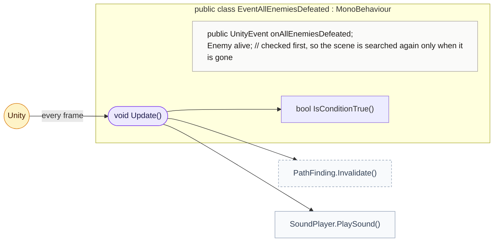
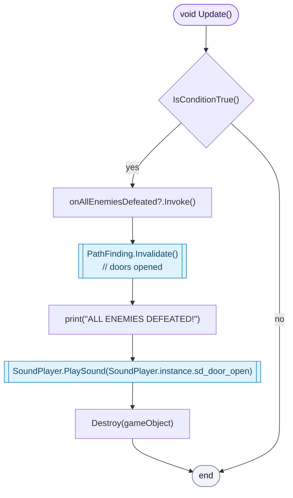
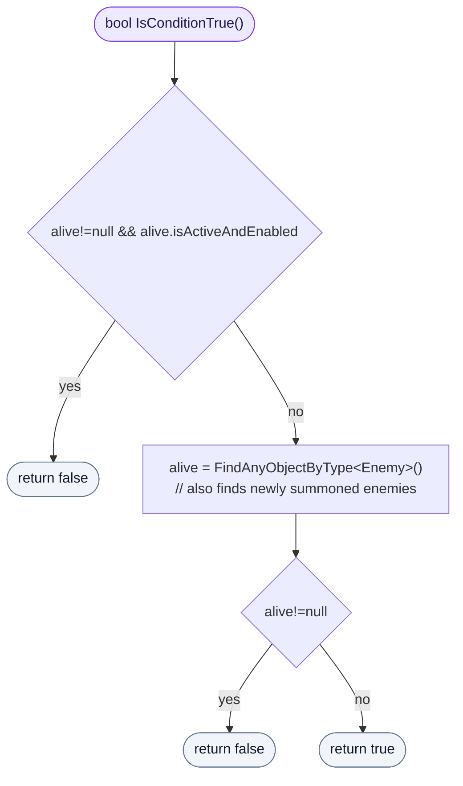

<!-- generated by CodeGraph~/codegraph.py from Map/EventAllEnemiesDefeated.cs. Do not edit: run python "CodeGraph~/codegraph.py". Notes go in CodeGraph~/ai/Map/EventAllEnemiesDefeated.cs.md -->
# Map/EventAllEnemiesDefeated.cs

[overview](../README.md) · [source](../../../Map/EventAllEnemiesDefeated.cs) · 29 lines · using `UnityEngine`, `UnityEngine.Events`

Fires a UnityEvent once, when no enemy is left (for example to open the doors).

## class EventAllEnemiesDefeated

Runs its event once no enemy is left.
What happens is set in the Inspector (`onAllEnemiesDefeated`), so it is not visible in code.

### EventAllEnemiesDefeated.Update

When the condition is met: runs the event, tells pathfinding that doors may have opened, plays the door sound, and removes itself so it fires only once.

[lines 10–20](../../../Map/EventAllEnemiesDefeated.cs#L10-L20) · called by Unity: every frame · calls [EventAllEnemiesDefeated.IsConditionTrue](EventAllEnemiesDefeated.cs.md#eventallenemiesdefeatedisconditiontrue), [PathFinding.Invalidate](../../../AI/PathFinding.cs#L35), [SoundPlayer.PlaySound](../SoundPlayer.cs.md#class-soundplayer)

### EventAllEnemiesDefeated.IsConditionTrue

Cheap check first: while the enemy it found last time is still alive, the answer is no. Otherwise it searches the scene again, which also finds new summons.

[lines 22–28](../../../Map/EventAllEnemiesDefeated.cs#L22-L28) · called by [EventAllEnemiesDefeated.Update](EventAllEnemiesDefeated.cs.md#eventallenemiesdefeatedupdate)
