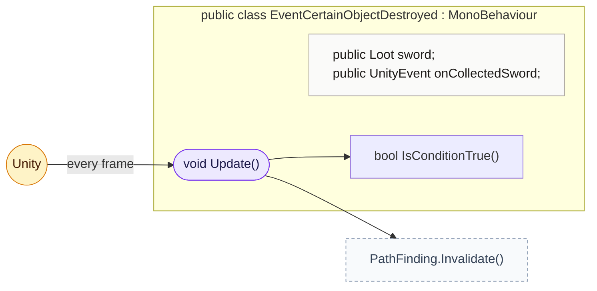
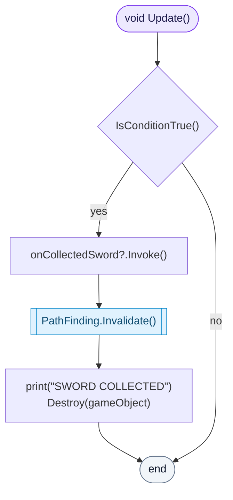
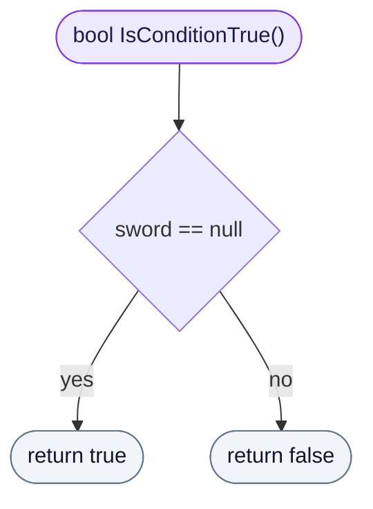

<!-- generated by CodeGraph~/codegraph.py from Map/EventCertainObjectDestroyed.cs. Do not edit: run python "CodeGraph~/codegraph.py". Notes go in CodeGraph~/ai/Map/EventCertainObjectDestroyed.cs.md -->
# Map/EventCertainObjectDestroyed.cs

[overview](../README.md) · [source](../../../Map/EventCertainObjectDestroyed.cs) · 28 lines · using `System.Collections`, `System.Collections.Generic`, `UnityEngine`, `UnityEngine.Events`

Fires a UnityEvent once, when a given pickup (the sword) is gone.

## class EventCertainObjectDestroyed

Runs its event once the `sword` pickup is gone.

### EventCertainObjectDestroyed.Update

When the sword has been picked up: runs the event, clears the pathfinding cache, and removes itself.

[lines 11–20](../../../Map/EventCertainObjectDestroyed.cs#L11-L20) · called by Unity: every frame · calls [EventCertainObjectDestroyed.IsConditionTrue](EventCertainObjectDestroyed.cs.md#eventcertainobjectdestroyedisconditiontrue), [PathFinding.Invalidate](../../../AI/PathFinding.cs#L35)

### EventCertainObjectDestroyed.IsConditionTrue

True once the sword object no longer exists.

[lines 22–26](../../../Map/EventCertainObjectDestroyed.cs#L22-L26) · called by [EventCertainObjectDestroyed.Update](EventCertainObjectDestroyed.cs.md#eventcertainobjectdestroyedupdate)
