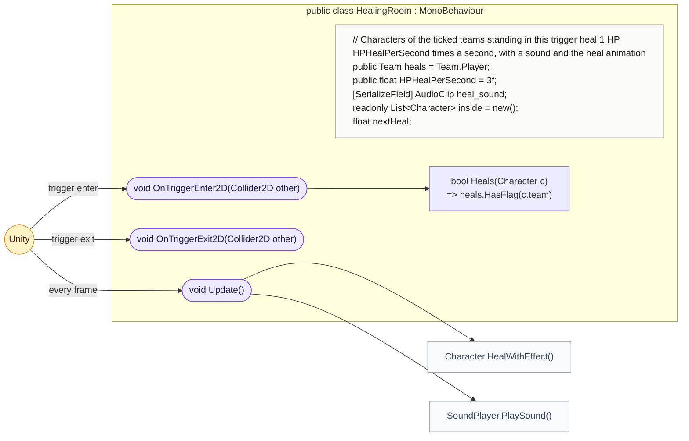
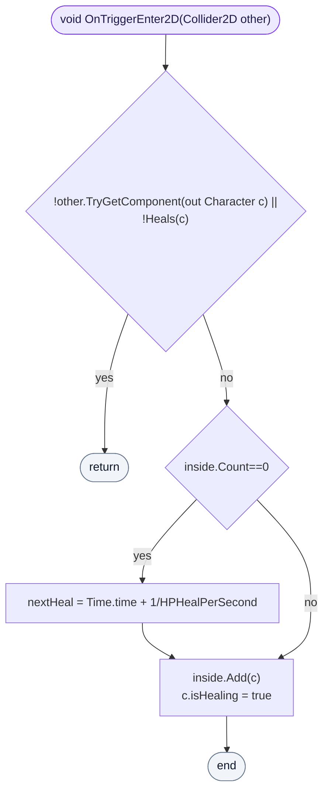
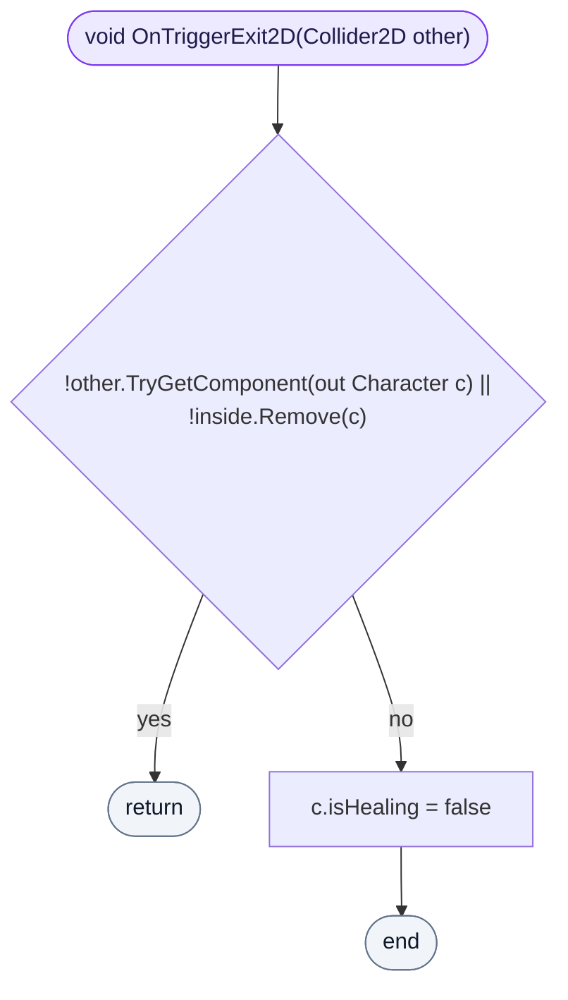
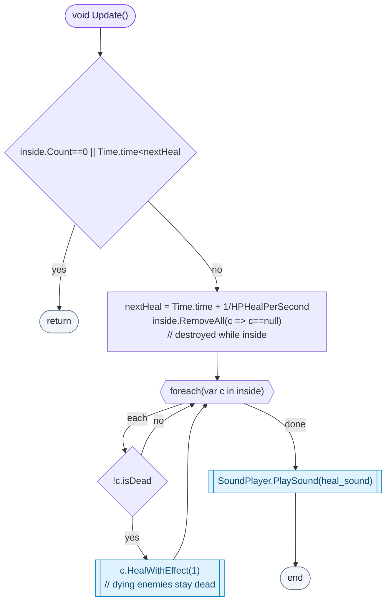

<!-- generated by CodeGraph~/codegraph.py from Map/HealingRoom.cs. Do not edit: run python "CodeGraph~/codegraph.py". Notes go in CodeGraph~/ai/Map/HealingRoom.cs.md -->
# Map/HealingRoom.cs

[overview](../README.md) · [source](../../../Map/HealingRoom.cs) · 32 lines · using `System.Collections.Generic`, `UnityEngine`

A trigger area (a spa or pool) that heals the characters of chosen teams while they stand in it.

## class HealingRoom

Heals characters of the ticked teams standing inside.
`heals` is a flags field: tick Player, Enemy or Neutral. Characters inside get `isHealing`, which makes the player use the in-water idle and walk clips.

### HealingRoom.OnTriggerEnter2D

A character of a healed team steps in: it joins the list and starts healing. The first one in starts the heal timer.

[lines 15–20](../../../Map/HealingRoom.cs#L15-L20) · called by Unity: trigger enter · calls [HealingRoom.Heals](HealingRoom.cs.md#class-healingroom)

### HealingRoom.OnTriggerExit2D

A character on the list steps out: it stops healing.

[lines 21–24](../../../Map/HealingRoom.cs#L21-L24) · called by Unity: trigger exit

### HealingRoom.Update

`HPHealPerSecond` times a second: forgets characters that were destroyed, heals each living one by 1 HP with the heal animation (the dead stay dead), and plays the heal sound once.

[lines 25–31](../../../Map/HealingRoom.cs#L25-L31) · called by Unity: every frame · calls [Character.HealWithEffect](../Character.cs.md#characterhealwitheffect), [SoundPlayer.PlaySound](../SoundPlayer.cs.md#class-soundplayer)
