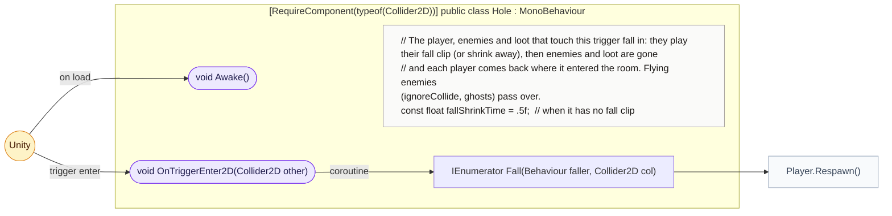
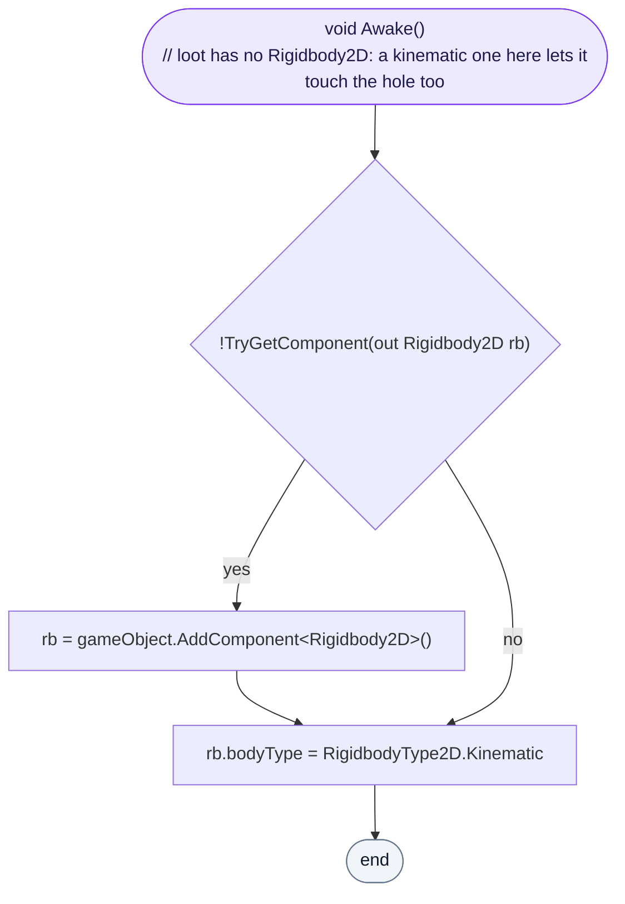
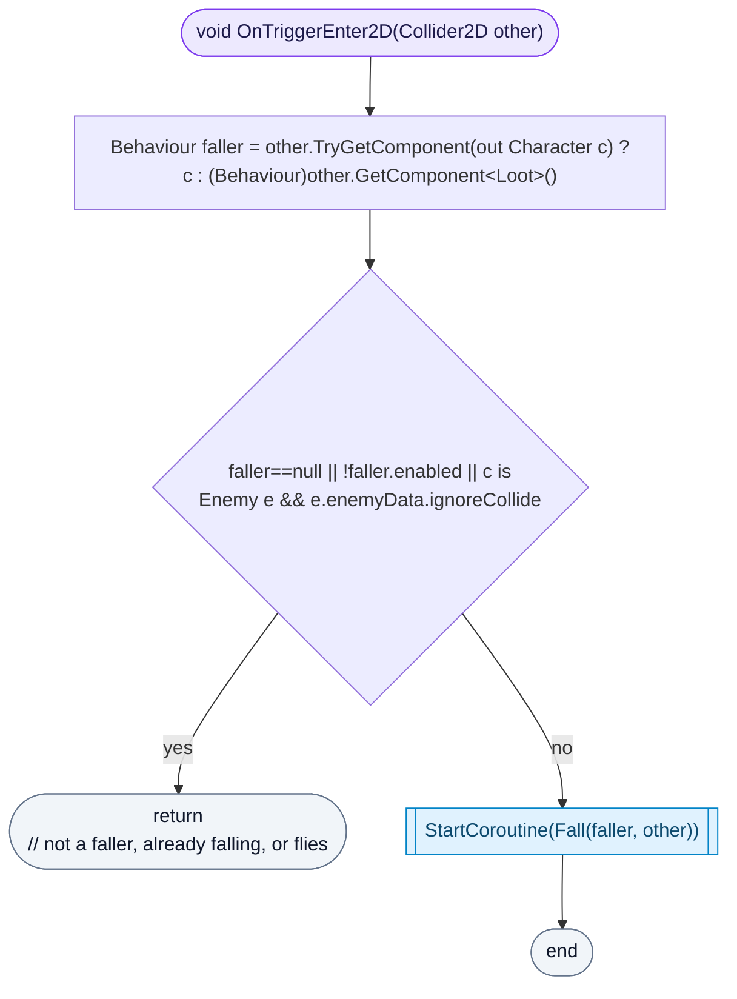
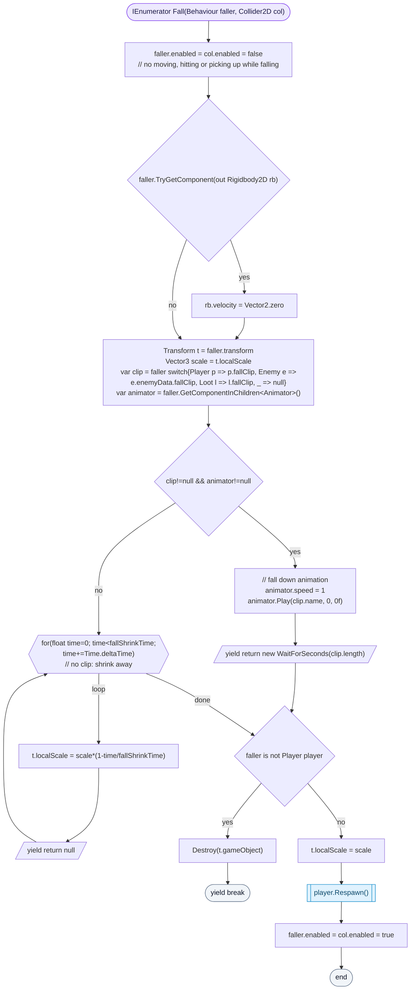

<!-- generated by CodeGraph~/codegraph.py from Map/Hole.cs. Do not edit: run python "CodeGraph~/codegraph.py". Notes go in CodeGraph~/ai/Map/Hole.cs.md -->
# Map/Hole.cs

[overview](../README.md) · [source](../../../Map/Hole.cs) · 34 lines · using `System.Collections`, `UnityEngine`

A hole in the floor: the player, enemies and loot fall in. Enemies and loot are gone; the player comes back where they entered the room. Flying enemies pass over.

## class Hole

Things fall in: enemies and loot vanish, the player respawns.
PathFinding steers walking enemies around holes, so mostly knocked-back enemies fall in.

### Hole.Awake

Gives the hole a kinematic Rigidbody2D, so loot (which has none) still triggers it.

[lines 11–14](../../../Map/Hole.cs#L11-L14) · called by Unity: on load

### Hole.OnTriggerEnter2D

A character or loot touches the hole: it falls, unless it is already falling (disabled) or is a flying enemy.

[lines 15–19](../../../Map/Hole.cs#L15-L19) · called by Unity: trigger enter · calls [Hole.Fall](Hole.cs.md#holefall) (coroutine)

### Hole.Fall

A coroutine: the faller stops and can't act. It plays its fall clip if it has one, else shrinks away over half a second. Enemies and loot are then destroyed; the player gets its size back, respawns at `roomEntryPos` and can move again.

[lines 20–33](../../../Map/Hole.cs#L20-L33) · called by [Hole.OnTriggerEnter2D](Hole.cs.md#holeontriggerenter2d) · calls [Player.Respawn](../Player.cs.md#class-player)
