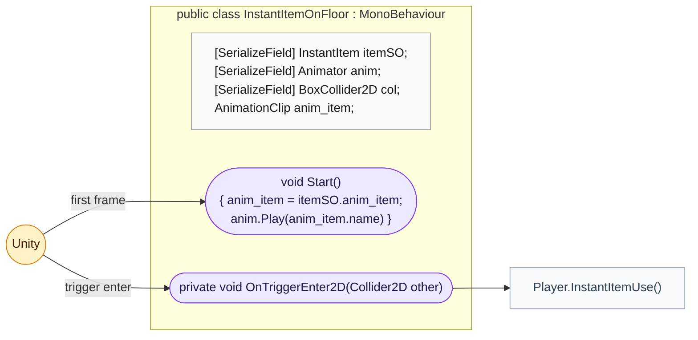
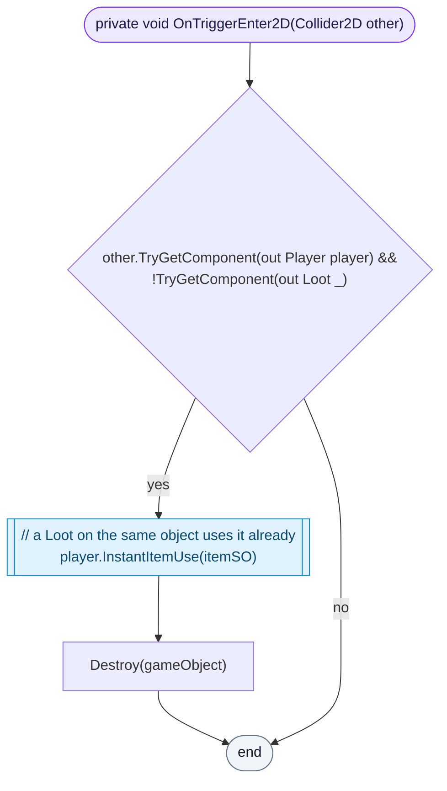

<!-- generated by CodeGraph~/codegraph.py from Map/InstantItemOnFloor.cs. Do not edit: run python "CodeGraph~/codegraph.py". Notes go in CodeGraph~/ai/Map/InstantItemOnFloor.cs.md -->
# Map/InstantItemOnFloor.cs

[overview](../README.md) · [source](../../../Map/InstantItemOnFloor.cs) · 25 lines · using `System.Collections`, `System.Collections.Generic`, `UnityEngine`

An instant item placed in the level by hand: it plays its floor animation and is used when the player walks over it.

## class InstantItemOnFloor

A hand-placed item, used when the player touches it.

### InstantItemOnFloor.OnTriggerEnter2D

The player uses the item and it disappears, unless a Loot on the same object handles the pickup already.

[lines 17–24](../../../Map/InstantItemOnFloor.cs#L17-L24) · called by Unity: trigger enter · calls [Player.InstantItemUse](../Player.cs.md#playerinstantitemuse)
