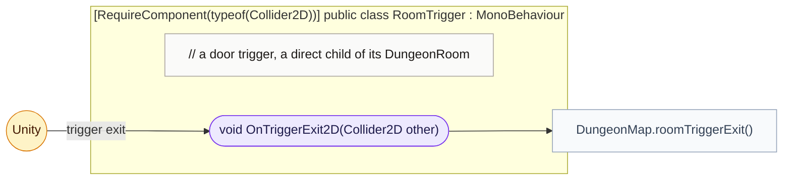
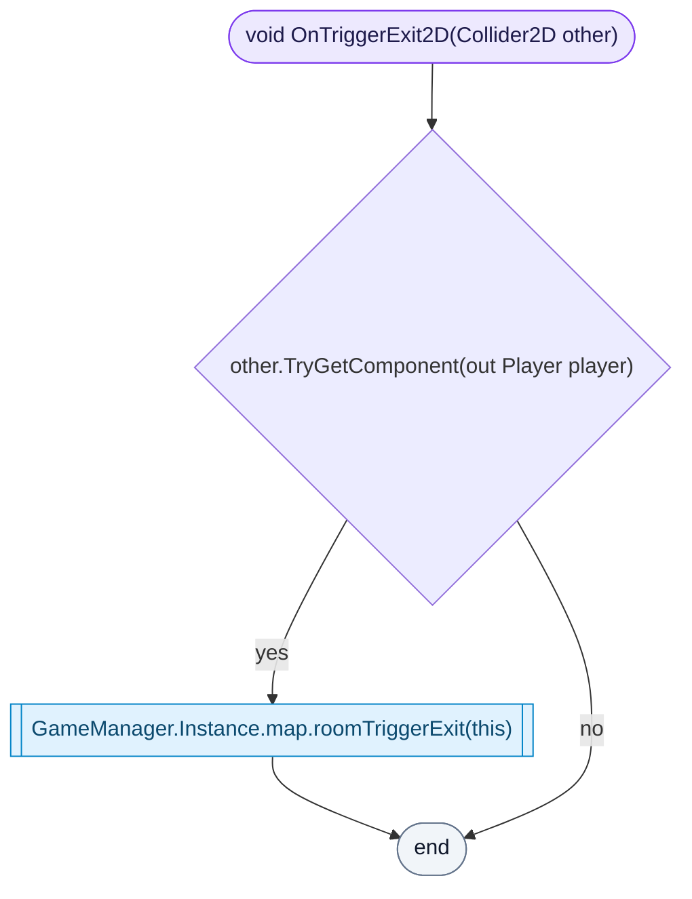

<!-- generated by CodeGraph~/codegraph.py from Map/RoomTrigger.cs. Do not edit: run python "CodeGraph~/codegraph.py". Notes go in CodeGraph~/ai/Map/RoomTrigger.cs.md -->
# Map/RoomTrigger.cs

[overview](../README.md) · [source](../../../Map/RoomTrigger.cs) · 13 lines · using `System.Collections`, `System.Collections.Generic`, `UnityEngine`

A door trigger, a direct child of its room.

## class RoomTrigger

Door trigger: tells the map when the player walks out.

### RoomTrigger.OnTriggerExit2D

The player left this trigger: DungeonMap decides whether they went through the door.

[lines 8–12](../../../Map/RoomTrigger.cs#L8-L12) · called by Unity: trigger exit · calls [DungeonMap.roomTriggerExit](DungeonMap.cs.md#dungeonmaproomtriggerexit)
