<!-- generated by CodeGraph~/codegraph.py from Player.cs. Do not edit: run python "CodeGraph~/codegraph.py". Notes go in CodeGraph~/ai/Player.cs.md -->
# Player.cs

[overview](README.md) · [source](../../Player.cs) · 176 lines · using `System.Collections`, `System.Collections.Generic`, `UnityEngine`, `UnityEngine.SceneManagement`

The streamer's character: two hands that each hold a weapon, movement and facing, attacks, animations, getting hurt, and respawning.

## class Direction

The four facings as vectors: up, right, down, left.
Indexed by `animFacing`. `strMoveDict` (the names) is not used.

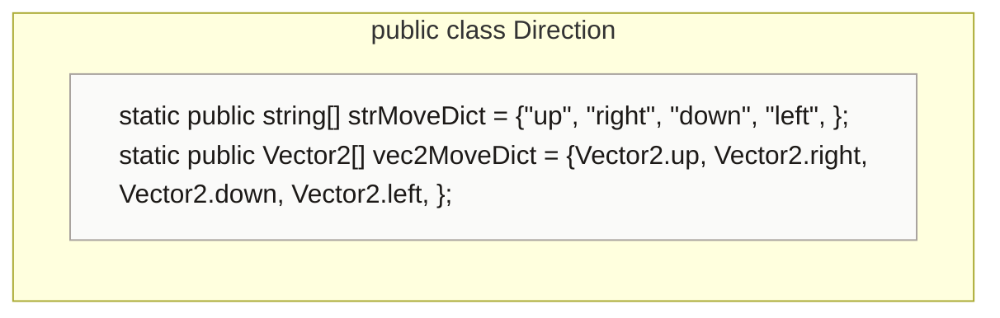

## class HoldingWeapons

One hand: its weapon, cooldown, and what an attack spawns.
Any Character can hold weapons. `StopAnim` is never called.

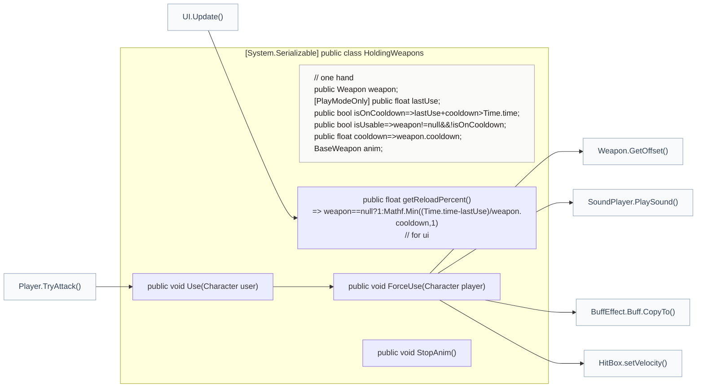

### HoldingWeapons.Use

Attacks if the hand has a weapon that is off cooldown.

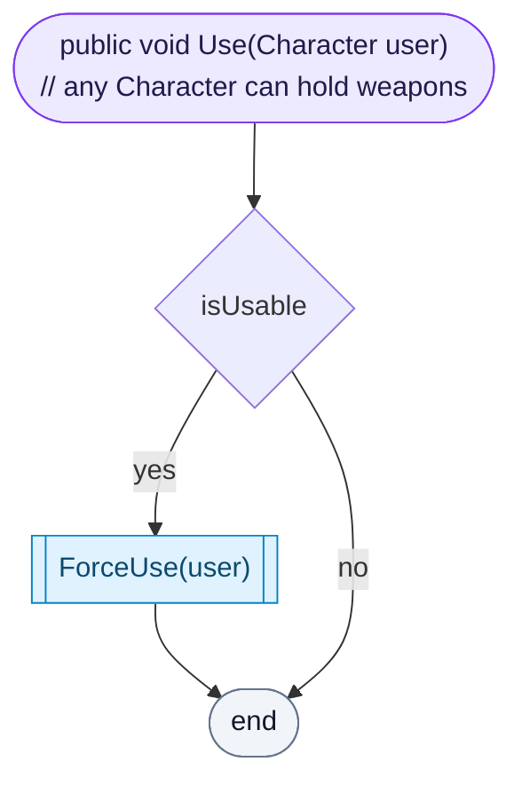

[lines 19–19](../../Player.cs#L19-L19) · called by [Player.TryAttack](Player.cs.md#playertryattack) · calls [HoldingWeapons.ForceUse](Player.cs.md#holdingweaponsforceuse)

### HoldingWeapons.ForceUse

One attack: starts the cooldown, plays the weapon's effect animation on the user (sped up to fit the cooldown) and its sound, then spawns the hitbox in front of the user. A hitbox that stays put is turned to face the attack. The hitbox gets the weapon, the owner (so it skips their team), the buff, damage × the user's attack stat, and a velocity: one of the four facings (Experimental.fourWayAttack) or the exact look direction.

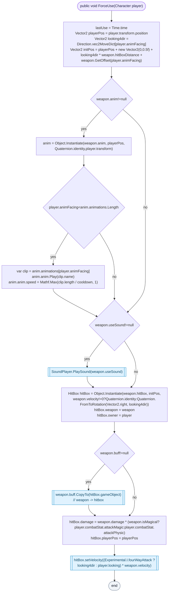

[lines 21–42](../../Player.cs#L21-L42) · called by [HoldingWeapons.Use](Player.cs.md#holdingweaponsuse) · calls [Weapon.GetOffset](Data%20Types/Weapon.cs.md#class-weapon), [SoundPlayer.PlaySound](SoundPlayer.cs.md#class-soundplayer), [BuffEffect.Buff.CopyTo](BuffEffect.cs.md#buffeffectbuffcopyto), [HitBox.setVelocity](HitBox.cs.md#hitboxsetvelocity)

### HoldingWeapons.StopAnim

Removes the effect animation early. Nothing calls it yet.

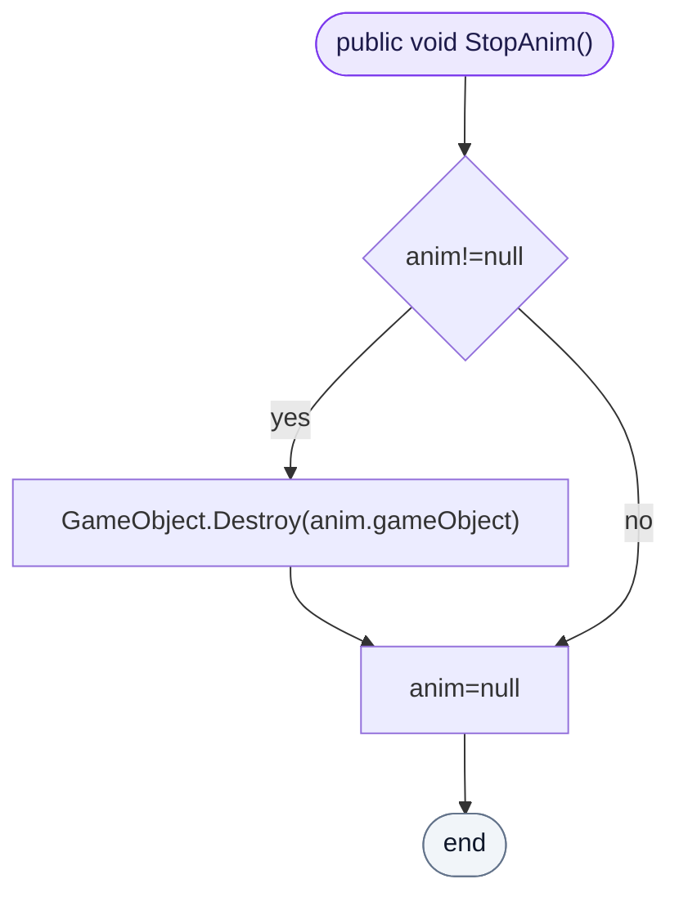

[lines 43–43](../../Player.cs#L43-L43)

## class Player

The streamer's character: moves, attacks with two hands.
Setting `HP` or `maxHP` updates the hearts in the UI. `state` is IDLE, MOVING, or the WeaponType number while attacking. Not used by code yet: `speedBoost`, `activeArmor`, `playerShooting`.

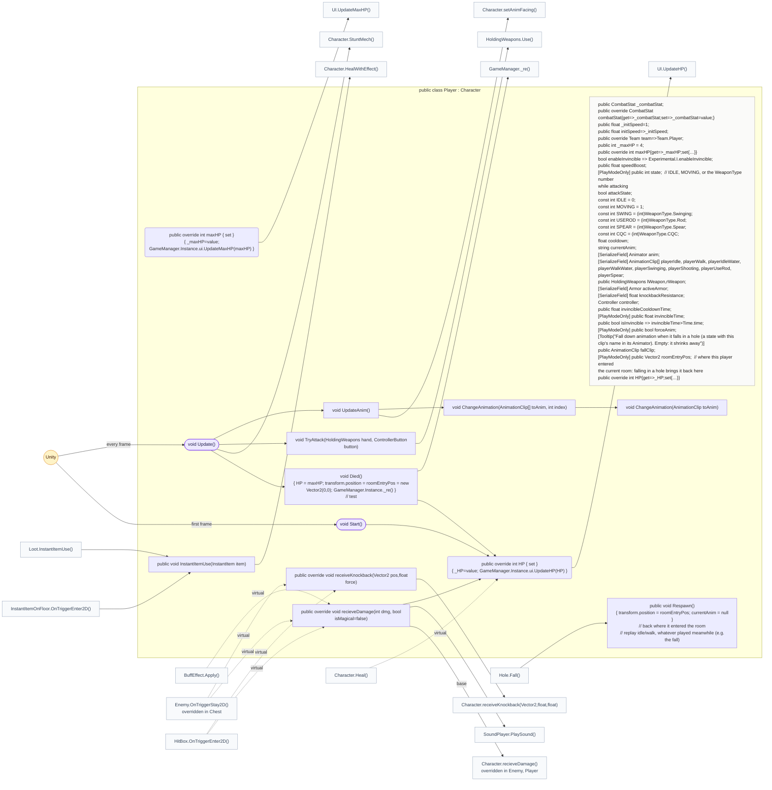

### Player.Start

Full HP, finds the controller, and remembers the start as the room entry point.

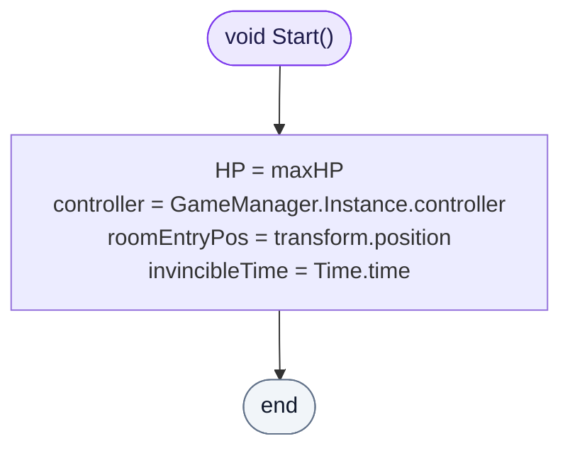

[lines 83–88](../../Player.cs#L83-L88) · called by Unity: first frame · calls [Player.HP.set](Player.cs.md#class-player)

### Player.Update

Each frame: a dead player respawns (test behaviour); movement comes from the controller and stops during an attack (Experimental.stopMoveOnAttack); facing follows the movement or the look input (Experimental.lookFollowMovement); it moves unless stunned; each hand attacks when its button is held; then the animation updates.

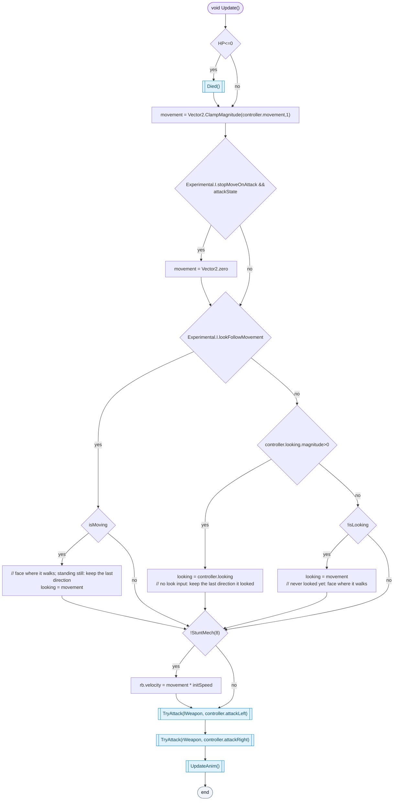

[lines 89–100](../../Player.cs#L89-L100) · called by Unity: every frame · calls [Player.Died](Player.cs.md#class-player), [Character.StuntMech](Character.cs.md#characterstuntmech), [Player.TryAttack](Player.cs.md#playertryattack), [Player.UpdateAnim](Player.cs.md#playerupdateanim)

### Player.TryAttack

When the hand can attack and its button is pressed: attacks, forces the attack animation to start, and sets the state to the weapon type.

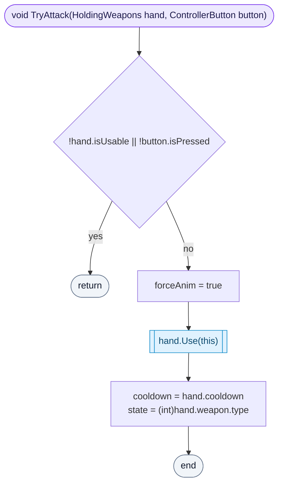

[lines 101–107](../../Player.cs#L101-L107) · called by [Player.Update](Player.cs.md#playerupdate) · calls [HoldingWeapons.Use](Player.cs.md#holdingweaponsuse)

### Player.InstantItemUse

A heal item heals with the heal animation. Other item types do nothing yet.

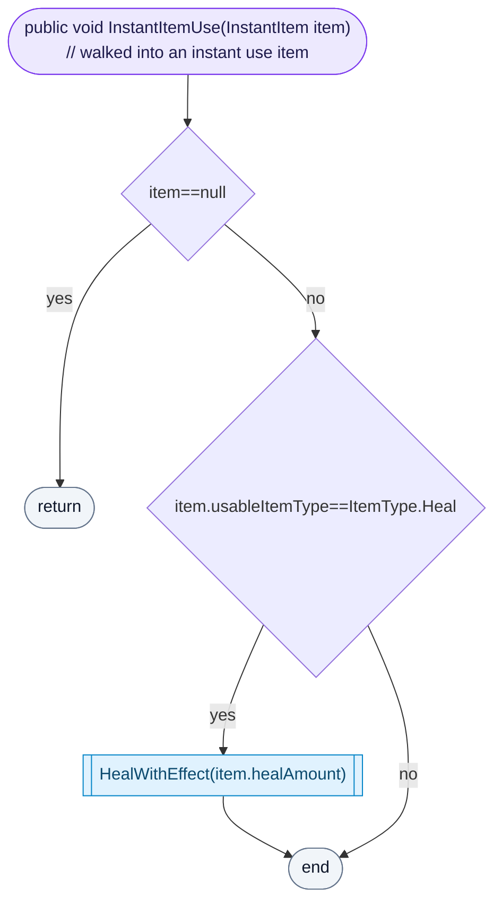

[lines 108–111](../../Player.cs#L108-L111) · called by [InstantItemOnFloor.OnTriggerEnter2D](Map/InstantItemOnFloor.cs.md#instantitemonfloorontriggerenter2d), [Loot.InstantItemUse](Loot.cs.md#class-loot) · calls [Character.HealWithEffect](Character.cs.md#characterhealwitheffect)

### Player.UpdateAnim

Lets a running attack animation finish (to 90%) unless a new attack forces a restart. Then picks the clip for the state and facing: idle or walk (the water versions in a healing room), or the weapon's attack (bare hands use the spear clip). Afterwards the state goes back to idle or moving.

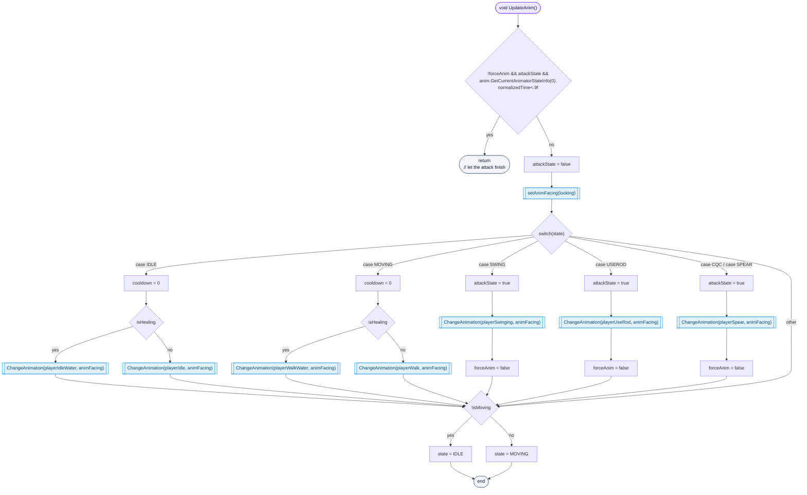

[lines 122–156](../../Player.cs#L122-L156) · called by [Player.Update](Player.cs.md#playerupdate) · calls [Character.setAnimFacing](Character.cs.md#class-character), [Player.ChangeAnimation(AnimationClip,int)](Player.cs.md#playerchangeanimationanimationclipint)

### Player.ChangeAnimation(AnimationClip,int)

Picks the clip for the facing, if that array has one.

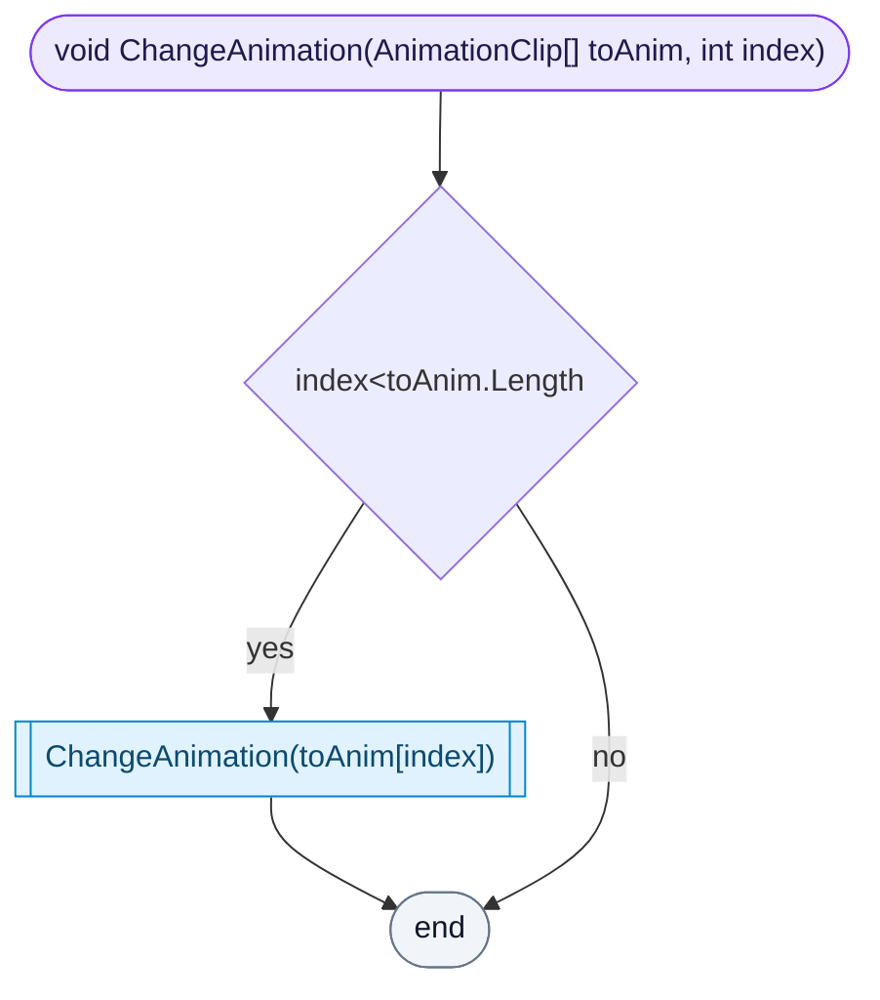

[lines 157–157](../../Player.cs#L157-L157) · called by [Player.UpdateAnim](Player.cs.md#playerupdateanim) · calls [Player.ChangeAnimation(AnimationClip)](Player.cs.md#playerchangeanimationanimationclip)

### Player.ChangeAnimation(AnimationClip)

Plays the clip from the start unless it is already playing (a forced attack restarts it). Attack clips are sped up to fit the weapon cooldown.

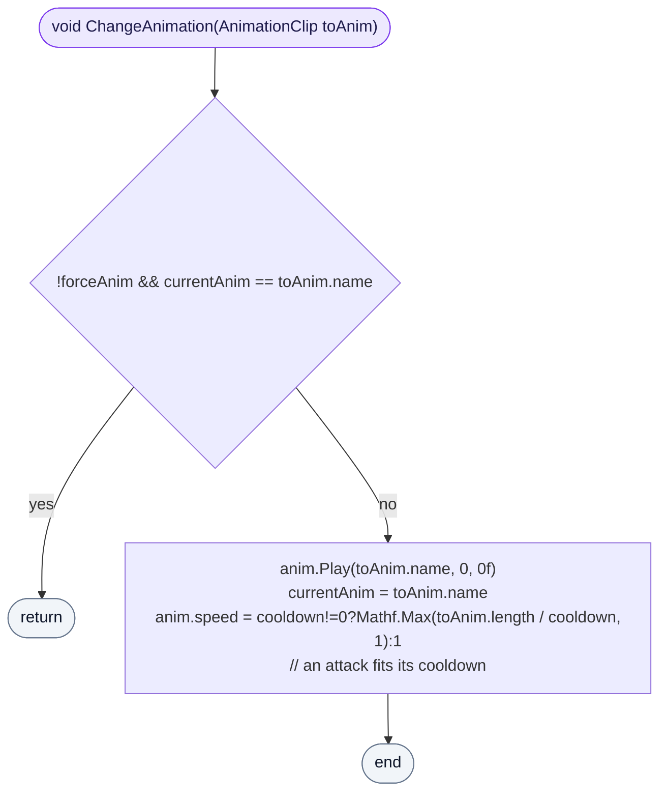

[lines 158–163](../../Player.cs#L158-L163) · called by [Player.ChangeAnimation(AnimationClip,int)](Player.cs.md#playerchangeanimationanimationclipint)

### Player.recieveDamage

Plays the hit sound. With Experimental.enableInvincible, hits during the invincible time after a hit do nothing; otherwise HP goes down by the damage (defense is not applied) and a new invincible time starts.

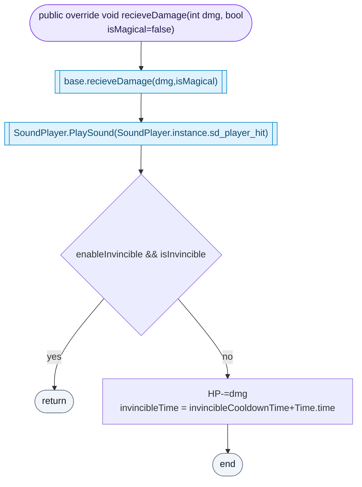

[lines 165–171](../../Player.cs#L165-L171) · called by [BuffEffect.Apply](BuffEffect.cs.md#buffeffectapply) (virtual), [Enemy.OnTriggerStay2D](Enemy.cs.md#enemyontriggerstay2d) (virtual), [HitBox.OnTriggerEnter2D](HitBox.cs.md#hitboxontriggerenter2d) (virtual) · calls [Character.recieveDamage](Character.cs.md#class-character) (base), [SoundPlayer.PlaySound](SoundPlayer.cs.md#class-soundplayer), [Player.HP.set](Player.cs.md#class-player)

### Player.receiveKnockback

No knockback while invincible; otherwise knockback reduced by `knockbackResistance`.

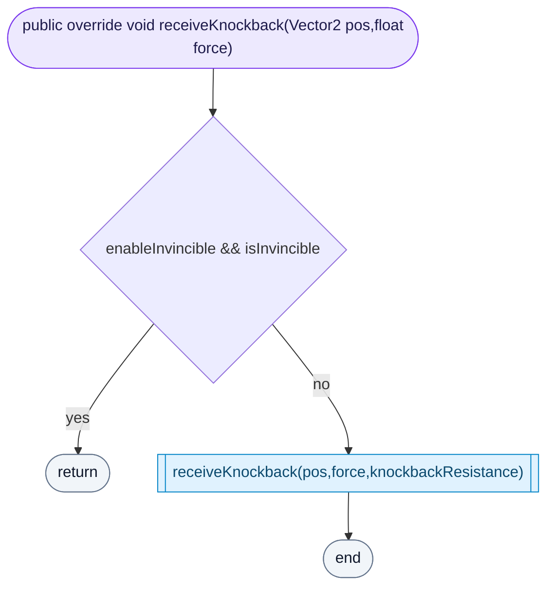

[lines 172–175](../../Player.cs#L172-L175) · called by [Enemy.OnTriggerStay2D](Enemy.cs.md#enemyontriggerstay2d) (virtual), [HitBox.OnTriggerEnter2D](HitBox.cs.md#hitboxontriggerenter2d) (virtual) · calls [Character.receiveKnockback(Vector2,float,float)](Character.cs.md#class-character)
