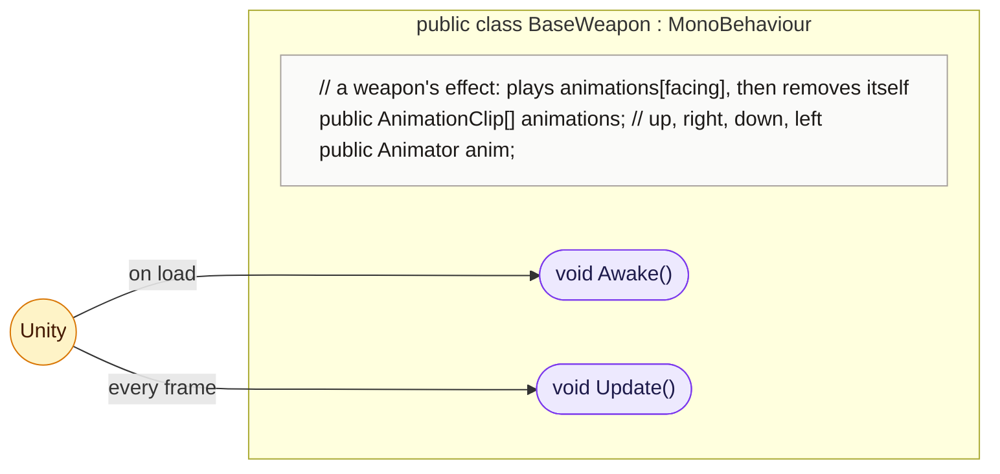
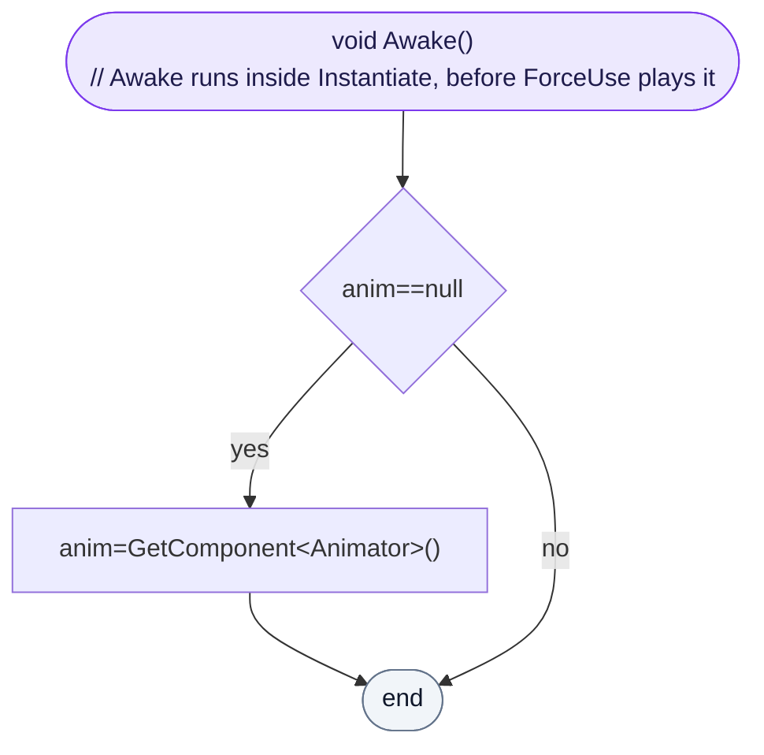
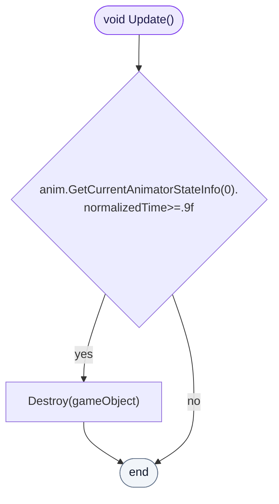

<!-- generated by CodeGraph~/codegraph.py from Player/Weapons/BaseWeapon.cs. Do not edit: run python "CodeGraph~/codegraph.py". Notes go in CodeGraph~/ai/Player/Weapons/BaseWeapon.cs.md -->
# Player/Weapons/BaseWeapon.cs

[overview](../../README.md) · [source](../../../../Player/Weapons/BaseWeapon.cs) · 11 lines · using `System.Collections`, `System.Collections.Generic`, `UnityEngine`

The effect a weapon plays on its user (a swing, a rod flash): an animation per facing that removes itself when done.

## class BaseWeapon

A weapon's effect: plays animations[facing], then goes.

### BaseWeapon.Awake

Finds its Animator if none is set. This runs inside Instantiate, so it is ready before `ForceUse` plays a clip.

[lines 9–9](../../../../Player/Weapons/BaseWeapon.cs#L9-L9) · called by Unity: on load

### BaseWeapon.Update

Removes the effect once its animation is 90% done.

[lines 10–10](../../../../Player/Weapons/BaseWeapon.cs#L10-L10) · called by Unity: every frame
