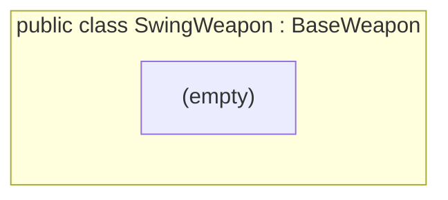

<!-- generated by CodeGraph~/codegraph.py from Player/Weapons/SwingWeapon.cs. Do not edit: run python "CodeGraph~/codegraph.py". Notes go in CodeGraph~/ai/Player/Weapons/SwingWeapon.cs.md -->
# Player/Weapons/SwingWeapon.cs

[overview](../../README.md) · [source](../../../../Player/Weapons/SwingWeapon.cs) · 1 lines

A BaseWeapon with nothing added: a separate type for swing effect prefabs.

## class SwingWeapon

Swing effect; same as BaseWeapon.

