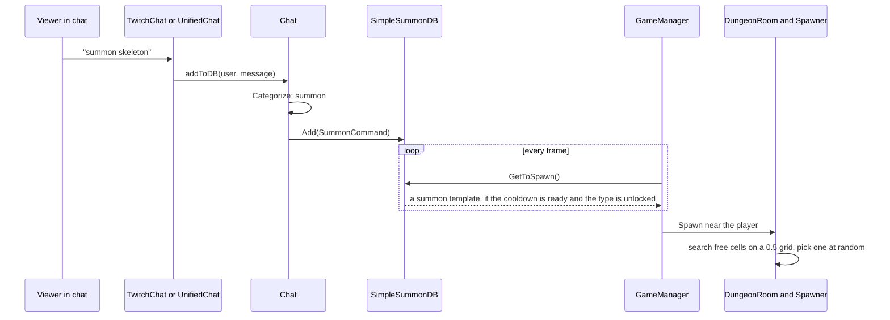
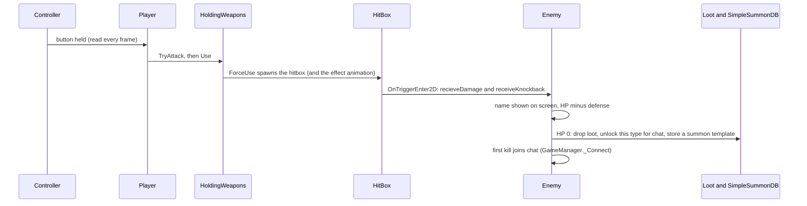
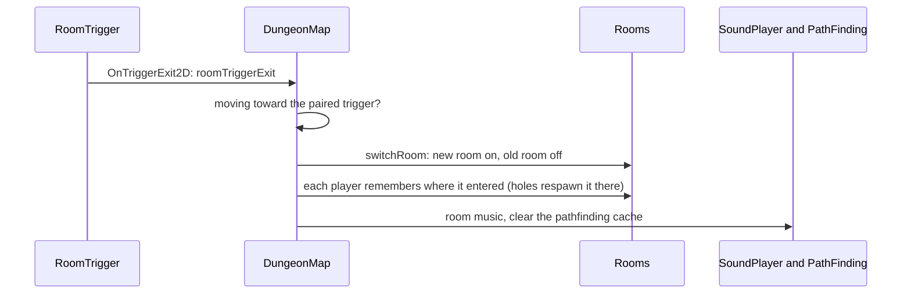
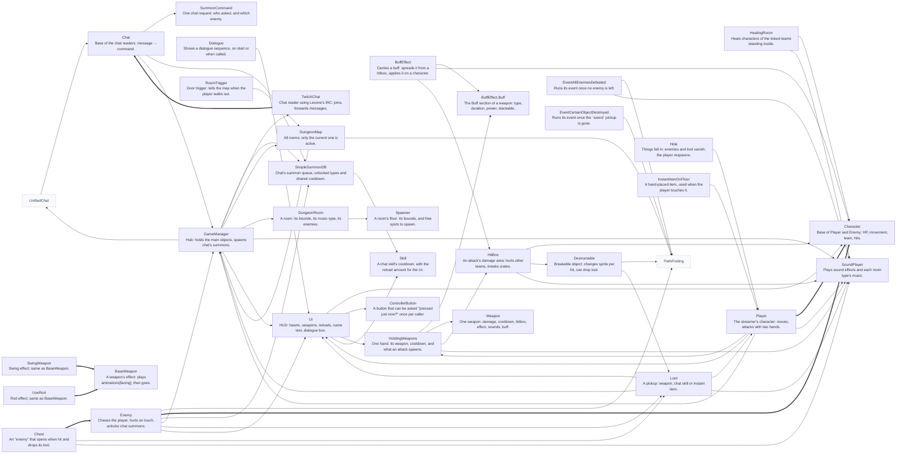

<!-- generated by CodeGraph~/codegraph.py. Do not edit: run python "CodeGraph~/codegraph.py". Notes go in CodeGraph~/ai -->
# Code graphs

Every line of C# in this folder, drawn by [codegraph.py](../codegraph.py) as graphs: one page per `.cs` file, a graph per class and a flowchart per method. The text and pictures between the graphs are written by the AI (or you) in [ai/](../ai). [How to read](#how-to-read-the-graphs) · [How to update](../README.md)

A top-down dungeon game that a streamer plays while chat fights back: chat types `summon <enemy>` to send enemies at the streamer, but only kinds the streamer has already killed. These notes are written by the AI; the graphs below them are drawn by the generator.

**The parts.** `GameManager` is the hub everything reaches through `GameManager.Instance`. It holds the player, UI, input, map and chat. `Player` and `Enemy` share `Character` (HP, team, knockback, stun). An attack is a `HitBox` spawned by one of the player's two hands (`HoldingWeapons`); weapons, enemy types and items are ScriptableObject assets in `Data Types/`. The dungeon is a `DungeonMap` of `DungeonRoom`s; only the room the player is in is active. `Experimental` holds every on/off switch for features still in testing.

**External code.** `AI/` holds code written by the AI and is drawn as outside boxes only: `PathFinding` (enemies walk around walls and holes and keep apart), `UnifiedChat` (reads Twitch and YouTube chat with no package, used when `Experimental.unifiedChat` is on), and `PlayModeOnly` (the `[PlayModeOnly]` Inspector attribute).

## A chat message becomes an enemy

## An attack lands

## The player goes through a door

## Who calls whom

Arrow: calls. Thick arrow: inherits. Gray dashed: external (AI/). Not drawn, because they call no other class and none calls them: PathFinding.Grid, PlayModeOnlyAttribute, PlayModeOnlyDrawer, ChannelBtn, CombatStat, Controller, Armor, EnemySO, InstantItem, UsableItem, Dialogues, Experimental, FollowPlayer, Door, Direction, Title.

## What Unity calls, and when

| When | Classes |
|---|---|
| on load (`Awake`) | [GameManager](GameManager.cs.md#gamemanagerawake), [Hole](Map/Hole.cs.md#holeawake), [BaseWeapon](Player/Weapons/BaseWeapon.cs.md#baseweaponawake), [SoundPlayer](SoundPlayer.cs.md#class-soundplayer), [Spawner](Spawner.cs.md#spawnerawake), [UI](UI.cs.md#uiawake) |
| first frame (`Start`) | [BuffEffect](BuffEffect.cs.md#class-buffeffect), [TwitchChat](Connector/TwitchChat.cs.md#class-twitchchat), [Destructable](DestructableObj.cs.md#class-destructable), [Dialogue](Dialogue.cs.md#dialoguestart), [Enemy](Enemy.cs.md#enemystart), [FollowPlayer](FollowPlayer.cs.md#class-followplayer), [GameManager](GameManager.cs.md#class-gamemanager), [HitBox](HitBox.cs.md#hitboxstart), [Loot](Loot.cs.md#lootstart), [DungeonMap](Map/DungeonMap.cs.md#dungeonmapstart), [InstantItemOnFloor](Map/InstantItemOnFloor.cs.md#class-instantitemonfloor), [Player](Player.cs.md#playerstart), [UI](UI.cs.md#uistart) |
| every frame (`Update`) | [UnifiedChat](../../AI/UnifiedChat.cs#L29), [Controller](Controller.cs.md#controllerupdate), [Dialogue](Dialogue.cs.md#class-dialogue), [Enemy](Enemy.cs.md#enemyupdate), [GameManager](GameManager.cs.md#gamemanagerupdate), [HitBox](HitBox.cs.md#hitboxupdate), [EventAllEnemiesDefeated](Map/EventAllEnemiesDefeated.cs.md#eventallenemiesdefeatedupdate), [EventCertainObjectDestroyed](Map/EventCertainObjectDestroyed.cs.md#eventcertainobjectdestroyedupdate), [HealingRoom](Map/HealingRoom.cs.md#healingroomupdate), [Player](Player.cs.md#playerupdate), [BaseWeapon](Player/Weapons/BaseWeapon.cs.md#baseweaponupdate), [UI](UI.cs.md#uiupdate) |
| every frame, after Update (`LateUpdate`) | [BuffEffect](BuffEffect.cs.md#buffeffectlateupdate) |
| destroyed (`OnDestroy`) | [UnifiedChat](../../AI/UnifiedChat.cs#L30) |
| Inspector edit (`OnValidate`) | [DungeonMap](Map/DungeonMap.cs.md#class-dungeonmap) |
| GUI events (`OnGUI`) | [PlayModeOnlyDrawer](../../AI/PlayModeOnly.cs#L12) |
| Scene view, selected (`OnDrawGizmosSelected`) | [Enemy](Enemy.cs.md#class-enemy) |
| trigger enter (`OnTriggerEnter2D`) | [BuffEffect](BuffEffect.cs.md#buffeffectontriggerenter2d), [HitBox](HitBox.cs.md#hitboxontriggerenter2d), [Loot](Loot.cs.md#lootontriggerenter2d), [HealingRoom](Map/HealingRoom.cs.md#healingroomontriggerenter2d), [Hole](Map/Hole.cs.md#holeontriggerenter2d), [InstantItemOnFloor](Map/InstantItemOnFloor.cs.md#instantitemonfloorontriggerenter2d) |
| trigger stay (`OnTriggerStay2D`) | [Enemy](Enemy.cs.md#enemyontriggerstay2d), [Chest](Map/Chest.cs.md#class-chest) |
| trigger exit (`OnTriggerExit2D`) | [HealingRoom](Map/HealingRoom.cs.md#healingroomontriggerexit2d), [RoomTrigger](Map/RoomTrigger.cs.md#roomtriggerontriggerexit2d) |

## Files

| File | Types | Lines | About |
|---|---|---|---|
| [BuffEffect.cs](BuffEffect.cs.md) | enum BuffType, BuffEffect, BuffEffect.Buff | 60 | Buffs and debuffs (burn, heal, slow, stun) that a weapon passes to whoever its hitbox touches. |
| [ChannelBtn.cs](ChannelBtn.cs.md) | ChannelBtn | 10 | The channel box: remembers which chat to read. |
| [Character.cs](Character.cs.md) | CombatStat, enum Team, Character | 69 | What the player and every enemy have in common: health, movement, facing, teams, knockback, stun and healing. |
| [Connector/Chat.cs](Connector/Chat.cs.md) | enum ChatType, Chat | 32 | Turns chat messages into game commands (summon, teleport, vote, work). |
| [Connector/SummonDB.cs](Connector/SummonDB.cs.md) | SummonCommand, SimpleSummonDB | 40 | The queue of enemies chat asked for, and which enemy types chat may summon. |
| [Connector/TwitchChat.cs](Connector/TwitchChat.cs.md) | TwitchChat | 208 | Reads Twitch chat through the Lexone Unity-Twitch-Chat package. The commented-out code at the end is an older IRC client, kept for reference (not drawn). |
| [Controller.cs](Controller.cs.md) | ControllerButton, Controller | 78 | Player input: gamepad, keyboard and mouse, read once per frame into fields that Player and UI use. |
| [Data Types/Armor.cs](Data%20Types/Armor.cs.md) | Armor | 11 | Armor data asset (Create → Armor). |
| [Data Types/Enemy.cs](Data%20Types/Enemy.cs.md) | EnemySO | 20 | The enemy type asset (Create → Enemy): one per kind of enemy, in Database/Enemies. |
| [Data Types/InstantItem.cs](Data%20Types/InstantItem.cs.md) | enum ItemType, InstantItem | 18 | Items used the moment the player walks over them (Create → InstantItem), like the Health Bone. |
| [Data Types/UsableItem.cs](Data%20Types/UsableItem.cs.md) | enum UsableItemType, UsableItem | 14 | Items to carry and use later (Create → UsableItem). Not used by code yet. |
| [Data Types/Weapon.cs](Data%20Types/Weapon.cs.md) | Weapon | 34 | The weapon asset (Create → Weapon): everything an attack needs, in Database/Weapons. |
| [Data Types/WeaponType.cs](Data%20Types/WeaponType.cs.md) | enum WeaponType | 9 | Kinds of weapon. The numbers (900 and up) double as `Player.state` while attacking, which picks the attack animation; CQC means bare hands. |
| [DestructableObj.cs](DestructableObj.cs.md) | Destructable | 29 | Breakable objects such as crates and pots. The file is DestructableObj.cs but the class is `Destructable`; Unity normally wants a MonoBehaviour's file and class names to match. |
| [Dialogue.cs](Dialogue.cs.md) | enum DialogueSequence, Dialogues, enum TriggerType, Dialogue | 46 | All story text in one table, and the component that shows a piece of it. |
| [Enemy.cs](Enemy.cs.md) | Enemy | 109 | Every enemy: chases the player around walls, hurts on touch, drops loot, and once killed becomes something chat can summon. |
| [Experimental.cs](Experimental.cs.md) | Experimental | 41 | Every experimental and test switch in one Inspector component, editable while playing. |
| [FollowPlayer.cs](FollowPlayer.cs.md) | FollowPlayer | 10 | Makes the Cinemachine camera follow the player. |
| [GameManager.cs](GameManager.cs.md) | GameManager | 74 | The one object everything else talks to: player, UI, input, map, chat, and the spawning of what chat summons. |
| [HitBox.cs](HitBox.cs.md) | HitBox | 42 | The area an attack spawns: it hurts what it touches, flies if the weapon says so, and disappears by time, by hits, or on touch. |
| [Loot.cs](Loot.cs.md) | enum LootType, Loot | 79 | Pickups on the floor: weapons, chat skills and instant items, and the code that drops them. |
| [Map/Chest.cs](Map/Chest.cs.md) | Chest | 24 | A chest is an enemy that never moves or attacks: any hit opens it and it drops its loot. |
| [Map/Door.cs](Map/Door.cs.md) | Door | 8 | An empty marker component. Room switching is done by RoomTrigger, and doors open through the room events. |
| [Map/DungeonMap.cs](Map/DungeonMap.cs.md) | DungeonMap | 47 | The dungeon: all rooms, which one is active, and how door triggers lead from one room to the next. |
| [Map/DungeonRoom.cs](Map/DungeonRoom.cs.md) | enum RoomType, DungeonRoom | 18 | One room: its area (from its floor's Spawner), its type (which picks the music), and spawning enemies into it. |
| [Map/EventAllEnemiesDefeated.cs](Map/EventAllEnemiesDefeated.cs.md) | EventAllEnemiesDefeated | 29 | Fires a UnityEvent once, when no enemy is left (for example to open the doors). |
| [Map/EventCertainObjectDestroyed.cs](Map/EventCertainObjectDestroyed.cs.md) | EventCertainObjectDestroyed | 28 | Fires a UnityEvent once, when a given pickup (the sword) is gone. |
| [Map/HealingRoom.cs](Map/HealingRoom.cs.md) | HealingRoom | 32 | A trigger area (a spa or pool) that heals the characters of chosen teams while they stand in it. |
| [Map/Hole.cs](Map/Hole.cs.md) | Hole | 34 | A hole in the floor: the player, enemies and loot fall in. Enemies and loot are gone; the player comes back where they entered the room. Flying enemies pass over. |
| [Map/InstantItemOnFloor.cs](Map/InstantItemOnFloor.cs.md) | InstantItemOnFloor | 25 | An instant item placed in the level by hand: it plays its floor animation and is used when the player walks over it. |
| [Map/RoomTrigger.cs](Map/RoomTrigger.cs.md) | RoomTrigger | 13 | A door trigger, a direct child of its room. |
| [Player.cs](Player.cs.md) | Direction, HoldingWeapons, Player | 176 | The streamer's character: two hands that each hold a weapon, movement and facing, attacks, animations, getting hurt, and respawning. |
| [Player/Weapons/BaseWeapon.cs](Player/Weapons/BaseWeapon.cs.md) | BaseWeapon | 11 | The effect a weapon plays on its user (a swing, a rod flash): an animation per facing that removes itself when done. |
| [Player/Weapons/SwingWeapon.cs](Player/Weapons/SwingWeapon.cs.md) | SwingWeapon | 1 | A BaseWeapon with nothing added: a separate type for swing effect prefabs. |
| [Player/Weapons/UseRod.cs](Player/Weapons/UseRod.cs.md) | UseRod | 1 | A BaseWeapon with nothing added: a separate type for rod effect prefabs. |
| [Skill.cs](Skill.cs.md) | Skill | 20 | A cooldown for a chat skill. Chat's summons share one (`SimpleSummonDB.spawnSkill`). |
| [SoundPlayer.cs](SoundPlayer.cs.md) | SoundPlayer | 28 | Sound effects and the music for each room type. |
| [Spawner.cs](Spawner.cs.md) | Spawner | 36 | Sits on a room's floor tilemap: measures the room and finds free spots to spawn enemies on. |
| [Title.cs](Title.cs.md) | Title | 16 | The title screen. |
| [UI.cs](UI.cs.md) | UI | 96 | The HUD: hearts, the two weapon icons with their reload, the summon cooldown, the enemy name text, and the dialogue box. |

## External files (AI/): drawn as outside boxes only

| File | Types | Lines | About |
|---|---|---|---|
| [AI/PathFinding.cs](../../AI/PathFinding.cs) | PathFinding, PathFinding.Grid | 179 |  |
| [AI/PlayModeOnly.cs](../../AI/PlayModeOnly.cs) | PlayModeOnlyAttribute, PlayModeOnlyDrawer | 16 |  |
| [AI/UnifiedChat.cs](../../AI/UnifiedChat.cs) | UnifiedChat | 91 |  |

## How to read the graphs

**Class graphs** (one per class): the gray box holds every field and property line, with its comment. Each other box
is a method; small methods show their code inside. Purple rounded boxes are called by Unity (the yellow circle; the
arrow says when). Arrows are calls; dotted arrows are virtual calls (through a base class), event subscriptions or calls
by name. Boxes outside the class belong to other classes; gray dashed ones are external (AI/).

**Flowcharts** (one per method with more than a few lines): diamonds are `if` and `switch`, hexagons are loops
(`each` goes in, `done` goes on), blue double boxes call other code of this project (links under the chart), slanted
boxes are `yield return` (a coroutine waits there), gray rounded boxes are `return` and the end.

**Diffs**: `python "CodeGraph~/codegraph.py" diff` draws the same graphs for what changed: green added, red removed,
yellow changed (changed lines also show what they were).

## Status

- Code lines on these pages: 1369 of 1369.
- Notes: 177 of 177 written, 0 may be out of date. `python "CodeGraph~/codegraph.py" todo` lists them.
