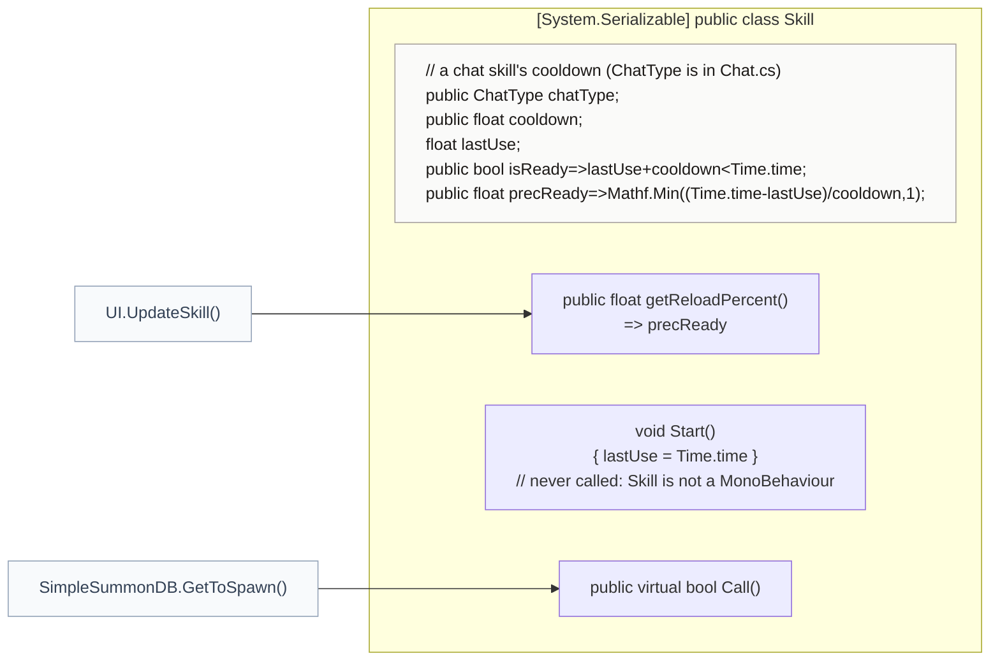
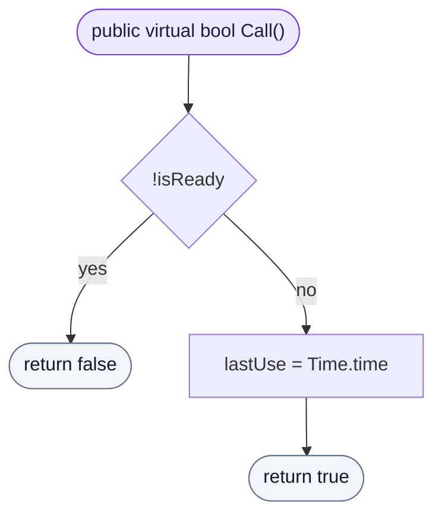

<!-- generated by CodeGraph~/codegraph.py from Skill.cs. Do not edit: run python "CodeGraph~/codegraph.py". Notes go in CodeGraph~/ai/Skill.cs.md -->
# Skill.cs

[overview](README.md) · [source](../../Skill.cs) · 20 lines · using `System.Collections`, `System.Collections.Generic`, `UnityEngine`

A cooldown for a chat skill. Chat's summons share one (`SimpleSummonDB.spawnSkill`).

## class Skill

A chat skill's cooldown, with the reload amount for the UI.
Not a MonoBehaviour, so its `Start` never runs and a new Skill is ready at once.

### Skill.Call

Uses the skill if it is ready (true) and starts the cooldown; false while it reloads.

[lines 15–19](../../Skill.cs#L15-L19) · called by [SimpleSummonDB.GetToSpawn](Connector/SummonDB.cs.md#simplesummondbgettospawn)
