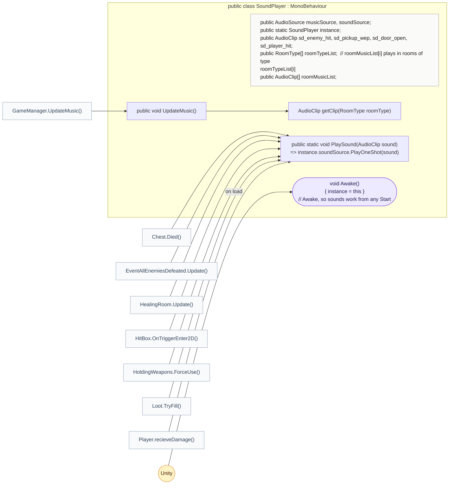
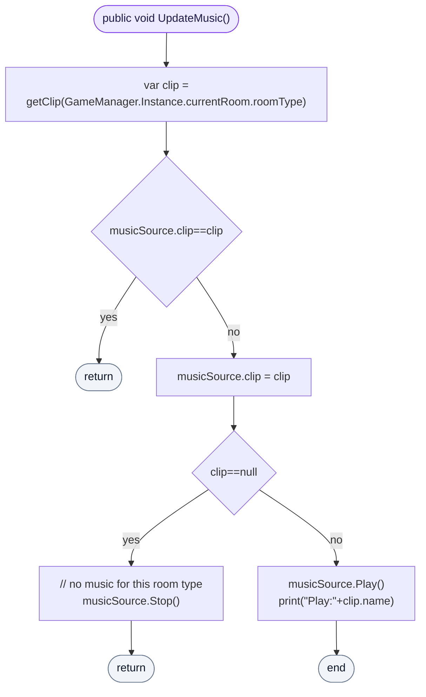
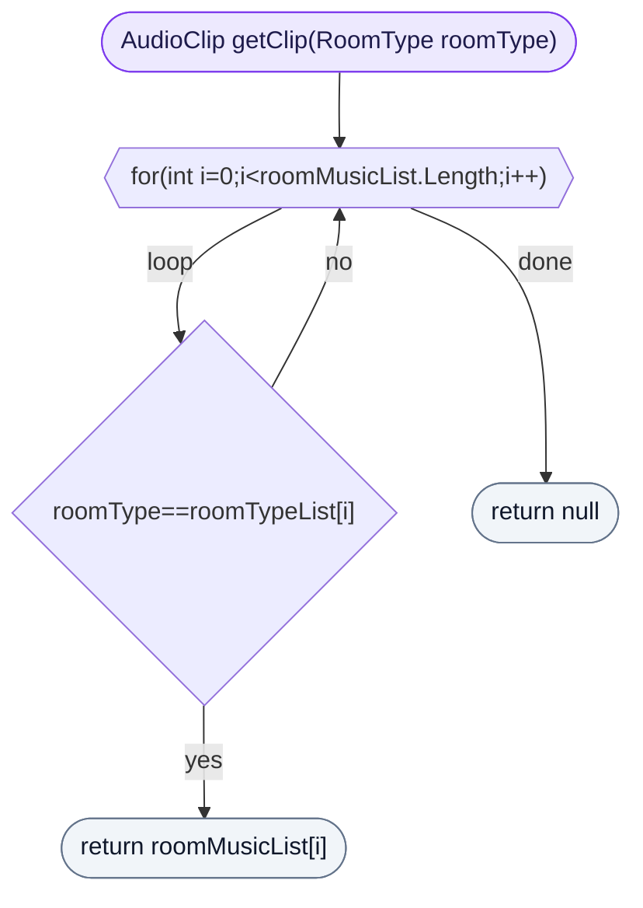

<!-- generated by CodeGraph~/codegraph.py from SoundPlayer.cs. Do not edit: run python "CodeGraph~/codegraph.py". Notes go in CodeGraph~/ai/SoundPlayer.cs.md -->
# SoundPlayer.cs

[overview](README.md) · [source](../../SoundPlayer.cs) · 28 lines · using `System.Collections`, `System.Collections.Generic`, `UnityEngine`

Sound effects and the music for each room type.

## class SoundPlayer

Plays sound effects and each room type's music.
`PlaySound` is static and uses `instance`, set in Awake so sounds work from any Start. `roomMusicList[i]` plays in rooms of type `roomTypeList[i]`.

### SoundPlayer.UpdateMusic

Called when the room changes: plays the current room type's music, unless it is already playing; stops the music if the type has none.

[lines 15–22](../../SoundPlayer.cs#L15-L22) · called by [GameManager.UpdateMusic](GameManager.cs.md#class-gamemanager) · calls [SoundPlayer.getClip](SoundPlayer.cs.md#soundplayergetclip)

### SoundPlayer.getClip

The music listed for a room type, or none.

[lines 23–27](../../SoundPlayer.cs#L23-L27) · called by [SoundPlayer.UpdateMusic](SoundPlayer.cs.md#soundplayerupdatemusic)
