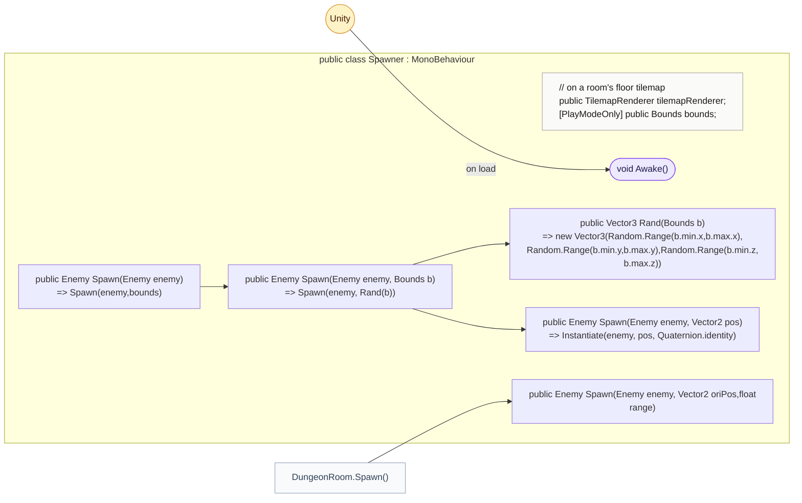
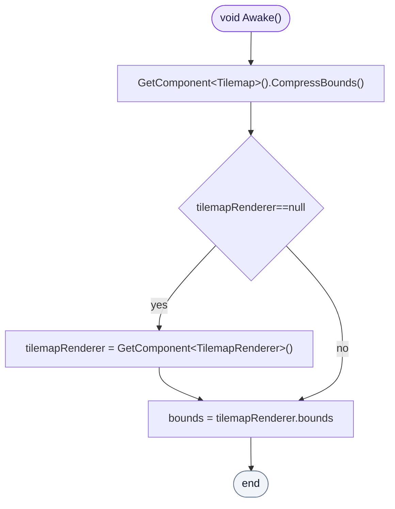
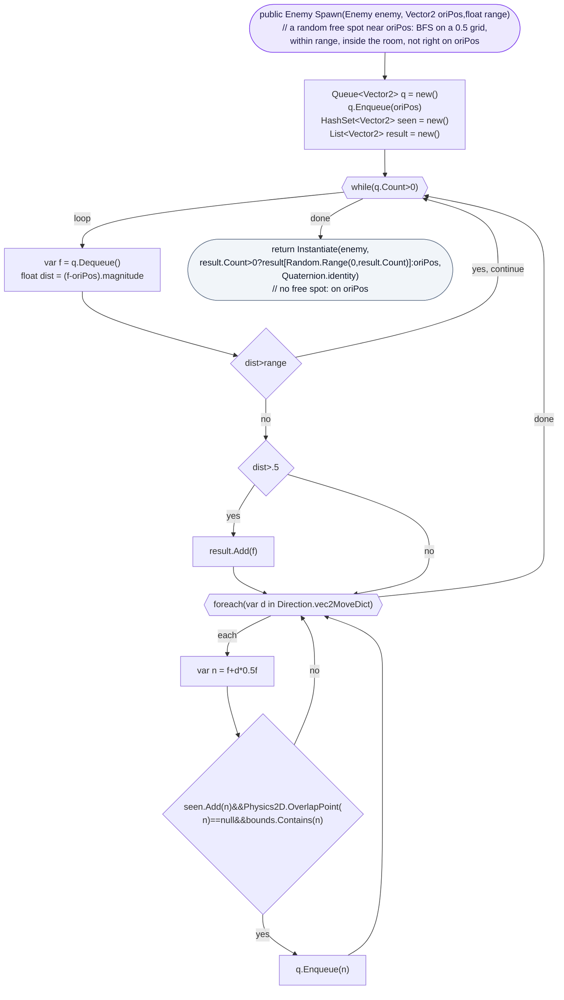

<!-- generated by CodeGraph~/codegraph.py from Spawner.cs. Do not edit: run python "CodeGraph~/codegraph.py". Notes go in CodeGraph~/ai/Spawner.cs.md -->
# Spawner.cs

[overview](README.md) · [source](../../Spawner.cs) · 36 lines · using `System.Collections.Generic`, `UnityEngine`, `UnityEngine.Tilemaps`

Sits on a room's floor tilemap: measures the room and finds free spots to spawn enemies on.

## class Spawner

A room's floor: its bounds, and free spots to spawn.
`bounds` is the room's area for everything else too (`DungeonRoom.bounds`, pathfinding limits).

### Spawner.Awake

Shrinks the tilemap to its painted tiles and takes the renderer's bounds as the room's area.

[lines 10–14](../../Spawner.cs#L10-L14) · called by Unity: on load

### Spawner.Spawn(Enemy,Vector2,float)

Searches outward from a point on a 0.5 grid (the same grid as PathFinding) over free cells inside the room, up to `range` away, and spawns the enemy on a random one more than 0.5 away. With no free cell it spawns on the point itself.

[lines 20–35](../../Spawner.cs#L20-L35) · called by [DungeonRoom.Spawn](Map/DungeonRoom.cs.md#dungeonroomspawn)
