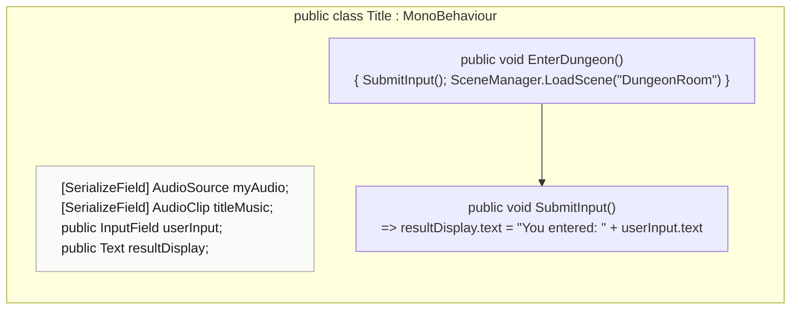

<!-- generated by CodeGraph~/codegraph.py from Title.cs. Do not edit: run python "CodeGraph~/codegraph.py". Notes go in CodeGraph~/ai/Title.cs.md -->
# Title.cs

[overview](README.md) · [source](../../Title.cs) · 16 lines · using `System.Collections`, `System.Collections.Generic`, `UnityEngine`, `UnityEngine.SceneManagement`, `UnityEngine.UI`

The title screen.

## class Title

Title screen: echoes the typed text, then enters the dungeon.
`EnterDungeon` loads the scene "DungeonRoom". Both methods are meant for UI buttons.

