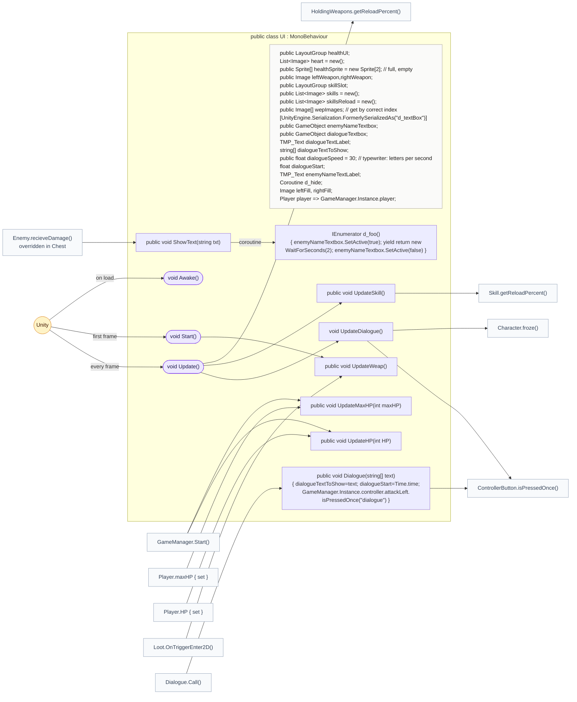
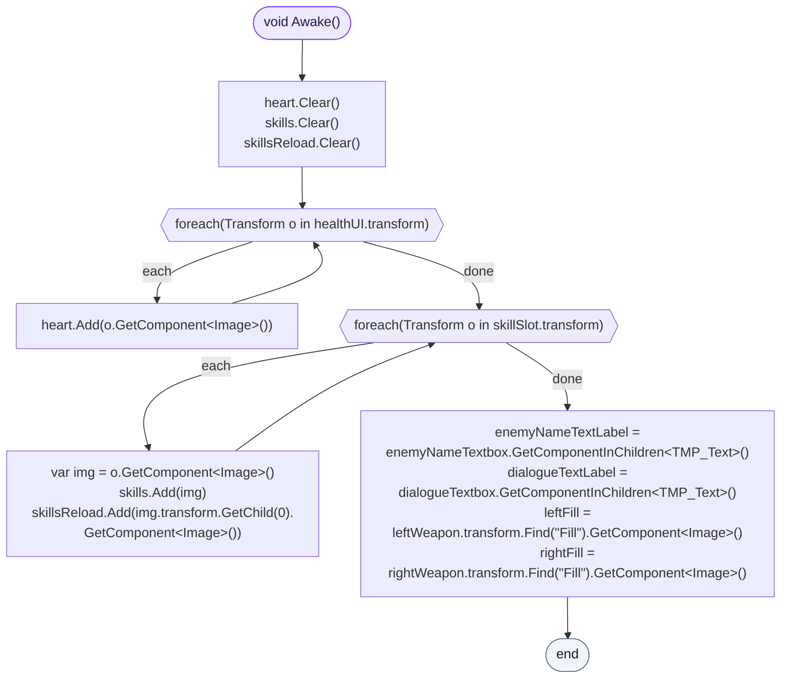
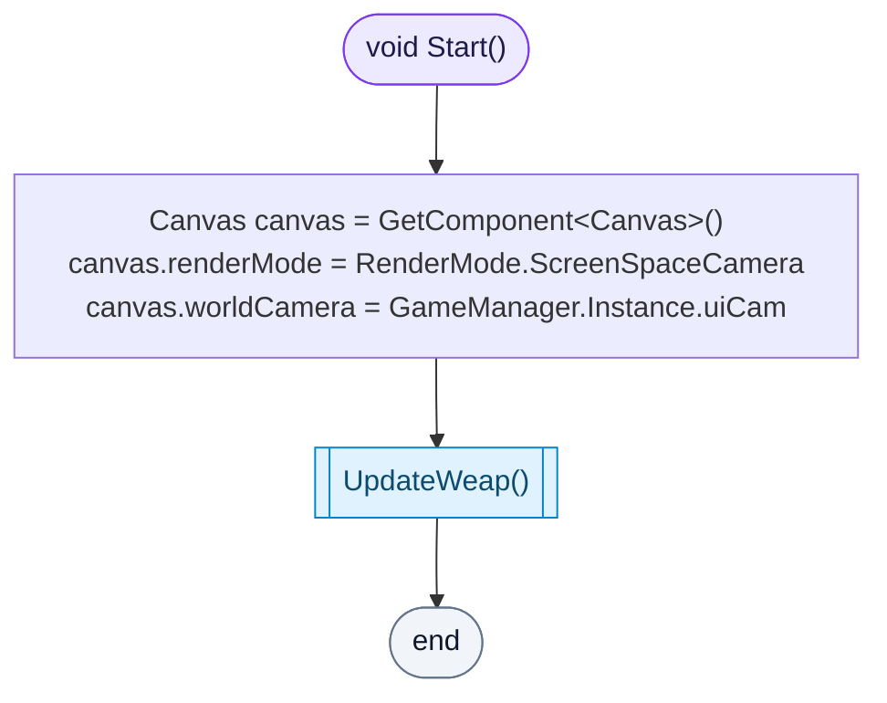
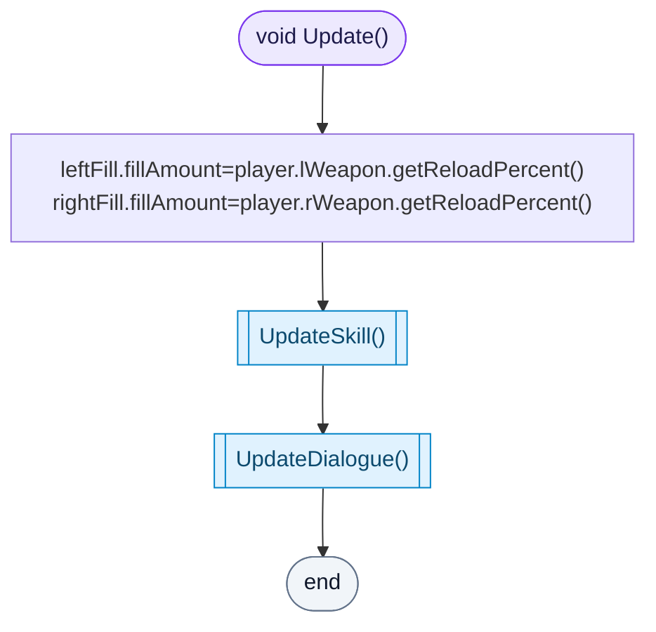
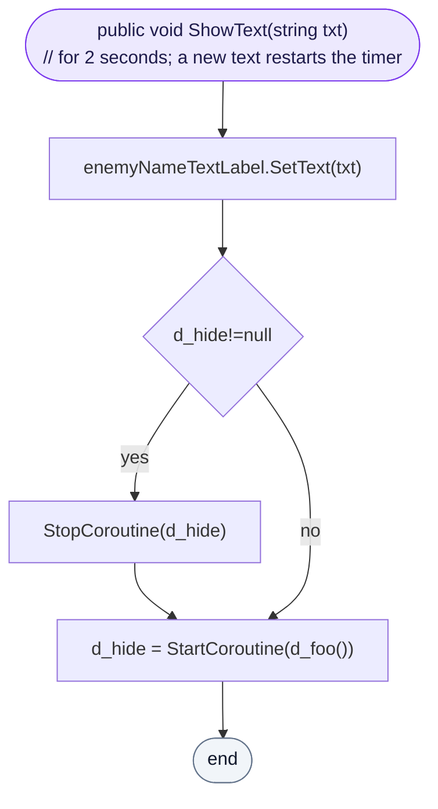
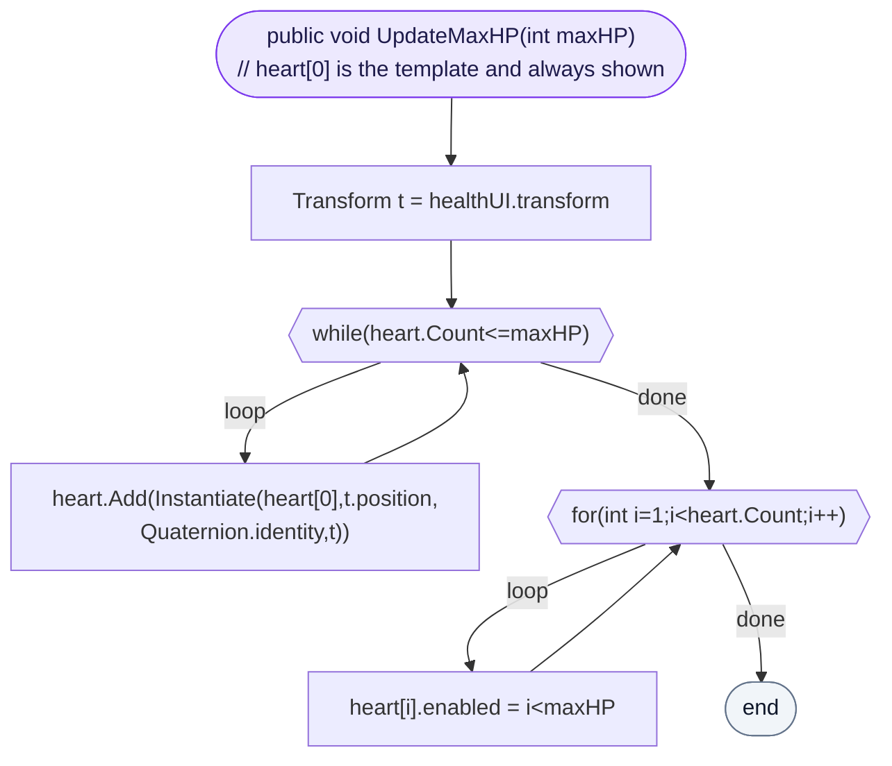
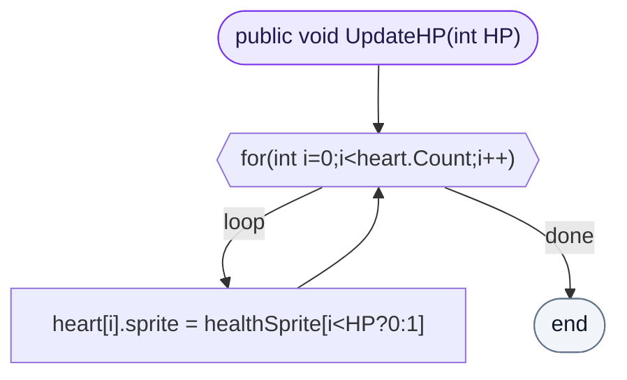
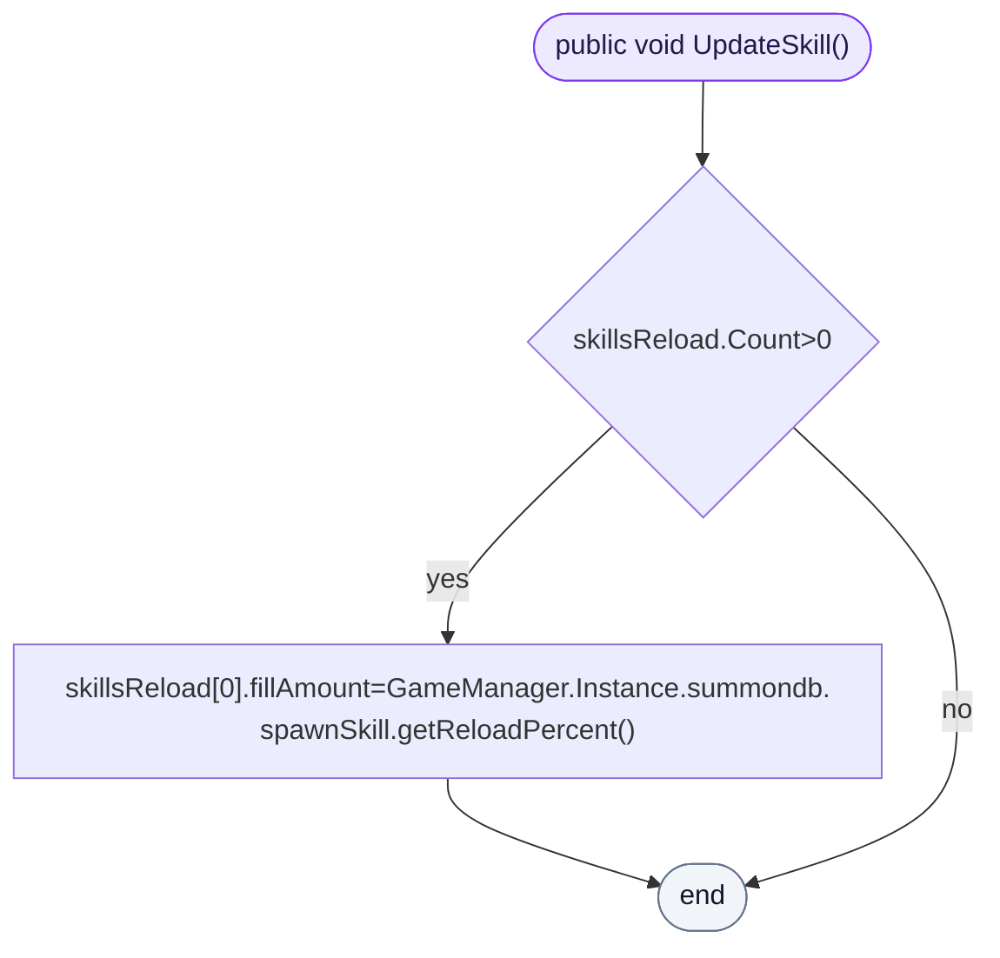
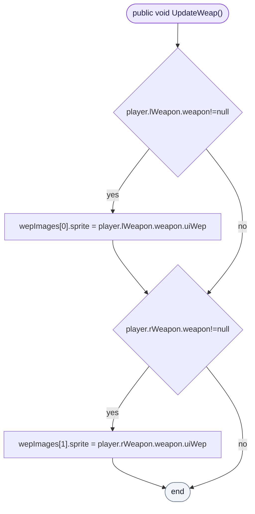
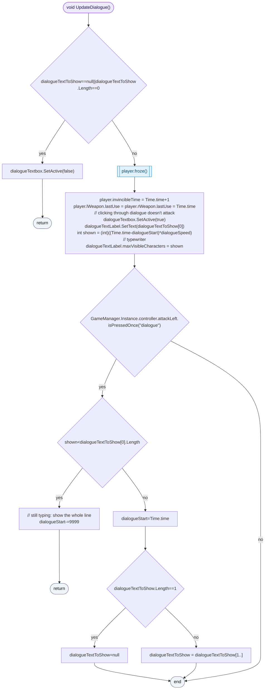

<!-- generated by CodeGraph~/codegraph.py from UI.cs. Do not edit: run python "CodeGraph~/codegraph.py". Notes go in CodeGraph~/ai/UI.cs.md -->
# UI.cs

[overview](README.md) · [source](../../UI.cs) · 96 lines · using `System.Collections`, `System.Collections.Generic`, `UnityEngine`, `UnityEngine.UI`, `TMPro`

The HUD: hearts, the two weapon icons with their reload, the summon cooldown, the enemy name text, and the dialogue box.

## class UI

HUD: hearts, weapons, reloads, name text, dialogue box.

### UI.Awake

Collects the pieces from the hierarchy: hearts under the health bar, skill slots and their reload images, the text labels, and each weapon icon's Fill image.

[lines 29–37](../../UI.cs#L29-L37) · called by Unity: on load

### UI.Start

Draws the canvas through the UI camera and shows the weapon icons.

[lines 38–43](../../UI.cs#L38-L43) · called by Unity: first frame · calls [UI.UpdateWeap](UI.cs.md#uiupdateweap)

### UI.Update

Each frame: weapon reload fills, the summon cooldown fill, and the dialogue.

[lines 44–49](../../UI.cs#L44-L49) · called by Unity: every frame · calls [HoldingWeapons.getReloadPercent](Player.cs.md#class-holdingweapons), [UI.UpdateSkill](UI.cs.md#uiupdateskill), [UI.UpdateDialogue](UI.cs.md#uiupdatedialogue)

### UI.ShowText

Shows a text (an enemy's name when it is hit) for 2 seconds; a new text restarts the 2 seconds.

[lines 51–55](../../UI.cs#L51-L55) · called by [Enemy.recieveDamage](Enemy.cs.md#enemyrecievedamage) · calls [UI.d_foo](UI.cs.md#class-ui) (coroutine)

### UI.UpdateMaxHP

Copies the first heart until there are enough, then shows exactly `maxHP` hearts (the first is always shown).

[lines 61–65](../../UI.cs#L61-L65) · called by [GameManager.Start](GameManager.cs.md#class-gamemanager), [Player.maxHP.set](Player.cs.md#class-player)

### UI.UpdateHP

Each heart is full or empty depending on HP.

[lines 66–66](../../UI.cs#L66-L66) · called by [GameManager.Start](GameManager.cs.md#class-gamemanager), [Player.HP.set](Player.cs.md#class-player)

### UI.UpdateSkill

The first skill slot's reload fill shows the summon cooldown.

[lines 67–67](../../UI.cs#L67-L67) · called by [UI.Update](UI.cs.md#uiupdate) · calls [Skill.getReloadPercent](Skill.cs.md#class-skill)

### UI.UpdateWeap

Each hand's weapon icon, if the hand holds a weapon.

[lines 68–71](../../UI.cs#L68-L71) · called by [Loot.OnTriggerEnter2D](Loot.cs.md#lootontriggerenter2d), [UI.Start](UI.cs.md#uistart)

### UI.UpdateDialogue

While there are lines: the player is frozen, invincible and can't attack. The first line types itself out at `dialogueSpeed` letters per second. A left-attack press shows the whole line if it is still typing, otherwise goes to the next line, closing the box after the last.

[lines 77–95](../../UI.cs#L77-L95) · called by [UI.Update](UI.cs.md#uiupdate) · calls [Character.froze](Character.cs.md#class-character), [ControllerButton.isPressedOnce](Controller.cs.md#controllerbuttonispressedonce)
