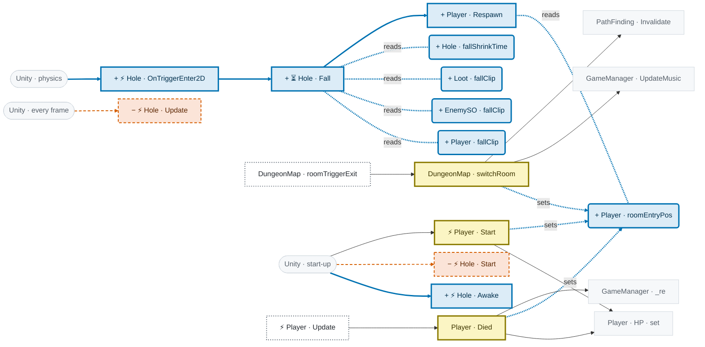
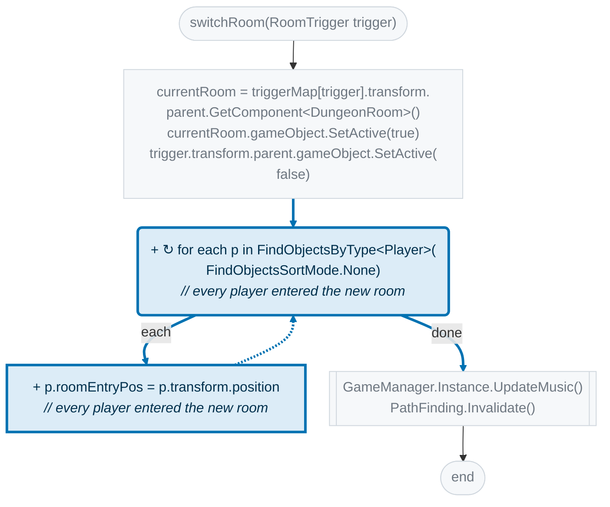
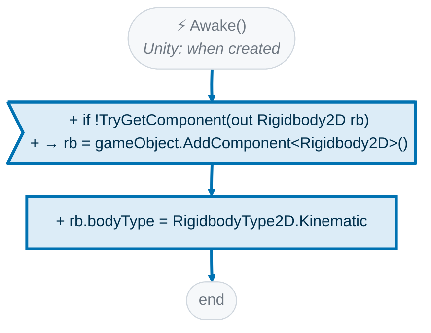
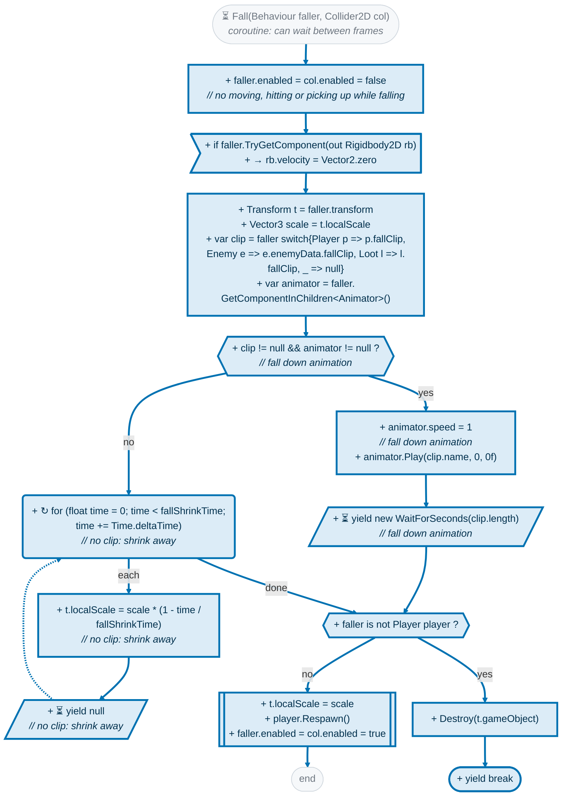
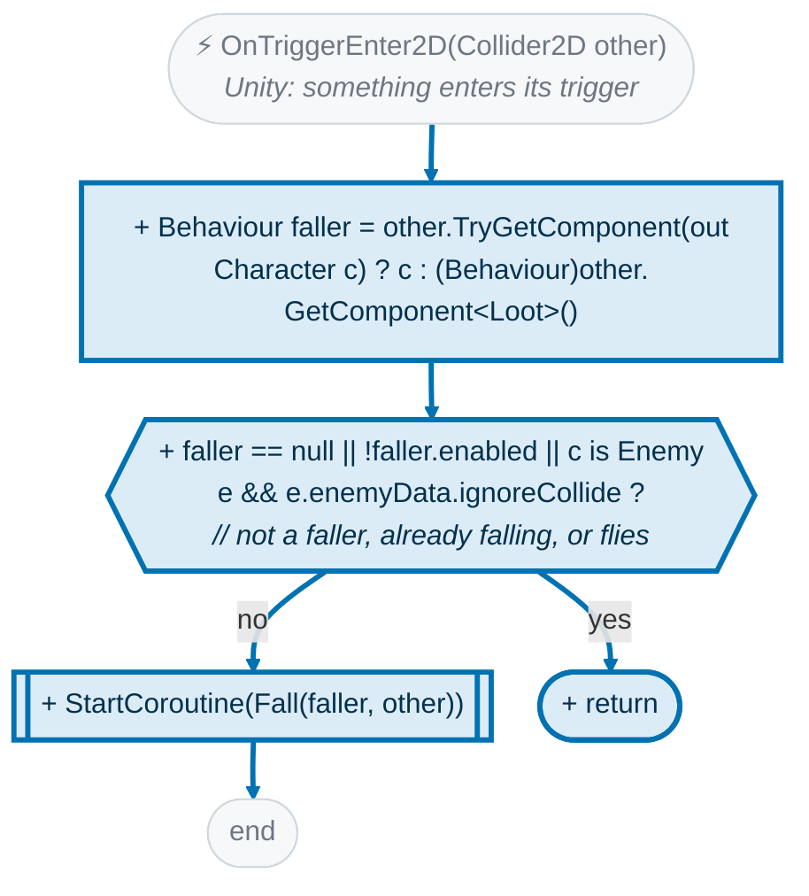
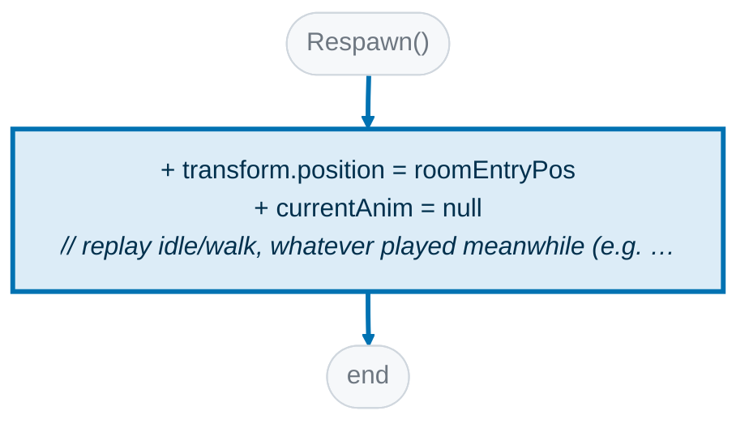
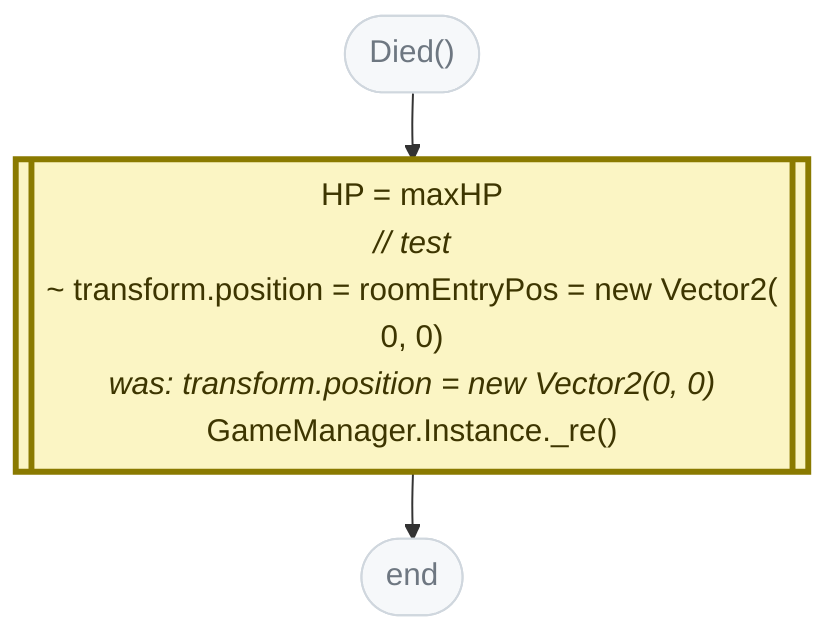
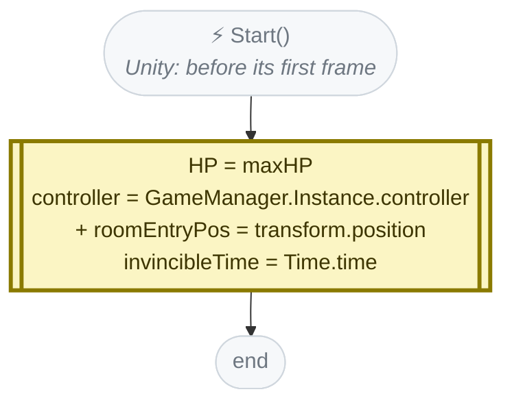

<!-- Generated by CodeGraph (CodeGraph~/tool). Do not edit this file: run the generator. AI / human notes live in CodeGraph~/notes/. -->
# Graph diff · `b47c315~1` → `b47c315`

> Holes: player, enemies and loot fall in (assignable fall clip, else shrink); each player respawns where it entered the room

5 files · 9 methods changed in your code · 5 state members changed

**Colors:** blue `+` added · vermilion dashed `−` removed · yellow `~` changed (with *was:*) · gray = unchanged context · dotted outline = not changed but calls changed code. Ranks: 🟥 signature / public API · 🟧 conditions, branches or calls · 🟨 plain statements · ⬜ comments / format. ⚡ Unity calls it · ⏳ coroutine · 🔁 runs every frame (reached from Update / FixedUpdate / …) · double-edged box = calls project code · dashed = `AI/` (external) · *L12* = source line

## What changed

- 🟧 **~ `DungeonMap.switchRoom`**  — 2 added
- 🟧 **+ `Hole.Awake`** ⚡ — new, 3 statements
- 🟧 **+ `Hole.Fall`** ⏳ — new, 20 statements; now calls `Player.Respawn`
- 🟧 **+ `Hole.OnTriggerEnter2D`** ⚡ — new, 4 statements; now calls `Hole.Fall`
- 🟧 **+ `Player.Respawn`**  — new, 2 statements
- 🟨 **− `Hole.Start`** ⚡ — removed (it was empty)
- 🟨 **− `Hole.Update`** ⚡ — removed (it was empty)
- 🟨 **~ `Player.Died`**  — 1 changed; 🔁 runs every frame
- 🟨 **~ `Player.Start`** ⚡ — 1 added
- 🟨 **+ `EnemySO.fallClip`** (state) — `AnimationClip fallClip` — Fall down animation when it falls in a hole (a state with this clip's name in its Animator). Empty: it shrinks away
- 🟨 **+ `Loot.fallClip`** (state) — `AnimationClip fallClip` — Fall down animation when it falls in a hole (a state with this clip's name in its Animator). Empty: it shrinks away
- 🟨 **+ `Hole.fallShrinkTime`** (state) — `float fallShrinkTime = .5f` — when it has no fall clip
- 🟨 **+ `Player.fallClip`** (state) — `AnimationClip fallClip` — Fall down animation when it falls in a hole (a state with this clip's name in its Animator). Empty: it shrinks away
- 🟨 **+ `Player.roomEntryPos`** (state) — `Vector2 roomEntryPos` — where this player entered the current room: falling in a hole brings it back here

## Separate parts of this change

Changes that don't call or share state with each other. Check each part against the commit message:

1. `DungeonMap.switchRoom`, `Player.Start`, `Player.Died`, `Hole.OnTriggerEnter2D`, `Hole.Fall`, `Player.Respawn`, `EnemySO.fallClip`, `Loot.fallClip`, `Hole.fallShrinkTime`, `Player.fallClip`, `Player.roomEntryPos`
2. `Hole.Awake`
3. `Hole.Start`
4. `Hole.Update`

## Impact map

Changed methods and state, with one step of context. Edges: calls (solid), sets (dashed), reads (dotted).

## Changed methods

### 🟧 ~ DungeonMap.switchRoom

now L35–42 · was L35–41

### 🟧 + ⚡ Hole.Awake

now L11–14

### 🟧 + ⏳ Hole.Fall

now L20–33

### 🟧 + ⚡ Hole.OnTriggerEnter2D

now L15–19

### 🟧 + Player.Respawn

now L112–115

### 🟨 ~ 🔁 Player.Died

now L116–120 · was L108–112

### 🟨 ~ ⚡ Player.Start

now L83–88 · was L80–84

