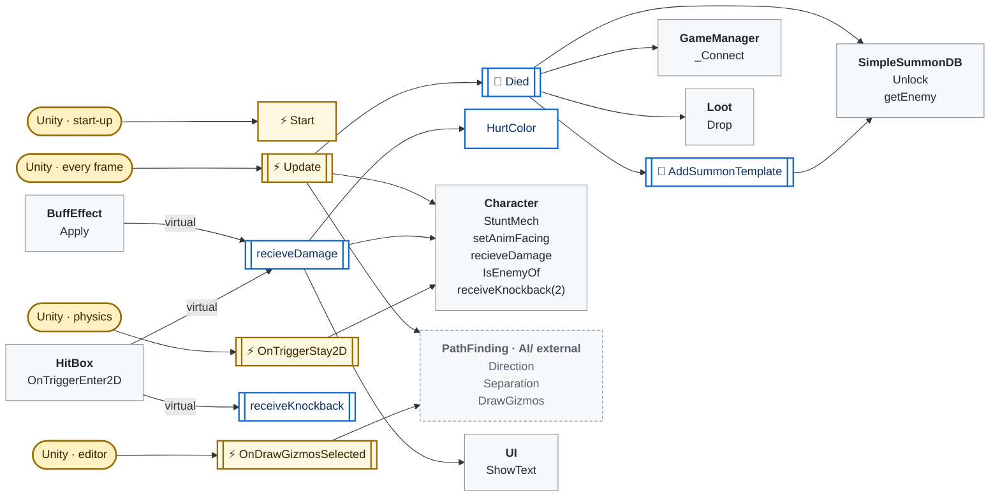
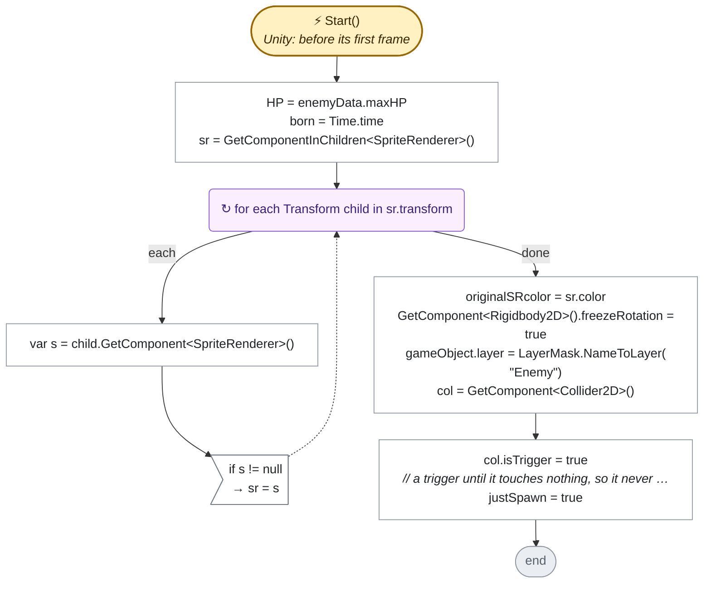
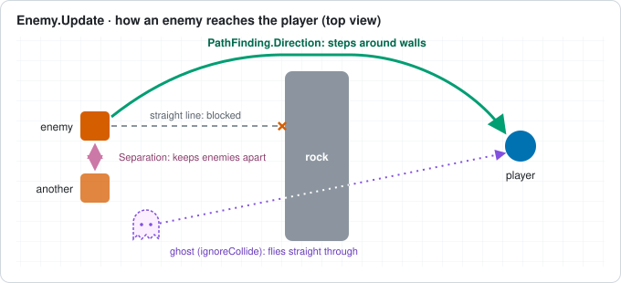
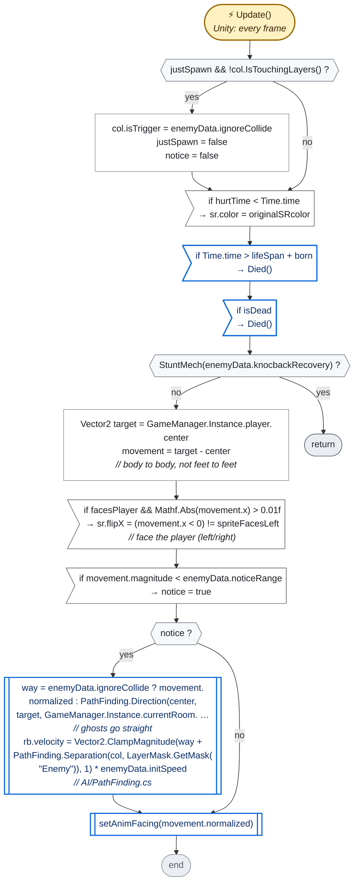
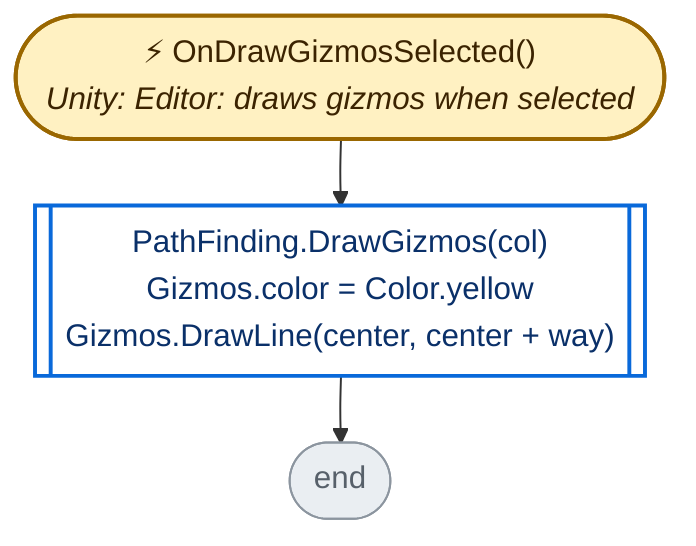
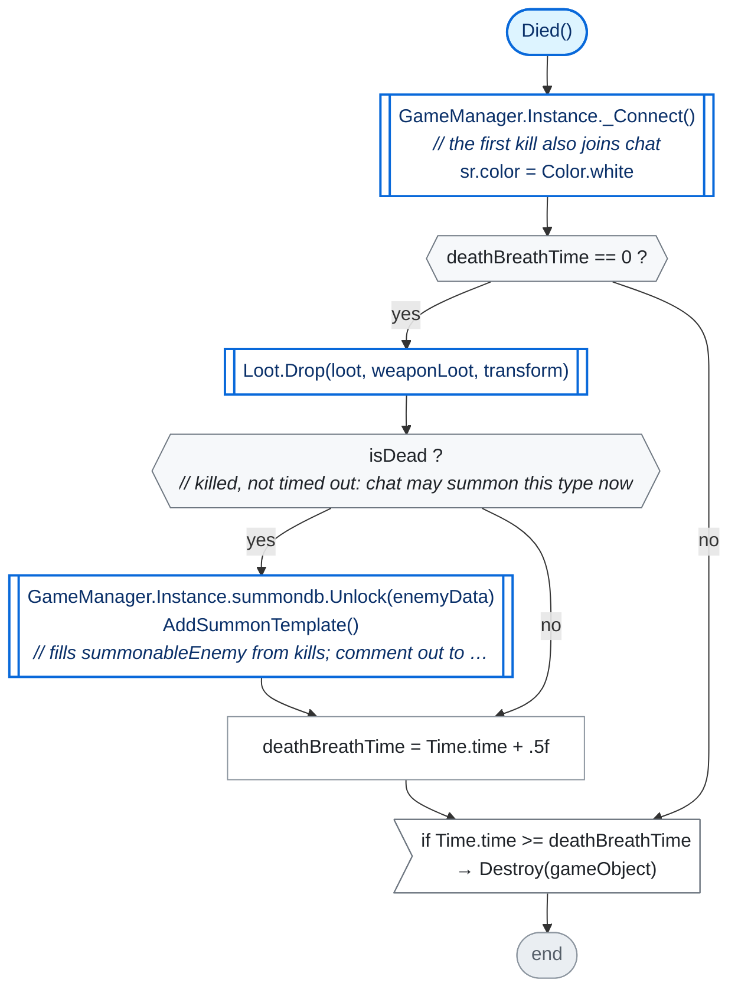
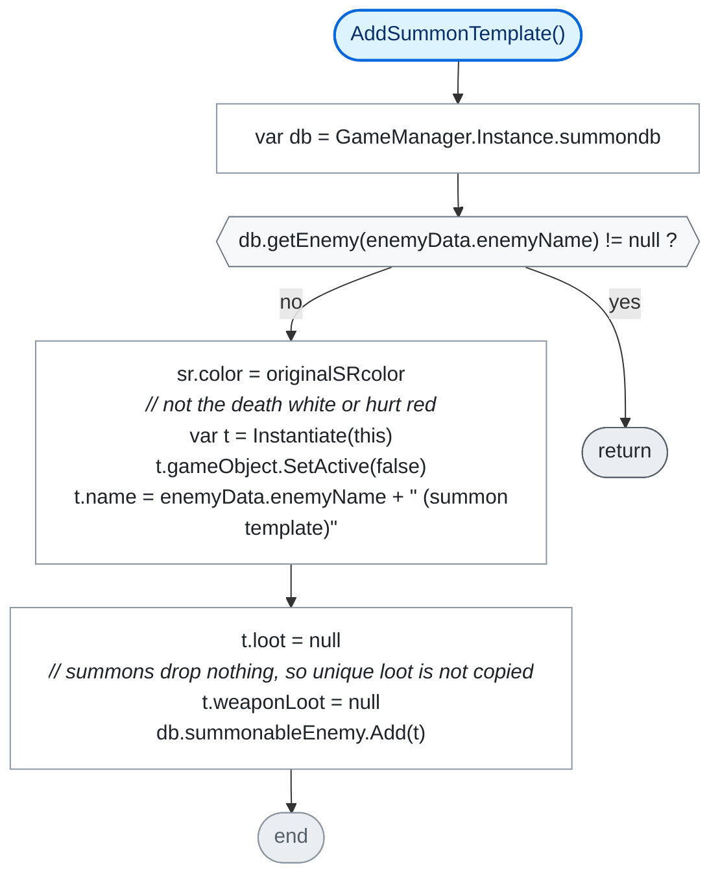
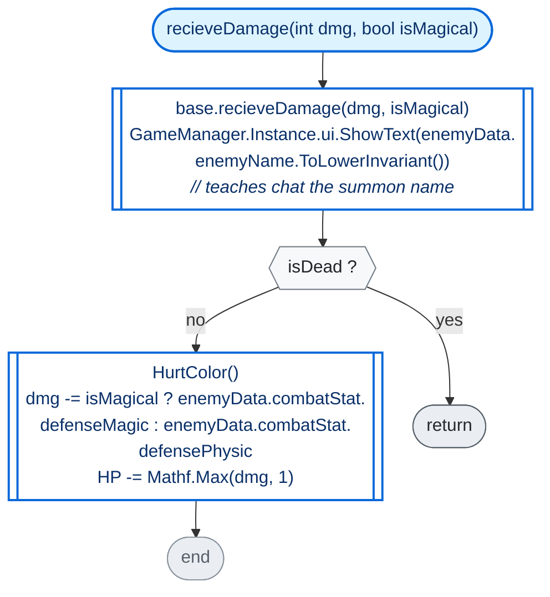
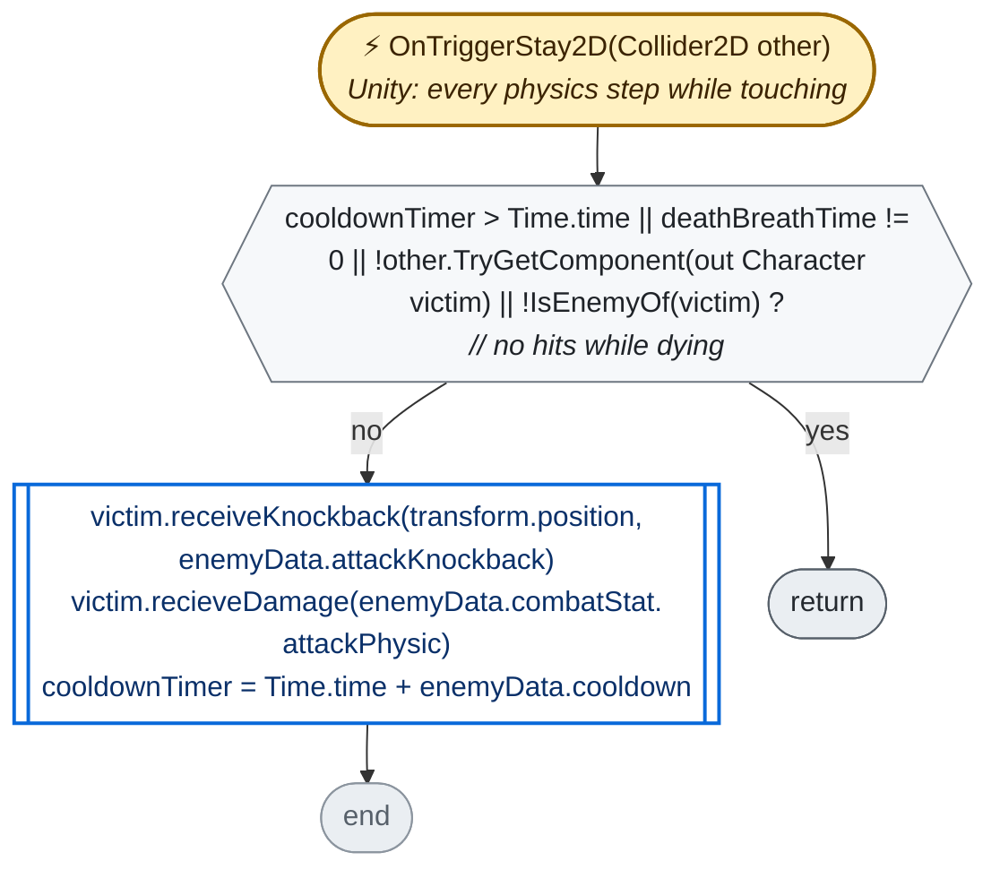

<!-- Generated by CodeGraph (CodeGraph~/tool). Do not edit this file: run the generator. AI / human notes live in CodeGraph~/notes/. -->
# Enemy.cs

`class Enemy : Character` · 109 lines · 14 code blocks · [source](../../../Enemy.cs) · [index](index.md)

> **🤖 AI note** · *summary* · unreviewed · ✅ matches the code
>
> A monster that chases the player and hurts it on touch. Any death (killed, or 360 s of `lifeSpan` running out) drops its loot; only a kill also unlocks its type for chat summons.

⚡ Unity calls it · ⏳ coroutine · 🔁 runs every frame (reached from Update / FixedUpdate / …) · double-edged box = calls project code · dashed = `AI/` (external) · *L12* = source line

## Who calls what

Left: who calls in (Unity included). Middle: its methods. Right: what they call or set elsewhere.

## State · class Enemy

| Member | Type | Inspector | Default / value | Comment / tooltip |
|---|---|---|---|---|
| `enemyData` | `EnemySO` | ✓ |  |  |
| `initSpeed` | `float {get}` |  | `=> enemyData.initSpeed` |  |
| `team` | `override Team {get}` |  | `=> Team.Enemy` |  |
| `combatStat` | `override CombatStat {get/set}` |  |  |  |
| `maxHP` | `override int {get/set}` |  |  |  |
| `anim` | `Animator` | ✓ |  |  |
| `enemyIdle` | `AnimationClip[]` | ✓ |  |  |
| `enemyWalk` | `AnimationClip[]` | ✓ |  |  |
| `enemyAttack` | `AnimationClip[]` | ✓ |  |  |
| `loot` | `Loot` | ✓ |  |  |
| `weaponLoot` | `Weapon` | ✓ |  | Optional. Weapon to drop, no Loot prefab needed |
| `sr` | `SpriteRenderer` |  |  |  |
| `col` | `Collider2D` |  |  |  |
| `originalSRcolor` | `Color` |  |  |  |
| `deathBreathTime` | `float` |  |  |  |
| `hurtTime` | `float` |  |  |  |
| `lifeSpan` | `float` |  | `360` | seconds, then it dies by itself |
| `born` | `float` |  |  |  |
| `cooldownTimer` | `float` |  |  |  |
| `justSpawn` | `bool` |  |  |  |
| `notice` | `bool` |  |  |  |
| `spriteFacesLeft` | `bool` | ✓ |  | Tick if the sprite art faces left. It is flipped to face the player |
| `facesPlayer` | `virtual bool {get}` |  | `=> true` | false: never flipped (Chest) |
| `way` | `Vector2` |  |  | where it walks, for the gizmo |

## Methods

| | Method | Lines | Calls (project) | Called by |
|---|---|---|---|---|
|  | [initSpeed · get](#m-enemy-initspeed-get) | [L8](../../../Enemy.cs#L8) | 0 |  |
|  | [team · get](#m-enemy-team-get) | [L9](../../../Enemy.cs#L9) | 0 |  |
|  | [combatStat · get](#m-enemy-combatstat-get) | [L10](../../../Enemy.cs#L10) | 0 |  |
|  | [maxHP · get](#m-enemy-maxhp-get) | [L11](../../../Enemy.cs#L11) | 0 |  |
|  | [facesPlayer · get](#m-enemy-facesplayer-get) | [L29](../../../Enemy.cs#L29) | 0 |  |
| ⚡ | [Start](#m-enemy-start) | [L32–46](../../../Enemy.cs#L32-L46) | 0 | Unity · before its first frame |
| ⚡ | [Update](#m-enemy-update) | [L47–62](../../../Enemy.cs#L47-L62) | 5 | Unity · every frame |
| ⚡ | [OnDrawGizmosSelected](#m-enemy-ondrawgizmosselected) | [L64–68](../../../Enemy.cs#L64-L68) | 1 | Unity · Editor: draws gizmos when selected |
| 🔁 | [Died](#m-enemy-died) | [L70–82](../../../Enemy.cs#L70-L82) | 4 | `Enemy.Update` |
| 🔁 | [AddSummonTemplate](#m-enemy-addsummontemplate) | [L83–90](../../../Enemy.cs#L83-L90) | 1 | `Enemy.Died` |
|  | [recieveDamage](#m-enemy-recievedamage) | [L91–98](../../../Enemy.cs#L91-L98) | 2 | `BuffEffect.Apply`, `Enemy.OnTriggerStay2D`, `HitBox.OnTriggerEnter2D` |
|  | [HurtColor](#m-enemy-hurtcolor) | [L99](../../../Enemy.cs#L99) | 0 | `Enemy.recieveDamage` |
|  | [receiveKnockback](#m-enemy-receiveknockback) | [L101](../../../Enemy.cs#L101) | 0 | `Enemy.OnTriggerStay2D`, `Enemy.receiveKnockback`, `HitBox.OnTriggerEnter2D` |
| ⚡ | [OnTriggerStay2D](#m-enemy-ontriggerstay2d) | [L103–108](../../../Enemy.cs#L103-L108) | 3 | Unity · every physics step while touching |

### ⚡ Start()

[L32–46](../../../Enemy.cs#L32-L46) · `Enemy.Start` · code `0f20c722`

### ⚡ Update()

[L47–62](../../../Enemy.cs#L47-L62) · `Enemy.Update` · code `d1033f11`

> **🤖 AI note** · *summary* · unreviewed · ✅ matches the code
>
> It spawns as a trigger and turns solid once nothing overlaps it (fliers with `ignoreCollide` stay passable). Unless stunned, it faces the player and walks to it around walls with `PathFinding.Direction` (fliers go straight), kept apart from other enemies by `PathFinding.Separation`.
>
> 

**Calls:** [`Enemy.Died`](#m-enemy-died) · [`Character.StuntMech`](Character.cs.md#m-character-stuntmech) · `PathFinding.Direction` *(AI/, external)* · `PathFinding.Separation` *(AI/, external)* · [`Character.setAnimFacing`](Character.cs.md#m-character-setanimfacing)

### ⚡ OnDrawGizmosSelected()

[L64–68](../../../Enemy.cs#L64-L68) · `Enemy.OnDrawGizmosSelected` · code `7b30d83c`

*Code comment:* select an enemy in play mode: its direction in yellow, walls it avoids in red

**Calls:** `PathFinding.DrawGizmos` *(AI/, external)*

### 🔁 Died()

[L70–82](../../../Enemy.cs#L70-L82) · `Enemy.Died` · code `5812bd4c`

> **🤖 AI note** · *summary* · unreviewed · ✅ matches the code
>
> Runs every frame while the enemy is dying. The first call drops loot and, for a kill only, unlocks the type for chat and keeps a hidden copy as the summon template. It flashes white and is destroyed 0.5 s later.

**Calls:** [`GameManager._Connect`](GameManager.cs.md#m-gamemanager--connect) · [`Loot.Drop`](Loot.cs.md#m-loot-drop) · [`SimpleSummonDB.Unlock`](Connector/SummonDB.cs.md#m-simplesummondb-unlock) · [`Enemy.AddSummonTemplate`](#m-enemy-addsummontemplate)

### 🔁 AddSummonTemplate()

[L83–90](../../../Enemy.cs#L83-L90) · `Enemy.AddSummonTemplate` · code `99131635`

*Code comment:* a hidden copy of this enemy becomes what chat summons, if its type has none yet

**Calls:** [`SimpleSummonDB.getEnemy`](Connector/SummonDB.cs.md#m-simplesummondb-getenemy)

### recieveDamage(int dmg, bool isMagical)

[L91–98](../../../Enemy.cs#L91-L98) · `Enemy.recieveDamage` · code `4e5654e0` · overrides `Character.recieveDamage`

> **🤖 AI note** · *usage* · unreviewed · ✅ matches the code
>
> Shows the enemy's name first (that is how viewers learn what to type to summon it), then takes `dmg` minus its defense, at least 1, and flashes red. Once dead it only shows the name.

**Calls:** base [`Character.recieveDamage`](Character.cs.md#m-character-recievedamage) · [`UI.ShowText`](UI.cs.md#m-ui-showtext) · [`Enemy.HurtColor`](#m-enemy-hurtcolor)

### ⚡ OnTriggerStay2D(Collider2D other)

[L103–108](../../../Enemy.cs#L103-L108) · `Enemy.OnTriggerStay2D` · code `504640ac`

> **🤖 AI note** · *summary* · unreviewed · ✅ matches the code
>
> Touch damage: a `Character` of another team that overlaps it is knocked back and takes `attackPhysic` damage, at most once per `cooldown`, and never while this enemy is dying.

**Calls:** [`Character.IsEnemyOf`](Character.cs.md#m-character-isenemyof) · [`Character.receiveKnockback(Vector2,float)`](Character.cs.md#m-character-receiveknockback-vector2-float) · [`Character.recieveDamage`](Character.cs.md#m-character-recievedamage)

### Short members

Straight-line members with one or two steps: the whole flow fits in one row.

| | Member | Lines | Steps |
|---|---|---|---|
|  | initSpeed · get | [L8](../../../Enemy.cs#L8) | `enemyData.initSpeed` |
|  | team · get | [L9](../../../Enemy.cs#L9) | `Team.Enemy` |
|  | combatStat · get | [L10](../../../Enemy.cs#L10) | `enemyData.combatStat` |
|  | maxHP · get | [L11](../../../Enemy.cs#L11) | `enemyData.maxHP` |
|  | facesPlayer · get | [L29](../../../Enemy.cs#L29) | `true` |
|  | HurtColor() | [L99](../../../Enemy.cs#L99) | `hurtTime = Time.time + 0.1f` `sr.color = Color.red` |
|  | receiveKnockback(Vector2 pos, float force) | [L101](../../../Enemy.cs#L101) | `receiveKnockback(pos, force, enemyData.knockbackResistance)` |

