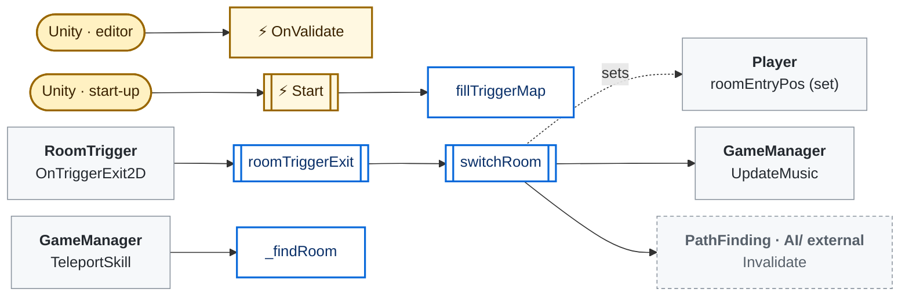
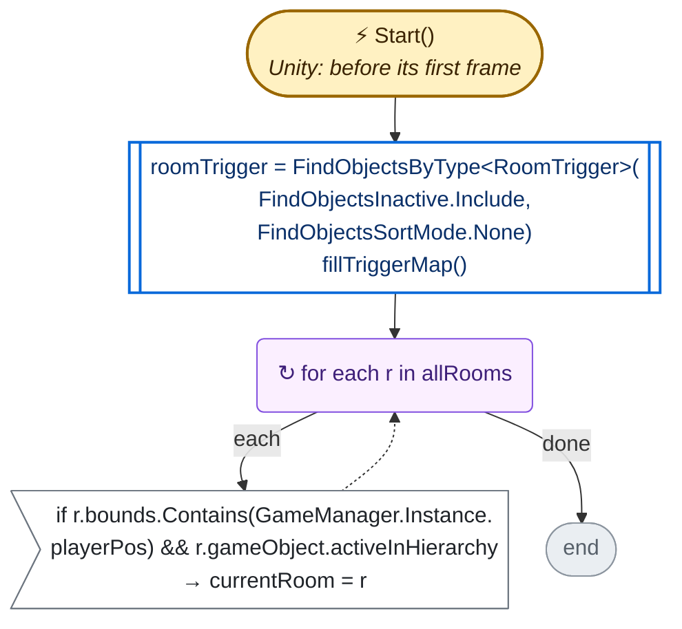
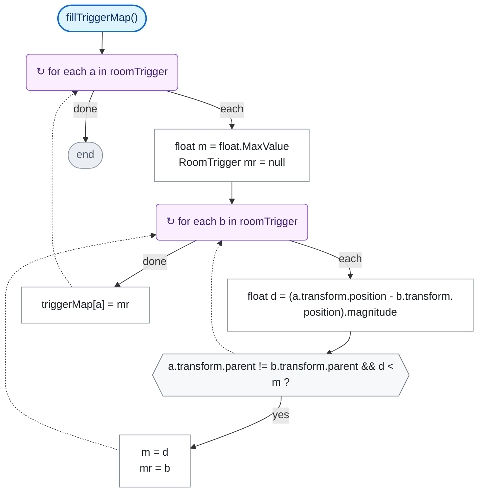
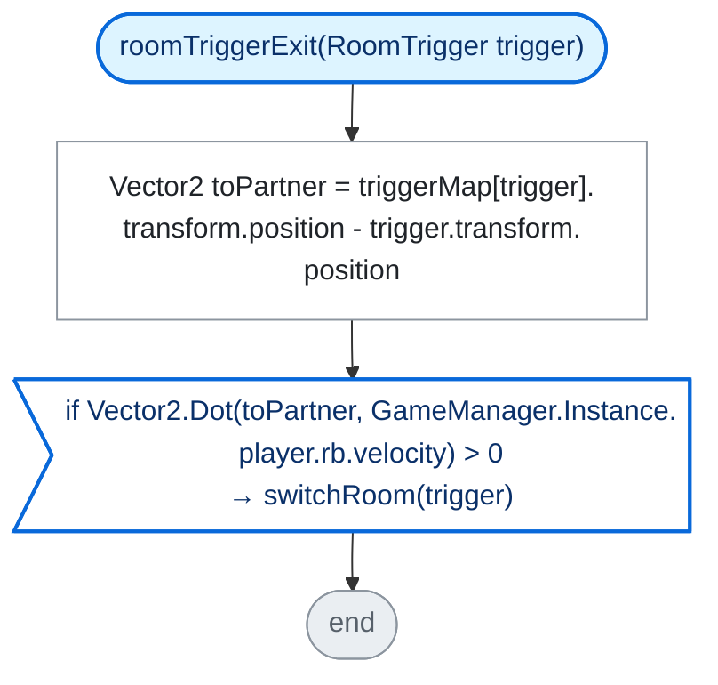
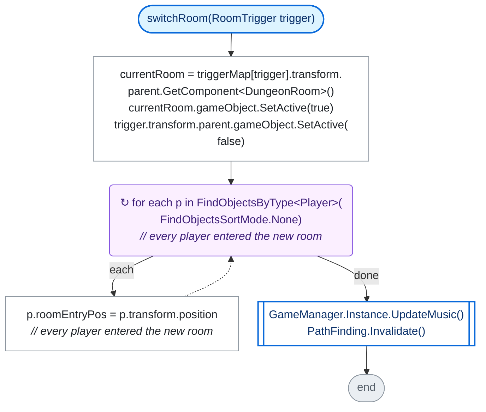
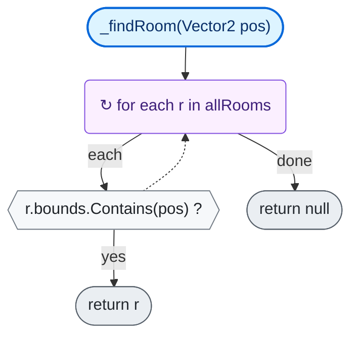

<!-- Generated by CodeGraph (CodeGraph~/tool). Do not edit this file: run the generator. AI / human notes live in CodeGraph~/notes/. -->
# Map/DungeonMap.cs

`class DungeonMap : MonoBehaviour` · 47 lines · 6 code blocks · [source](../../../../Map/DungeonMap.cs) · [index](../index.md)

*Code comment on `DungeonMap`:* only currentRoom is active

⚡ Unity calls it · ⏳ coroutine · 🔁 runs every frame (reached from Update / FixedUpdate / …) · double-edged box = calls project code · dashed = `AI/` (external) · *L12* = source line

## Who calls what

Left: who calls in (Unity included). Middle: its methods. Right: what they call or set elsewhere.

## State · class DungeonMap

| Member | Type | Inspector | Default / value | Comment / tooltip |
|---|---|---|---|---|
| `currentRoom` | `DungeonRoom` | ✓ |  |  |
| `allRooms` | `DungeonRoom[]` | hidden |  |  |
| `width` | `int` | ✓ |  | pixel of each cell |
| `height` | `int` | ✓ |  | pixel of each cell |
| `roomTrigger` | `RoomTrigger[]` | hidden |  |  |
| `triggerMap` | `Dictionary<RoomTrigger, RoomTrigger>` | ✓ | `new()` |  |

## Methods

| | Method | Lines | Calls (project) | Called by |
|---|---|---|---|---|
| ⚡ | [OnValidate](#m-dungeonmap-onvalidate) | [L13](../../../../Map/DungeonMap.cs#L13) | 0 | Unity · Editor: a value changed in the Inspector |
| ⚡ | [Start](#m-dungeonmap-start) | [L15–19](../../../../Map/DungeonMap.cs#L15-L19) | 1 | Unity · before its first frame |
|  | [fillTriggerMap](#m-dungeonmap-filltriggermap) | [L20–30](../../../../Map/DungeonMap.cs#L20-L30) | 0 | `DungeonMap.Start` |
|  | [roomTriggerExit](#m-dungeonmap-roomtriggerexit) | [L31–34](../../../../Map/DungeonMap.cs#L31-L34) | 1 | `RoomTrigger.OnTriggerExit2D` |
|  | [switchRoom](#m-dungeonmap-switchroom) | [L35–42](../../../../Map/DungeonMap.cs#L35-L42) | 2 | `DungeonMap.roomTriggerExit` |
|  | [_findRoom](#m-dungeonmap--findroom) | [L43–46](../../../../Map/DungeonMap.cs#L43-L46) | 0 | `GameManager.TeleportSkill` |

### ⚡ Start()

[L15–19](../../../../Map/DungeonMap.cs#L15-L19) · `DungeonMap.Start` · code `30a34477`

**Calls:** [`DungeonMap.fillTriggerMap`](#m-dungeonmap-filltriggermap)

### fillTriggerMap()

[L20–30](../../../../Map/DungeonMap.cs#L20-L30) · `DungeonMap.fillTriggerMap` · code `9961c837`

*Code comment:* pair each door trigger with the nearest trigger of another room

### roomTriggerExit(RoomTrigger trigger)

[L31–34](../../../../Map/DungeonMap.cs#L31-L34) · `DungeonMap.roomTriggerExit` · code `f501cedd`

*Code comment:* switch when leaving a door trigger toward its partner

**Calls:** [`DungeonMap.switchRoom`](#m-dungeonmap-switchroom)

### switchRoom(RoomTrigger trigger)

[L35–42](../../../../Map/DungeonMap.cs#L35-L42) · `DungeonMap.switchRoom` · code `c9862d83`

**Calls:** [`GameManager.UpdateMusic`](../GameManager.cs.md#m-gamemanager-updatemusic) · `PathFinding.Invalidate` *(AI/, external)*

### _findRoom(Vector2 pos)

[L43–46](../../../../Map/DungeonMap.cs#L43-L46) · `DungeonMap._findRoom` · code `c48cad68`

*Code comment:* buggy, use with care

### Short members

Straight-line members with one or two steps: the whole flow fits in one row.

| | Member | Lines | Steps |
|---|---|---|---|
| ⚡ | OnValidate() | [L13](../../../../Map/DungeonMap.cs#L13) | `allRooms = FindObjectsByType<DungeonRoom>(FindObjectsInactive.Include, FindObjectsSortMode.None)` |

