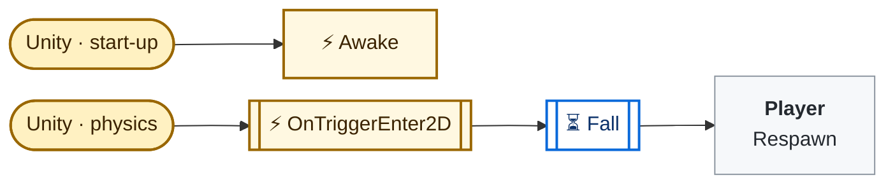
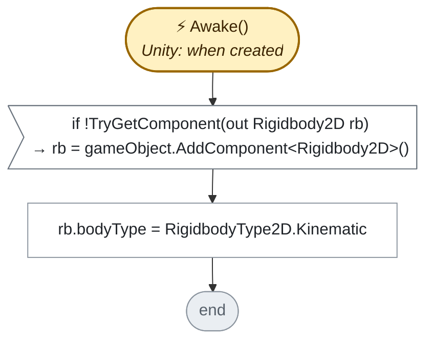
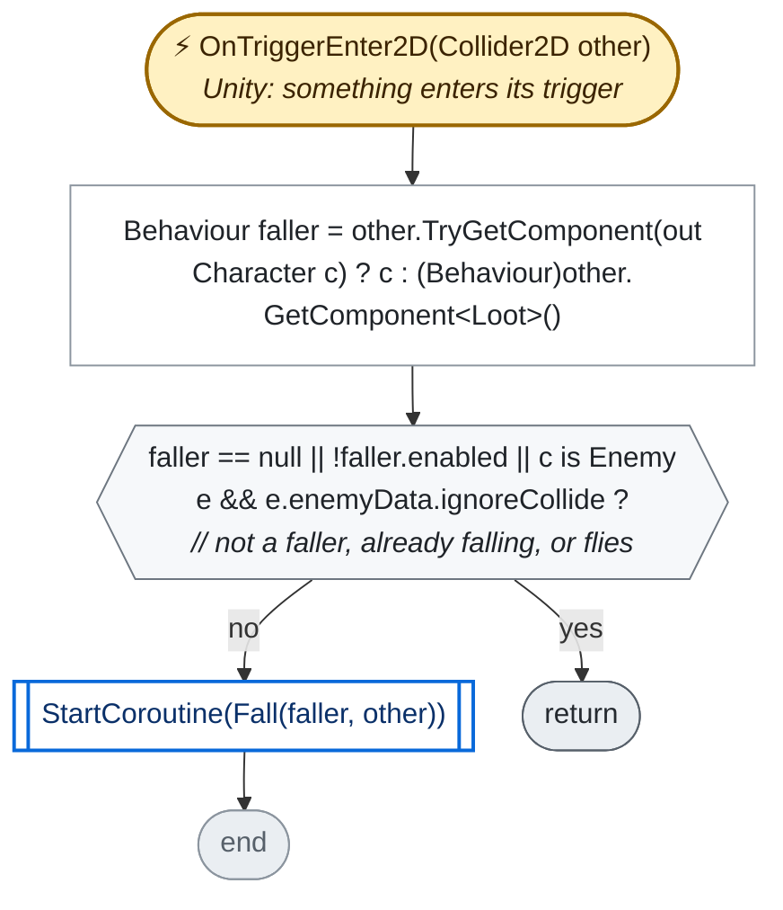
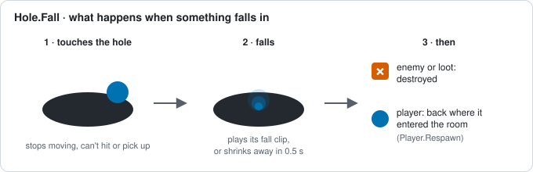
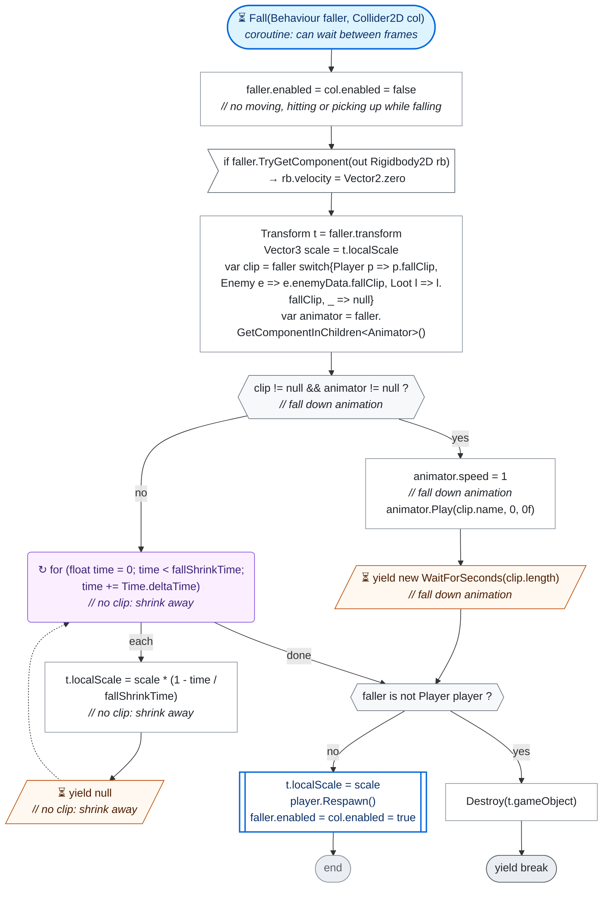

<!-- Generated by CodeGraph (CodeGraph~/tool). Do not edit this file: run the generator. AI / human notes live in CodeGraph~/notes/. -->
# Map/Hole.cs

`class Hole : MonoBehaviour` · 34 lines · 3 code blocks · [source](../../../../Map/Hole.cs) · [index](../index.md)

> **🤖 AI note** · *summary* · unreviewed · ✅ matches the code
>
> A pit. Characters and loot that touch it fall in, except enemies that fly (`ignoreCollide`).

*Code comment on `Hole`:* The player, enemies and loot that touch this trigger fall in: they play their fall clip (or shrink away), then enemies and loot are gone and each player comes back where it entered the room. Flying enemies (ignoreCollide, ghosts) pass over.

⚡ Unity calls it · ⏳ coroutine · 🔁 runs every frame (reached from Update / FixedUpdate / …) · double-edged box = calls project code · dashed = `AI/` (external) · *L12* = source line

## Who calls what

Left: who calls in (Unity included). Middle: its methods. Right: what they call or set elsewhere.

## State · class Hole

| Member | Type | Inspector | Default / value | Comment / tooltip |
|---|---|---|---|---|
| `fallShrinkTime` | `const float` |  | `.5f` | when it has no fall clip |

## Methods

| | Method | Lines | Calls (project) | Called by |
|---|---|---|---|---|
| ⚡ | [Awake](#m-hole-awake) | [L11–14](../../../../Map/Hole.cs#L11-L14) | 0 | Unity · when created |
| ⚡ | [OnTriggerEnter2D](#m-hole-ontriggerenter2d) | [L15–19](../../../../Map/Hole.cs#L15-L19) | 1 | Unity · something enters its trigger |
| ⏳ | [Fall](#m-hole-fall) | [L20–33](../../../../Map/Hole.cs#L20-L33) | 1 | `Hole.OnTriggerEnter2D` |

### ⚡ Awake()

[L11–14](../../../../Map/Hole.cs#L11-L14) · `Hole.Awake` · code `863edb87`

*Code comment:* loot has no Rigidbody2D: a kinematic one here lets it touch the hole too

### ⚡ OnTriggerEnter2D(Collider2D other)

[L15–19](../../../../Map/Hole.cs#L15-L19) · `Hole.OnTriggerEnter2D` · code `8d56f78c`

> **🤖 AI note** · *summary* · unreviewed · ✅ matches the code
>
> Starts a `Fall` for a `Character` or `Loot` that touches the hole, unless it is already falling (switched off) or is a flying enemy.

**Calls:** [`Hole.Fall`](#m-hole-fall)

### ⏳ Fall(Behaviour faller, Collider2D col)

[L20–33](../../../../Map/Hole.cs#L20-L33) · `Hole.Fall` · code `854190ab`

> **🤖 AI note** · *summary* · unreviewed · ✅ matches the code
>
> Freezes the faller, then plays its fall clip if it has one, or shrinks it away in 0.5 s. Enemies and loot are then destroyed; a player gets its size back and returns to where it entered the room (`Player.Respawn`).
>
> 

**Calls:** [`Player.Respawn`](../Player.cs.md#m-player-respawn)

