<!-- Generated by CodeGraph (CodeGraph~/tool). Do not edit this file: run the generator. AI / human notes live in CodeGraph~/notes/. -->
# Player.cs

`class Direction` · `class HoldingWeapons` · `class Player : Character` · 176 lines · 28 code blocks · [source](../../../Player.cs) · [index](index.md)

⚡ Unity calls it · ⏳ coroutine · 🔁 runs every frame (reached from Update / FixedUpdate / …) · double-edged box = calls project code · dashed = `AI/` (external) · *L12* = source line

## Who calls what · HoldingWeapons

Left: who calls in (Unity included). Middle: its methods. Right: what they call or set elsewhere.

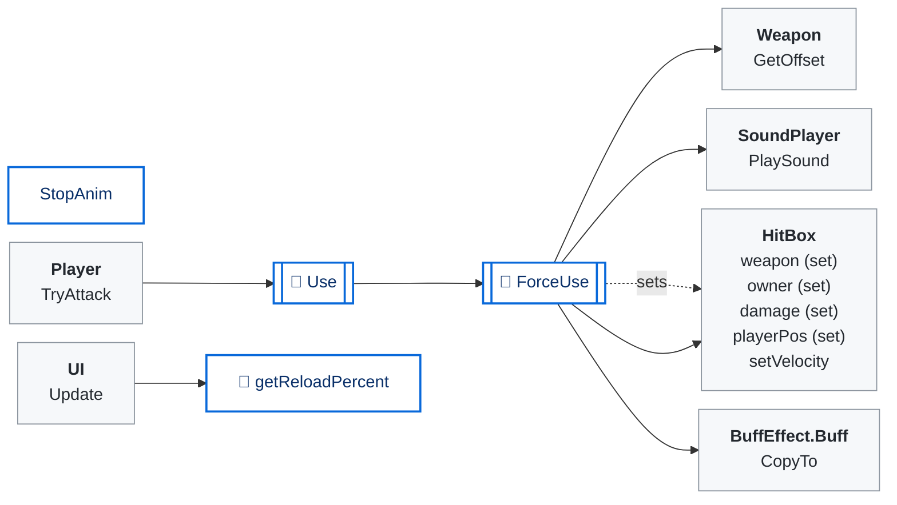

## Who calls what · Player

Left: who calls in (Unity included). Middle: its methods. Right: what they call or set elsewhere.

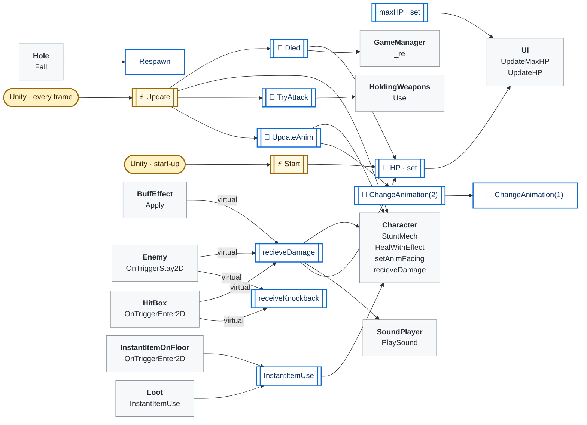

## State · class Direction

| Member | Type | Inspector | Default / value | Comment / tooltip |
|---|---|---|---|---|
| `strMoveDict` | `static string[]` |  | `{"up", "right", "down", "left", }` |  |
| `vec2MoveDict` | `static Vector2[]` |  | `{Vector2.up, Vector2.right, Vector2.down, Vector2.left, }` |  |

## State · class HoldingWeapons

| Member | Type | Inspector | Default / value | Comment / tooltip |
|---|---|---|---|---|
| `weapon` | `Weapon` | ✓ |  |  |
| `lastUse` | `float` | play mode only |  |  |
| `isOnCooldown` | `bool {get}` |  | `=> lastUse + cooldown > Time.time` |  |
| `isUsable` | `bool {get}` |  | `=> weapon != null && !isOnCooldown` |  |
| `cooldown` | `float {get}` |  | `=> weapon.cooldown` |  |
| `anim` | `BaseWeapon` |  |  |  |

## State · class Player

| Member | Type | Inspector | Default / value | Comment / tooltip |
|---|---|---|---|---|
| `_combatStat` | `CombatStat` | ✓ |  |  |
| `combatStat` | `override CombatStat {get/set}` |  |  |  |
| `_initSpeed` | `float` | ✓ | `1` |  |
| `initSpeed` | `float {get}` |  | `=> _initSpeed` |  |
| `team` | `override Team {get}` |  | `=> Team.Player` |  |
| `_maxHP` | `int` | ✓ | `4` |  |
| `maxHP` | `override int {get/set}` |  |  |  |
| `enableInvincible` | `bool {get}` |  | `=> Experimental.I.enableInvincible` |  |
| `speedBoost` | `float` | ✓ |  |  |
| `state` | `int` | play mode only |  | IDLE, MOVING, or the WeaponType number while attacking |
| `attackState` | `bool` |  |  |  |
| `IDLE` | `const int` |  | `0` |  |
| `MOVING` | `const int` |  | `1` |  |
| `SWING` | `const int` |  | `(int)WeaponType.Swinging` |  |
| `USEROD` | `const int` |  | `(int)WeaponType.Rod` |  |
| `SPEAR` | `const int` |  | `(int)WeaponType.Spear` |  |
| `CQC` | `const int` |  | `(int)WeaponType.CQC` |  |
| `cooldown` | `float` |  |  |  |
| `currentAnim` | `string` |  |  |  |
| `anim` | `Animator` | ✓ |  |  |
| `playerIdle` | `AnimationClip[]` | ✓ |  |  |
| `playerWalk` | `AnimationClip[]` | ✓ |  |  |
| `playerIdleWater` | `AnimationClip[]` | ✓ |  |  |
| `playerWalkWater` | `AnimationClip[]` | ✓ |  |  |
| `playerSwinging` | `AnimationClip[]` | ✓ |  |  |
| `playerShooting` | `AnimationClip[]` | ✓ |  |  |
| `playerUseRod` | `AnimationClip[]` | ✓ |  |  |
| `playerSpear` | `AnimationClip[]` | ✓ |  |  |
| `lWeapon` | `HoldingWeapons` | ✓ |  |  |
| `rWeapon` | `HoldingWeapons` | ✓ |  |  |
| `activeArmor` | `Armor` | ✓ |  |  |
| `knockbackResistance` | `float` | ✓ |  |  |
| `controller` | `Controller` |  |  |  |
| `invincibleCooldownTime` | `float` | ✓ |  |  |
| `invincibleTime` | `float` | play mode only |  |  |
| `isInvincible` | `bool {get}` |  | `=> invincibleTime > Time.time` |  |
| `forceAnim` | `bool` | play mode only |  |  |
| `fallClip` | `AnimationClip` | ✓ |  | Fall down animation when it falls in a hole (a state with this clip's name in its Animator). Empty: it shrinks away |
| `roomEntryPos` | `Vector2` | play mode only |  | where this player entered the current room: falling in a hole brings it back here |
| `HP` | `override int {get/set}` |  |  |  |

## Methods

| | Method | Lines | Calls (project) | Called by |
|---|---|---|---|---|
|  | [isOnCooldown · get](#m-holdingweapons-isoncooldown-get) | [L15](../../../Player.cs#L15) | 0 |  |
|  | [isUsable · get](#m-holdingweapons-isusable-get) | [L16](../../../Player.cs#L16) | 0 |  |
|  | [cooldown · get](#m-holdingweapons-cooldown-get) | [L17](../../../Player.cs#L17) | 0 |  |
| 🔁 | [Use](#m-holdingweapons-use) | [L19](../../../Player.cs#L19) | 1 | `Player.TryAttack` |
| 🔁 | [getReloadPercent](#m-holdingweapons-getreloadpercent) | [L20](../../../Player.cs#L20) | 0 | `UI.Update` |
| 🔁 | [ForceUse](#m-holdingweapons-forceuse) | [L21–42](../../../Player.cs#L21-L42) | 4 | `HoldingWeapons.Use` |
|  | [StopAnim](#m-holdingweapons-stopanim) | [L43](../../../Player.cs#L43) | 0 | *none in code (Inspector / UnityEvent?)* |
|  | [combatStat · get](#m-player-combatstat-get) | [L49](../../../Player.cs#L49) | 0 |  |
|  | [combatStat · set](#m-player-combatstat-set) | [L49](../../../Player.cs#L49) | 0 |  |
|  | [initSpeed · get](#m-player-initspeed-get) | [L51](../../../Player.cs#L51) | 0 |  |
|  | [team · get](#m-player-team-get) | [L52](../../../Player.cs#L52) | 0 |  |
|  | [maxHP · get](#m-player-maxhp-get) | [L54](../../../Player.cs#L54) | 0 |  |
|  | [maxHP · set](#m-player-maxhp-set) | [L54](../../../Player.cs#L54) | 1 |  |
|  | [enableInvincible · get](#m-player-enableinvincible-get) | [L55](../../../Player.cs#L55) | 0 |  |
|  | [isInvincible · get](#m-player-isinvincible-get) | [L75](../../../Player.cs#L75) | 0 |  |
|  | [HP · get](#m-player-hp-get) | [L81](../../../Player.cs#L81) | 0 |  |
| 🔁 | [HP · set](#m-player-hp-set) | [L81](../../../Player.cs#L81) | 1 | `Player.Died`, `Player.Start`, `Player.recieveDamage` |
| ⚡ | [Start](#m-player-start) | [L83–88](../../../Player.cs#L83-L88) | 1 | Unity · before its first frame |
| ⚡ | [Update](#m-player-update) | [L89–100](../../../Player.cs#L89-L100) | 4 | Unity · every frame |
| 🔁 | [TryAttack](#m-player-tryattack) | [L101–107](../../../Player.cs#L101-L107) | 1 | `Player.Update` |
|  | [InstantItemUse](#m-player-instantitemuse) | [L108–111](../../../Player.cs#L108-L111) | 1 | `InstantItemOnFloor.OnTriggerEnter2D`, `Loot.InstantItemUse` |
|  | [Respawn](#m-player-respawn) | [L112–115](../../../Player.cs#L112-L115) | 0 | `Hole.Fall` |
| 🔁 | [Died](#m-player-died) | [L116–120](../../../Player.cs#L116-L120) | 2 | `Player.Update` |
| 🔁 | [UpdateAnim](#m-player-updateanim) | [L122–156](../../../Player.cs#L122-L156) | 2 | `Player.Update` |
| 🔁 | [ChangeAnimation(2)](#m-player-changeanimation-animationclip---int) | [L157](../../../Player.cs#L157) | 1 | `Player.UpdateAnim` |
| 🔁 | [ChangeAnimation(1)](#m-player-changeanimation-animationclip) | [L158–163](../../../Player.cs#L158-L163) | 0 | `Player.ChangeAnimation(AnimationClip[],int)` |
|  | [recieveDamage](#m-player-recievedamage) | [L165–171](../../../Player.cs#L165-L171) | 2 | `BuffEffect.Apply`, `Enemy.OnTriggerStay2D`, `HitBox.OnTriggerEnter2D` |
|  | [receiveKnockback](#m-player-receiveknockback) | [L172–175](../../../Player.cs#L172-L175) | 0 | `Enemy.OnTriggerStay2D`, `HitBox.OnTriggerEnter2D`, `Player.receiveKnockback` |

### 🔁 ForceUse(Character player)

[L21–42](../../../Player.cs#L21-L42) · `HoldingWeapons.ForceUse` · code `388eb2e1`

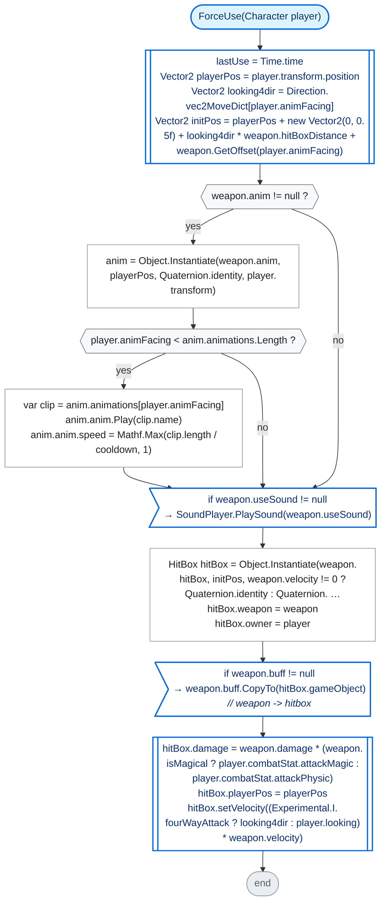

**Calls:** [`Weapon.GetOffset`](Data Types/Weapon.cs.md#m-weapon-getoffset) · [`SoundPlayer.PlaySound`](SoundPlayer.cs.md#m-soundplayer-playsound) · [`BuffEffect.Buff.CopyTo`](BuffEffect.cs.md#m-buffeffect-buff-copyto) · [`HitBox.setVelocity`](HitBox.cs.md#m-hitbox-setvelocity)

### StopAnim()

[L43](../../../Player.cs#L43) · `HoldingWeapons.StopAnim` · code `c2bd49a3`

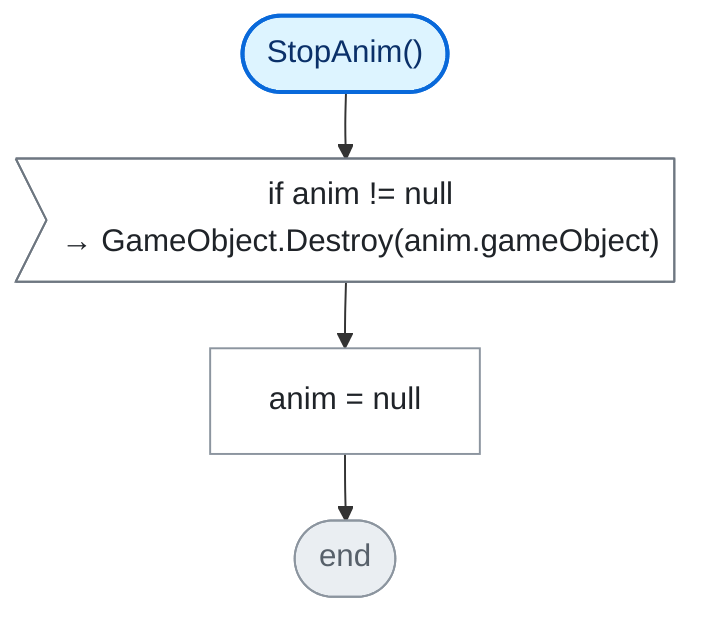

### ⚡ Start()

[L83–88](../../../Player.cs#L83-L88) · `Player.Start` · code `87b1b389`

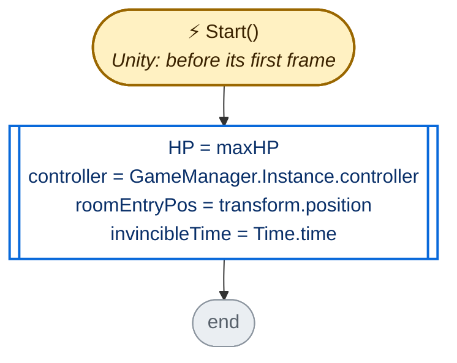

**Calls:** [`Player.HP.set`](#m-player-hp-set)

### ⚡ Update()

[L89–100](../../../Player.cs#L89-L100) · `Player.Update` · code `32124683`

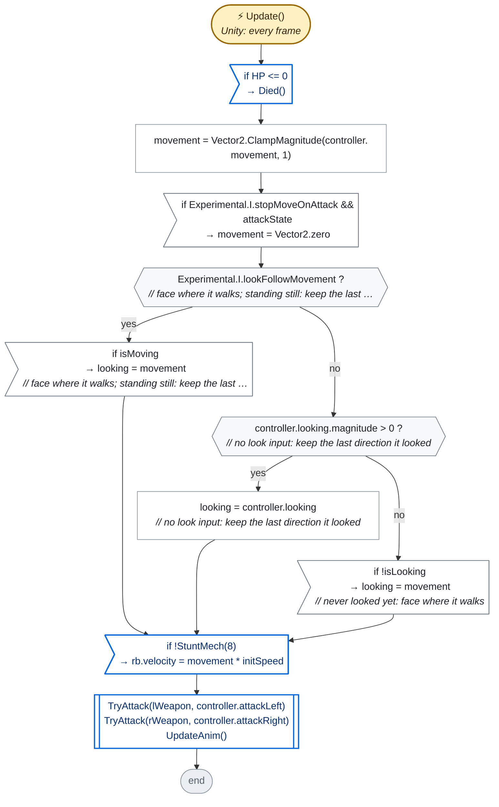

**Calls:** [`Player.Died`](#m-player-died) · [`Character.StuntMech`](Character.cs.md#m-character-stuntmech) · [`Player.TryAttack`](#m-player-tryattack) · [`Player.UpdateAnim`](#m-player-updateanim)

### 🔁 TryAttack(HoldingWeapons hand, ControllerButton button)

[L101–107](../../../Player.cs#L101-L107) · `Player.TryAttack` · code `45b2fee2`

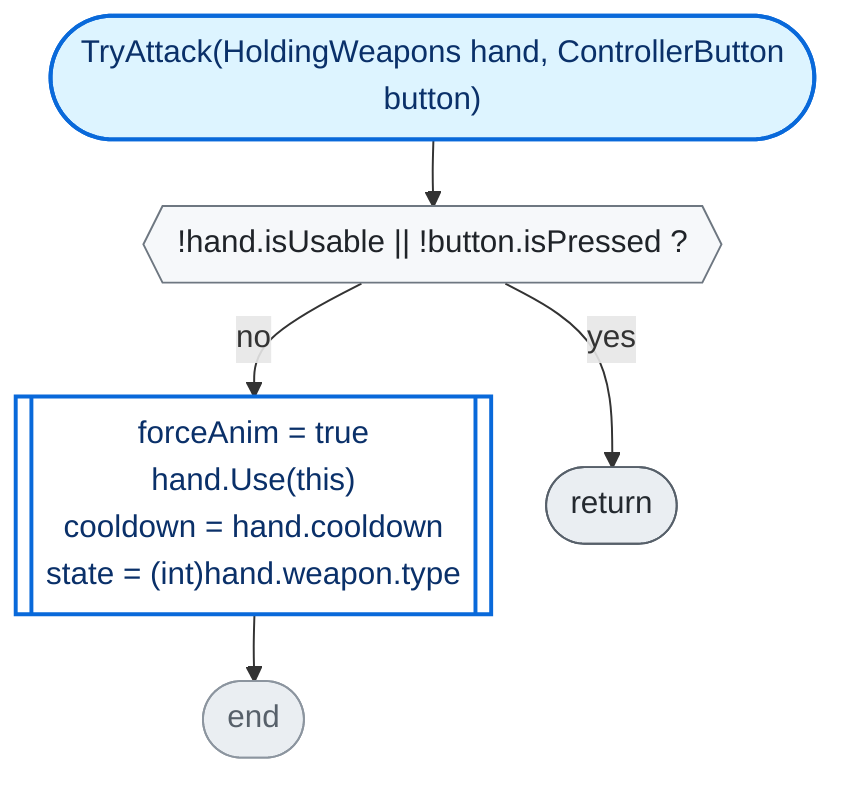

**Calls:** [`HoldingWeapons.Use`](#m-holdingweapons-use)

### InstantItemUse(InstantItem item)

[L108–111](../../../Player.cs#L108-L111) · `Player.InstantItemUse` · code `319e894e`

*Code comment:* walked into an instant use item

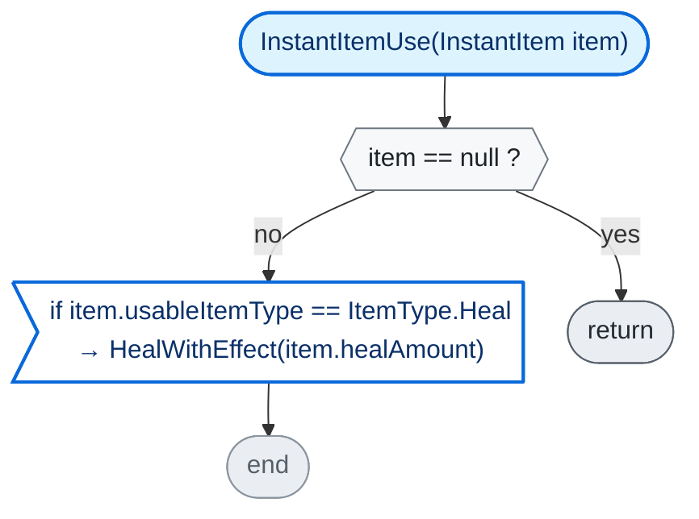

**Calls:** [`Character.HealWithEffect`](Character.cs.md#m-character-healwitheffect)

### 🔁 Died()

[L116–120](../../../Player.cs#L116-L120) · `Player.Died` · code `f9ae8084`

> **🤖 AI note** · *summary* · unreviewed · ⚠️ **code changed since this note** (written for `5188fa45`, now `f9ae8084`)
>
> Test respawn: refills HP, moves the player to (0, 0) and sends the map back to the first room.

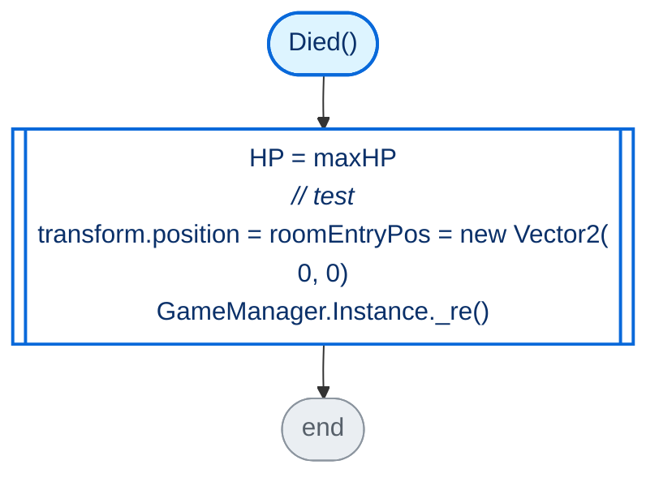

**Calls:** [`Player.HP.set`](#m-player-hp-set) · [`GameManager._re`](GameManager.cs.md#m-gamemanager--re)

### 🔁 UpdateAnim()

[L122–156](../../../Player.cs#L122-L156) · `Player.UpdateAnim` · code `6cfa72ae`

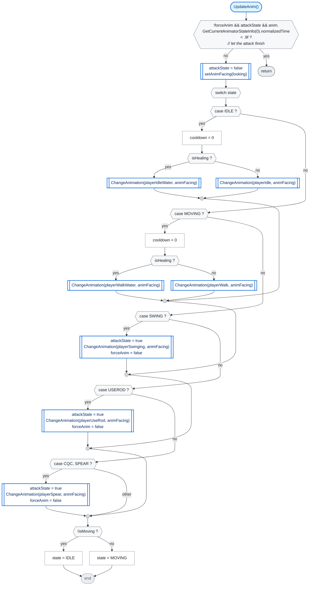

**Calls:** [`Character.setAnimFacing`](Character.cs.md#m-character-setanimfacing) · [`Player.ChangeAnimation(AnimationClip[],int)`](#m-player-changeanimation-animationclip---int)

### 🔁 ChangeAnimation(AnimationClip toAnim)

[L158–163](../../../Player.cs#L158-L163) · `Player.ChangeAnimation(AnimationClip)` · code `c332df46`

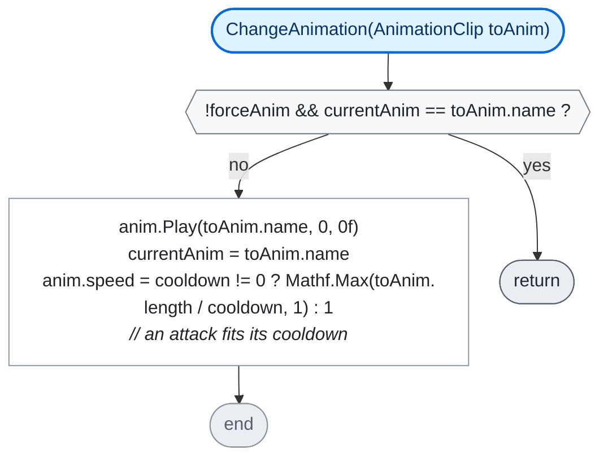

### recieveDamage(int dmg, bool isMagical)

[L165–171](../../../Player.cs#L165-L171) · `Player.recieveDamage` · code `dde55018` · overrides `Character.recieveDamage`

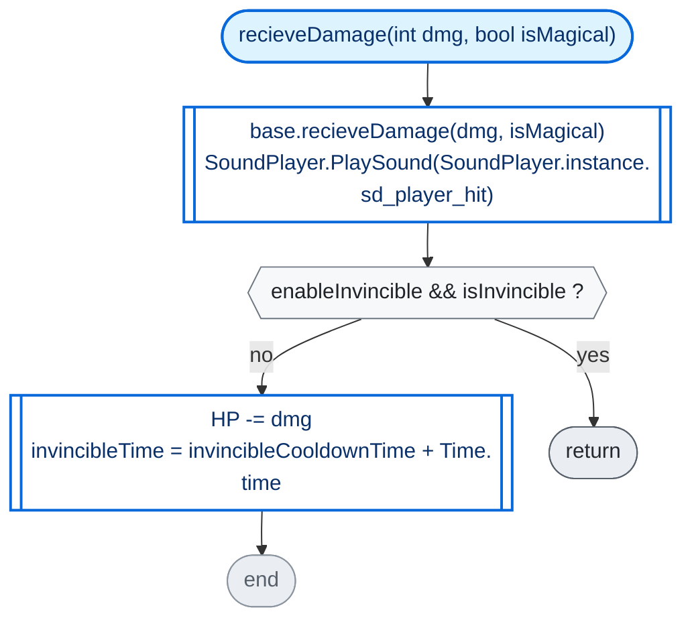

**Calls:** base [`Character.recieveDamage`](Character.cs.md#m-character-recievedamage) · [`SoundPlayer.PlaySound`](SoundPlayer.cs.md#m-soundplayer-playsound) · [`Player.HP.set`](#m-player-hp-set)

### receiveKnockback(Vector2 pos, float force)

[L172–175](../../../Player.cs#L172-L175) · `Player.receiveKnockback` · code `610850d2` · overrides `Character.receiveKnockback(Vector2,float)`

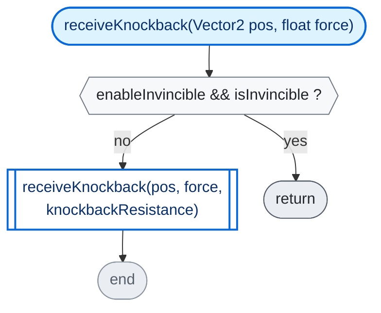

### Short members

Straight-line members with one or two steps: the whole flow fits in one row.

| | Member | Lines | Steps |
|---|---|---|---|
|  | isOnCooldown · get | [L15](../../../Player.cs#L15) | `lastUse + cooldown > Time.time` |
|  | isUsable · get | [L16](../../../Player.cs#L16) | `weapon != null && !isOnCooldown` |
|  | cooldown · get | [L17](../../../Player.cs#L17) | `weapon.cooldown` |
| 🔁 | Use(Character user) | [L19](../../../Player.cs#L19) | *(empty)* |
| 🔁 | getReloadPercent() | [L20](../../../Player.cs#L20) | `weapon == null ? 1 : Mathf.Min((Time.time - lastUse) / weapon.cooldown, 1)` |
|  | combatStat · get | [L49](../../../Player.cs#L49) | `_combatStat` |
|  | combatStat · set | [L49](../../../Player.cs#L49) | `_combatStat = value` |
|  | initSpeed · get | [L51](../../../Player.cs#L51) | `_initSpeed` |
|  | team · get | [L52](../../../Player.cs#L52) | `Team.Player` |
|  | maxHP · get | [L54](../../../Player.cs#L54) | `_maxHP` |
|  | maxHP · set | [L54](../../../Player.cs#L54) | `_maxHP = value` `GameManager.Instance.ui.UpdateMaxHP(maxHP)` |
|  | enableInvincible · get | [L55](../../../Player.cs#L55) | `Experimental.I.enableInvincible` |
|  | isInvincible · get | [L75](../../../Player.cs#L75) | `invincibleTime > Time.time` |
|  | HP · get | [L81](../../../Player.cs#L81) | `_HP` |
| 🔁 | HP · set | [L81](../../../Player.cs#L81) | `_HP = value` `GameManager.Instance.ui.UpdateHP(HP)` |
|  | Respawn() | [L112–115](../../../Player.cs#L112-L115) | `transform.position = roomEntryPos` `currentAnim = null` |
| 🔁 | ChangeAnimation(AnimationClip[] toAnim, int index) | [L157](../../../Player.cs#L157) | *(empty)* |

