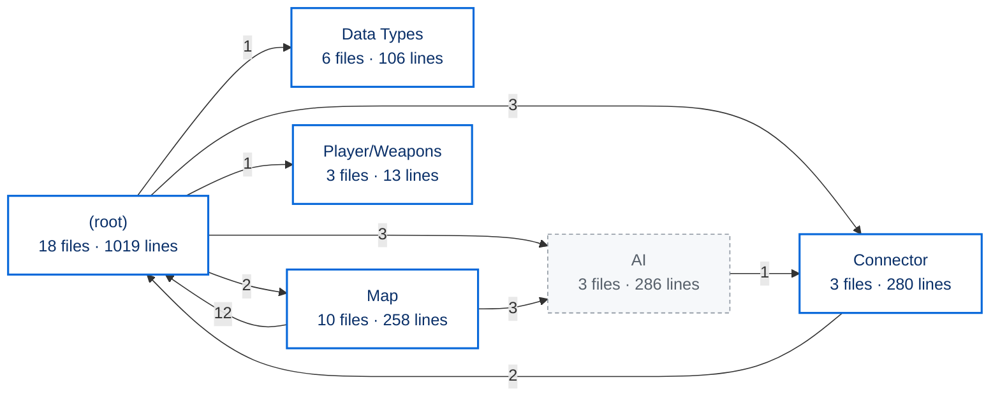

<!-- Generated by CodeGraph (CodeGraph~/tool). Do not edit this file: run the generator. AI / human notes live in CodeGraph~/notes/. -->
# Code graph · Lord of the Dungeon

43 C# files · 1962 lines · 61 types · 217 code blocks · every statement of your own code is in a flowchart node (738/738 statements mapped) · `AI/` is treated as external

⚡ Unity calls it · ⏳ coroutine · 🔁 runs every frame (reached from Update / FixedUpdate / …) · double-edged box = calls project code · dashed = `AI/` (external) · *L12* = source line

## Folders

Arrow number = how many classes in one folder call, set, create or extend classes in the other.

## What Unity runs, and when

Every method Unity calls by itself, by phase. Everything else in the game starts from one of these (or from a button / UnityEvent wired in a scene, which the code can't show). *every frame* and *physics* run all the time: changes there cost performance.

| Class | start-up | every frame | physics | editor |
|---|---|---|---|---|
| `BaseWeapon` | Awake | Update |  |  |
| `BuffEffect` | Start | LateUpdate | OnTriggerEnter2D |  |
| `Chest` |  |  | OnTriggerStay2D |  |
| `Controller` |  | Update |  |  |
| `Destructable` | Start |  |  |  |
| `Dialogue` | Start | Update |  |  |
| `DungeonMap` | [Start](Map/DungeonMap.cs.md#m-dungeonmap-start) |  |  | [OnValidate](Map/DungeonMap.cs.md#m-dungeonmap-onvalidate) |
| `Enemy` | [Start](Enemy.cs.md#m-enemy-start) | [Update](Enemy.cs.md#m-enemy-update) | [OnTriggerStay2D](Enemy.cs.md#m-enemy-ontriggerstay2d) | [OnDrawGizmosSelected](Enemy.cs.md#m-enemy-ondrawgizmosselected) |
| `EventAllEnemiesDefeated` |  | Update |  |  |
| `EventCertainObjectDestroyed` |  | Update |  |  |
| `FollowPlayer` | Start |  |  |  |
| `GameManager` | Awake, Start | Update |  |  |
| `HealingRoom` |  | Update | OnTriggerEnter2D, OnTriggerExit2D |  |
| `HitBox` | Start | Update | OnTriggerEnter2D |  |
| `Hole` | [Awake](Map/Hole.cs.md#m-hole-awake) |  | [OnTriggerEnter2D](Map/Hole.cs.md#m-hole-ontriggerenter2d) |  |
| `InstantItemOnFloor` | Start |  | OnTriggerEnter2D |  |
| `Loot` | Start |  | OnTriggerEnter2D |  |
| `Player` | [Start](Player.cs.md#m-player-start) | [Update](Player.cs.md#m-player-update) |  |  |
| `RoomTrigger` |  |  | OnTriggerExit2D |  |
| `SoundPlayer` | Awake |  |  |  |
| `Spawner` | Awake |  |  |  |
| `TwitchChat` | Start |  |  |  |
| `UI` | Awake, Start | Update |  |  |

## Files

| File | Types | Lines | Code blocks | 🔁 per frame | AI notes |
|---|---|---|---|---|---|
| AI/PathFinding.cs *(external)* | PathFinding | 179 | 17 | 14 |  |
| AI/PlayModeOnly.cs *(external)* | PlayModeOnlyAttribute, PlayModeOnlyDrawer | 16 | 3 |  |  |
| AI/UnifiedChat.cs *(external)* | UnifiedChat | 91 | 10 | 9 |  |
| BuffEffect.cs | BuffType, BuffEffect | 60 | 5 | 3 |  |
| ChannelBtn.cs | ChannelBtn | 10 | 1 |  |  |
| Character.cs | CombatStat, Team, Character | 69 | 20 | 10 |  |
| Connector/Chat.cs | ChatType, Chat | 32 | 2 |  |  |
| Connector/SummonDB.cs | SummonCommand, SimpleSummonDB | 40 | 7 | 4 |  |
| Connector/TwitchChat.cs | TwitchChat | 208 | 5 | 3 |  |
| Controller.cs | ControllerButton, Controller | 78 | 8 | 5 |  |
| Data Types/Armor.cs | Armor | 11 | 0 |  |  |
| Data Types/Enemy.cs | EnemySO | 20 | 0 |  |  |
| Data Types/InstantItem.cs | ItemType, InstantItem | 18 | 0 |  |  |
| Data Types/UsableItem.cs | UsableItemType, UsableItem | 14 | 0 |  |  |
| Data Types/Weapon.cs | Weapon | 34 | 1 | 1 |  |
| Data Types/WeaponType.cs | WeaponType | 9 | 0 |  |  |
| DestructableObj.cs | Destructable | 29 | 3 |  |  |
| Dialogue.cs | DialogueSequence, Dialogues, TriggerType, Dialogue | 46 | 3 | 1 |  |
| [Enemy.cs](Enemy.cs.md) | Enemy | 109 | 14 | 4 | 5 ✅ |
| Experimental.cs | Experimental | 41 | 1 |  |  |
| FollowPlayer.cs | FollowPlayer | 10 | 1 |  |  |
| GameManager.cs | GameManager | 74 | 15 | 4 |  |
| HitBox.cs | HitBox | 42 | 5 | 2 |  |
| Loot.cs | LootType, Loot | 79 | 10 | 1 |  |
| Map/Chest.cs | Chest | 24 | 5 | 1 |  |
| Map/Door.cs | Door | 8 | 0 |  |  |
| [Map/DungeonMap.cs](Map/DungeonMap.cs.md) | DungeonMap | 47 | 6 |  |  |
| Map/DungeonRoom.cs | RoomType, DungeonRoom | 18 | 2 | 1 |  |
| Map/EventAllEnemiesDefeated.cs | EventAllEnemiesDefeated | 29 | 2 | 2 |  |
| Map/EventCertainObjectDestroyed.cs | EventCertainObjectDestroyed | 28 | 2 | 2 |  |
| Map/HealingRoom.cs | HealingRoom | 32 | 4 | 1 |  |
| [Map/Hole.cs](Map/Hole.cs.md) | Hole | 34 | 3 |  | 3 ✅ |
| Map/InstantItemOnFloor.cs | InstantItemOnFloor | 25 | 2 |  |  |
| Map/RoomTrigger.cs | RoomTrigger | 13 | 1 |  |  |
| [Player.cs](Player.cs.md) | Direction, HoldingWeapons, Player | 176 | 28 | 10 | 1 ✅ · 1 ⚠️ |
| Player/Weapons/BaseWeapon.cs | BaseWeapon | 11 | 2 | 1 |  |
| Player/Weapons/SwingWeapon.cs | SwingWeapon | 1 | 0 |  |  |
| Player/Weapons/UseRod.cs | UseRod | 1 | 0 |  |  |
| Skill.cs | Skill | 20 | 5 | 2 |  |
| SoundPlayer.cs | SoundPlayer | 28 | 4 | 1 |  |
| Spawner.cs | Spawner | 36 | 6 | 1 |  |
| Title.cs | Title | 16 | 2 |  |  |
| UI.cs | UI | 96 | 12 | 4 |  |

