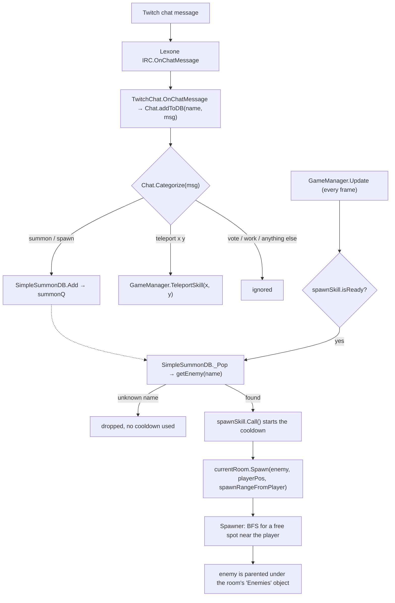

# Architecture: what the code does, and why

Scope: all 35 scripts on `main` (commit `8c77b4d`). Line numbers refer to that commit.
Scenes, prefabs and assets are not in this repo. When this page says "in the Unity project",
it describes something that the code needs but that cannot be checked from here.

> Written by Claude (AI) on 2026-11-04 from reading the code and the git history.
> It was not checked in the Unity editor.

---

## 1. The game in one paragraph

*Lord of the Dungeon* is a top-down 2D action game for live streams. The streamer walks
through hand-built dungeon rooms, fights with two weapon slots (left and right mouse button),
opens chests, breaks objects, and heals in pools. **Twitch chat plays against the streamer.**
Viewers type `summon <enemy>` to send monsters, or `teleport <x> <y>` to move the player.
When the player hits an enemy, the enemy's name appears on screen, so chat learns which
names it can summon.

---

## 2. The main loop

**Player side, every frame:** `Controller` reads input → `Player` moves, aims and uses
weapons → `HitBox` damages enemies and objects → loot drops → `RoomTrigger` switches rooms.

**Chat side:** a Twitch message → command parser → summon queue → `GameManager` takes one
queued enemy each time the summon cooldown is ready → `Spawner` places it near the player,
inside the current room.



---

## 3. The systems

### 3.1 `GameManager` — the hub (`GameManager.cs`)

- **Singleton:** `GameManager.Instance`, set in `Awake` (line 41). A second GameManager
  removes only its own component (`Destroy(this)`, line 44). The first one survives scene
  loads (`DontDestroyOnLoad`, line 49).
- **Holds the main references:** `player`, `ui`, `controller`, `chat` (the `TwitchChat`),
  `map` (the `DungeonMap`), `initRoom`, `mockEnemy`, `uiPrefab`, `mainCam`, `uiCam`,
  `availableSkill`.
- **`Awake`:** finds `Camera.main` and its child `"UI Cam"`. Finds the `UI` in the scene, or
  creates `uiPrefab`. Turns vSync off and sets `Application.targetFrameRate = FPS` (60).
- **`Start`:** sends the player's HP to the UI and finds the `SoundPlayer`.
- **`Update`:** the offline test spawner (`testWithoutChat`); the `;` key reloads the
  `DungeonRoom` scene (debug); takes at most one enemy from the summon queue.
- **`_Connect()`:** joins Twitch chat once, using the channel name from `Data.cn`.
- **`TeleportSkill(x, y)`:** the chat teleport.
- **`_re()`:** goes back to the first room (used when the player dies).

### 3.2 Title screen (`Title.cs`, `ChannelBtn.cs`)

- `ChannelBtn.Call()` stores the text of a TextMeshPro input field in `Data.cn`.
  `Data` is a static holder that lives in the Unity project. It is **not** in this repo.
- `Title.EnterDungeon()` calls `SubmitInput()` (it shows "You entered: ..." in a legacy
  UI `Text`), then loads the scene `"DungeonRoom"`.
- Both methods are most likely wired to UI buttons in the Inspector.

### 3.3 Input (`Controller.cs`)

| Action | Keyboard and mouse | Gamepad |
|---|---|---|
| Move | WASD / arrows (old Input Manager axes `"Horizontal"`, `"Vertical"`) | left stick |
| Aim | mouse position while "mouse mode" is on; otherwise the movement direction | right stick |
| Left weapon | left mouse button | left shoulder |
| Right weapon | right mouse button | right shoulder |
| `attack` (read, not used) | K | west button |
| `switchWeapon` (read, not used) | Q | north button |

- When **any** gamepad is connected, only the gamepad is read. Keyboard movement and the
  mouse are ignored.
- Mouse mode turns on when the mouse moves more than `mouseDistanceActivation` (10 px). It
  turns off after `mouseTimeDeactivation` (1 s) without mouse movement. This timeout only
  works since commit `8c77b4d`. The cursor is visible only in mouse mode.
- `ControllerButton` wraps a bool and adds `isPressedOnce()` (true once per press).
- The code uses **both** the old Input Manager and the new Input System package, so the
  Unity setting *Active Input Handling* must be **Both**.

### 3.4 Characters (`Character.cs`, `Player.cs`, `Enemy.cs`, `Map/Chest.cs`)

```
Character (abstract)
├── Player
└── Enemy
    └── Chest
```

**`Character`:** `movement`, `looking` (the setter always normalizes it), `animFacing`,
`HP`, a `Rigidbody2D`, knockback and stun.

- Facing: `0 = up, 1 = right, 2 = down, 3 = left`. `_setAnimFacing` picks right or left when
  `|x| > 0.7071` (cos 45°), otherwise up or down. The default is down.
- Knockback (`receiveKnockback`): velocity = force × direction away from the hitter
  (±10° random) × (1 − resistance). This starts a stun of up to 1 s. During the stun,
  `StuntMech(recover)` slows the velocity by `exp(-recover * dt)` every frame and ends the
  stun early when the speed drops below 0.5. A stunned character ignores its own movement.

**`Player`:**

- Moves with `rb.velocity = movement * initSpeed`. Aims with the controller's `looking`, or
  with the last movement direction when there is no aim input.
- Has two hand slots, `lWeapon` and `rWeapon` (`HoldingWeapons`). Holding the button attacks
  again each time the weapon's cooldown ends.
- Animation is a small state machine on the int `state`: `IDLE = 0`, `MOVING = 1`, or the
  weapon type number (900+) during an attack. Each state plays a clip from an array in facing
  order: `playerIdle`, `playerWalk`, the `...Water` versions while healing,
  `playerSwinging`, `playerUseRod`, `playerSpear` (also used for CQC). An attack animation
  plays until 90% before idle or walk can replace it. Attack animation speed is scaled to the
  weapon cooldown, but never slower than normal speed.
- Getting hit: optional invincibility time (`enableInvincible`, `invincibleCooldownTime`).
  No knockback while invincible.
- The `HP` and `maxHP` setters update the UI directly.
- **Death is a test version** (marked `//test`): full heal, move to (0, 0), back to `initRoom`.

**`Enemy`:**

- Its data comes from an `EnemySO` asset: speed, HP, stats, knockback values, `noticeRange`,
  `ignoreCollide`, `cooldown`.
- **Spawn-safe collision:** an enemy starts as a trigger. When it no longer touches anything,
  `isTrigger` becomes `enemyData.ignoreCollide`. So a new enemy never gets stuck in a wall
  or in another enemy.
- Chases the player once the player is within `noticeRange` (default 9999, so always).
- On contact (`OnTriggerStay2D`) with the player: knockback and damage, then it waits
  `cooldown` seconds.
- When hit: shows its name in quotes on screen, flashes red for 0.1 s, plays the hit sound,
  and takes damage minus its defense (at least 1).
- Death: drops its loot once, turns white, waits 0.5 s (the "death breath"), then destroys
  itself. It also joins Twitch chat if that has not happened yet.
- **Lifetime:** 360 s after it first became active, it dies by itself (`lifeSpan`).

**`Chest`** (an `Enemy`): any hit opens it (`HP = 0`). It drops its loot once and switches
to the open sprite. No damage text, no red flash, no contact damage. It is **not** destroyed.

### 3.5 Combat and weapons

Files: `Data Types/Weapon.cs`, `Data Types/WeaponType.cs`, `HoldingWeapons` in `Player.cs`,
`HitBox.cs`, `Player/Weapons/`.

**`Weapon`** (ScriptableObject): `type`, `useSound`, `hitSound` (not used), `isMagical`,
`damage`, `cooldown`, `knocback`, `hitBoxDistance` (was `range`), `hitBox` (prefab),
`velocity`, `destroyTimer`, `maxHits` (was `destroyOnHit`), `anim` (effect prefab),
`uiWep` (icon).

**`WeaponType`:** `Swinging = 900, Bow = 901, Rod = 902, Boomerang = 903, Spear = 904,
CQC = 905`.

- The numbers start at 900 so a weapon type can be used as a Player animation `state`
  next to `IDLE = 0` and `MOVING = 1`.
- **CQC** means close-quarters combat (bare hands). A slot that holds a CQC weapon counts as
  empty when you pick up a weapon.
- **Bow** and **Boomerang** have no attack animation yet.

**Using a weapon** (`HoldingWeapons.ForceUse`, `Player.cs:30`):

1. `lastUse = now`, so the cooldown starts.
2. Effect: create `weapon.anim` as a child of the player. Play the clip for the current
   facing. Speed = clip length / cooldown (at least 1).
3. Play `useSound`.
4. Hitbox: create `weapon.hitBox` at player position + (0, 0.5) + facing direction ×
   `hitBoxDistance`. A melee hitbox (`velocity` = 0) is rotated toward the facing direction.
   A projectile is not rotated, and flies along the exact aim direction at `velocity`.
5. `damage = weapon.damage ×` the player's `attackMagic` or `attackPhysic`.

**`HitBox`:**

- Enemy: each enemy is hit at most once per hitbox, with damage and knockback. The hitbox is
  destroyed after `maxHits` enemies (0 = no limit).
- Destructable (non-magic weapons only): damage, then the hitbox is destroyed.
- `destroyTimer` > 0: the hitbox lives that many seconds. `destroyTimer` = 0: it is destroyed
  at its first trigger contact with anything.

**`BaseWeapon`** (the effect): destroys its GameObject at 90% of its animation.
`SwingWeapon` and `UseRod` are empty subclasses. They only give the component a name.

**Damage:**

| Hit | Damage | Knockback |
|---|---|---|
| Player weapon → Enemy | `weapon.damage × attackPhysic` (or `attackMagic`) − enemy `defensePhysic` (or `defenseMagic`). At least 1. | `knocback × (1 − enemy knockbackResistance)`, away from where the player stood when attacking |
| Player weapon → Destructable | 1 hit. Magic weapons do nothing. | — |
| Player weapon → Chest | opens it | like an enemy (uses the chest's `EnemySO`) |
| Enemy contact → Player | enemy `attackPhysic`. Player defense and armor are **not** used. | `attackKnockback × (1 − player knockbackResistance)` |

### 3.6 Chat and summoning (`Connector/`, `Skill.cs`)

**`TwitchChat`** (extends `Chat`) uses the Lexone *Unity-Twitch-Chat* package
(`Lexone.UnityTwitchChat`, `IRC.Instance`). `Connect()` calls `JoinChannel(channel)` and
subscribes to `OnChatMessage`. The connection itself is set up on Lexone's `IRC` component in
the scene. **The game only reads chat. It never sends messages.**

**Commands** (`Chat.Categorize`, `Connector/Chat.cs:33`). The message is lowercased and split
on spaces. The first word may be any start of the command word.

| Command | Short forms | Words | What happens | Status |
|---|---|---|---|---|
| `summon <enemy>` or `spawn <enemy>` | `s`, `su`, `sum`, `sp`, `spa`, ... | 2–3 (the 3rd word, a location, is ignored) | added to the summon queue | works |
| `teleport <x> <y>` | `t`, `te`, `tel`, ... | exactly 3 | the player jumps to world point (x, y) if it is in the current room and free | works, **no cooldown** |
| `vote <option>` | `v`, `vo`, ... | exactly 2 | nothing yet | planned |
| `work <job>` | `w`, `wo`, ... | exactly 2 | nothing yet | planned |

**`SimpleSummonDB`** (in `TwitchChat` → `summondb`):

- A queue made of a `List` and an index. Over 300 entries → `Reset()`, which also drops
  the commands that are still waiting.
- `spawnSkill` (a `Skill`) is the **global** summon cooldown.
- `getEnemy(name)` compares with `enemyData.enemyName` of the prefabs in `summonableEnemy`
  (lowercase, trimmed).

**`Skill`:** a small cooldown helper: `isReady`, `getReloadPercent()`, `Call()`. Its
`Start()` is never called, because `Skill` is not a MonoBehaviour.

**`availableSkill`** (in `GameManager`) lists the chat skills that are unlocked. Chat-skill
loot fills it. But nothing reads it yet: the check in `Chat.addToDB` is commented out.

**Chat connects late:** the first time the player puts a weapon into the left hand from loot,
or when the first enemy dies.

**Offline test:** `GameManager.testWithoutChat` = true → no Twitch connection, and
`mockEnemy` spawns every `testWithoutChatSpawnCooldown` seconds.

### 3.7 Map and rooms (`Map/`, `Spawner.cs`)

- **Only the current room is active.** Every other room is switched off with
  `SetActive(false)`, so its enemies, events and healing areas pause.
- **`DungeonMap`** keeps `allRooms` (filled in `OnValidate`, which runs only in the editor),
  `currentRoom`, the list of `RoomTrigger`s, and `triggerMap`.
- **`RoomTrigger`:** a trigger collider at a door, a direct child of a `DungeonRoom`. In
  `Start`, each trigger is paired with the nearest trigger that belongs to another room.
- **Switching rooms** (`DungeonMap.roomTriggerExit`, line 51): when the player leaves a
  trigger while moving toward its partner trigger (dot product of the player velocity and
  the partner direction > 0), the partner's room becomes active, the old room is switched
  off, and the music is updated. Two older versions are kept: `roomTriggerExitLegacy` and
  `roomTriggerExitLegacy2`.
- **`DungeonRoom`:** `roomType` (`rest`, `enemies`, `traps`, `boss`; today it only picks the
  music) and a `Spawner`. `Spawn()` puts new enemies under a child object named `"Enemies"`.
- **`Spawner`:** sits on the room's floor `Tilemap`. `bounds` = the tilemap renderer bounds.
  Spawning near a point is a BFS on a 0.5-unit grid: only points within `range` of the
  player, with no collider, inside the bounds, and at least 0.5 away. One result is picked
  at random. If none is found, the enemy appears at the player's position.
- **`_findRoom(pos)`** returns the first room whose bounds contain `pos`. The owner's comment:
  `// buggy, use with care`.

### 3.8 Pickups, objects and room events

- **`Loot`:** `lootType` = `weapon`, `chatSkill` or `None`.
  - A weapon goes into an empty or CQC slot (left first). If both hands are full, you swap by
    holding the left or right attack button **while you walk onto** the loot.
  - A chat skill is added to `availableSkill`.
  - In `Start`, it makes sure there is a `SpriteRenderer` and a collider, and shows the
    weapon icon.
- **`Destructable`** (`DestructableObj.cs`): breaks after `hitUntillBreak` hits from
  non-magic weapons. Its sprite changes with each hit. Then it drops loot and is
  optionally destroyed.
- **`EventAllEnemiesDefeated`:** fires its UnityEvent when no active `Enemy` is left. This
  includes summoned enemies, and also chests (see [TECH_DEBT.md](TECH_DEBT.md) B1). Then it
  destroys itself.
- **`EventCertainObjectDestroyed`:** fires when the `Loot` in its `sword` field is gone
  (picked up). This looks like the tutorial: take the sword, then a door opens.
- **`HealingRoom`:** while the player stands in the area, `isHealing` = true (so the "water"
  animations play), and the player gets +1 HP every `1 / HPHealPerSecond` seconds, with a
  sound and an effect.
- **`Door`:** an empty placeholder class.

### 3.9 UI, sound and camera

- **`UI`:** hearts (copies of the first heart; full and empty sprites), two weapon icons with
  a `"Fill"` child that shows the cooldown, skill slots (slot 0 shows the summon cooldown),
  and a text box that is visible for 2 s. The canvas is *Screen Space - Camera* on `UI Cam`.
- **`SoundPlayer`:** static `PlaySound()` for one-shot effects. Music is chosen by `RoomType`
  with two parallel arrays, and changes when you switch rooms.
- **`FollowPlayer`:** makes the Cinemachine (2.x API) virtual camera follow the player.

### 3.10 Planned, but not wired yet

These look unused, but the owner wants to keep them (they are plans):

- chat: `vote` and `work` commands; the summon location (3rd word, `spawnableLocation`,
  `Direction.strMoveDict`); a fair per-viewer queue (the commented `SummonDB`,
  `limitPerPlayer`); locking chat skills until they are picked up (`availableSkill`);
  chat messages as data (`ChatMsg`, `TwitchChatMsg`); "dead enemies become summonable"
  (commented block in `Enemy.Died`)
- items: `Armor` (`Player.activeArmor`), `UsableItem` (`Heal`, `Mute`, `Enhance`, `Explode`)
- weapons: `Bow`, `Boomerang`, `playerShooting` clips, `hitSound`, weapon switching
  (`switchWeapon`, `attack`, commented `SwitchWeapon()`)
- enemies: their animation clips (`enemyIdle`, `enemyWalk`, `enemyAttack` are never played)
- map: `Door`, `RoomType.traps` and `RoomType.boss` logic, `DungeonMap.width/height`
- other: `Player.speedBoost`, teleport cooldown (`if(true){ // TODO: check cooldown`),
  `Yoink()` (push loot away from the player), `PlayerControl.cs` (an empty file)

---

## 4. What the code is trying to hold

These are the promises the code keeps today. A change that breaks one of them will break
something far away.

1. **One `GameManager`**, reachable from everywhere as `GameManager.Instance`.
2. **One active room** at a time, and `DungeonMap.currentRoom` is that room.
3. **One facing order: up, right, down, left** (0–3). It is used by `Direction.vec2MoveDict`,
   every clip array on the `Player`, and `BaseWeapon.animations`.
4. **Animator state name = clip name.** Animation is played by name.
5. **`WeaponType` numbers stay at 900 and above**, so they never equal `IDLE` (0) or
   `MOVING` (1).
6. **Chat can never overwhelm the streamer:** at most one summon per cooldown, however busy
   chat is.
7. **The name chat types is `enemyData.enemyName`**: one word, not case-sensitive.
8. **Chat joins once,** and only after the game has started.
9. **Shared data assets are read-only at runtime.** All enemies of one type share one
   `EnemySO`, and all copies of a weapon share one `Weapon`. `Enemy.combatStat` returns the
   asset's own object, and its setter does nothing.
10. **Saved names never change:** field names, enum numbers, file and class names, and public
    method names (see section 6).

---

## 5. Why it is built this way

There is no design document. These reasons come from the code, its comments, and the old
versions that were kept. Treat them as well-founded guesses.

- **This is how Unity works.** Scripts are components on GameObjects, data lives in assets,
  and the Inspector is the main tool. That gives many small MonoBehaviours, public fields,
  ScriptableObjects and UnityEvents.
- **Built fast, to try ideas.** A singleton hub and direct calls mean that a new feature
  touches very few files. Polling keeps each rule in one place, and it is easy to debug.
  Public fields allow live tuning in Play Mode.
- **No version control before the first commit.** So the commented-out code and the
  `...Legacy` methods are the history and the undo button.
- **Timestamps instead of coroutines.** Rooms are switched off all the time. A coroutine on
  an inactive GameObject stops, but a timestamp keeps working. (This may be a happy side
  effect and not the original reason.)
- **One active room.** Simple and cheap: enemies, AI, physics and events in the other rooms
  pause for free. Spawned enemies are put under their room, so they pause with it. Music
  follows the room type. Rooms are placed by hand. The commented-out grid code shows that a
  grid of rooms was tried first.
- **Room switching by movement direction** is the third version:
  v1 asked which room's bounds contain the player (`_findRoom`, "buggy"),
  v2 compared the distances to the two door triggers,
  v3 (current) checks whether the player moves toward the other door when leaving a trigger.
- **The chat design protects the streamer and helps the viewers:**
  - the `Chat` base class → `TwitchChat`: the chat source can be replaced, and there is a
    test mode without chat;
  - a switch on the first letter plus prefix matching: chat can type fast (for example
    `s goblin`), and
    the word-count rules stop most normal chat lines from matching;
  - one global summon cooldown with a queue: busy chat cannot flood the room; unknown names
    are skipped without using the cooldown; the queue is capped at 300;
  - the enemy's name is shown when it is hit: the game teaches chat the summon words;
  - late connection: the start of the game (first room, first weapon) is not interrupted;
  - BFS spawning near the player: enemies appear close enough to matter, in a reachable
    spot, not inside walls, and inside the current room.
- **Spawn-safe collision:** enemies start as triggers and turn solid only when they are free.
- **`WeaponType` starts at 900** so one `switch` can handle both movement states and attacks.
- **CQC as an "empty hand":** bare hands are a real `Weapon` asset, and a pickup replaces them.
- **Animation from code** (`Animator.Play` with clip arrays per direction): you do not need to
  build an Animator graph for 4 directions × many states. This is common in 2D pixel games.
- **Movement and knockback through physics:** correct collisions with walls. Knockback, an
  exponential slow-down and a short stun give hits their impact.
- **Healing pools** switch the walk and idle animations to "water" versions: the healing room
  is a pool you stand in.

---

## 6. What the Unity project must provide

The code expects these things. Nothing checks them, and when one is missing you usually get a
`NullReferenceException` or a feature that silently does nothing.

### Project and scene

| The Unity project needs | Used by | If it is missing |
|---|---|---|
| A static `Data` class with a `string cn` | `ChannelBtn`, `GameManager._Connect` | compile error |
| Scene `"DungeonRoom"` in Build Settings | `Title.EnterDungeon`, `;` key | scene load error |
| *Active Input Handling* = **Both** | `Controller` | input errors or dead input |
| Layer `"Enemy"` | `Enemy.Start` | error when an enemy starts |
| Main camera (tag `MainCamera`) with a child `"UI Cam"` that has a `Camera` | `GameManager.Awake` | error at start |
| Lexone `IRC` component in the scene | `TwitchChat.Start` / `Connect` | error when chat connects |
| One `GameManager` with `player`, `controller`, `chat`, `map`, `initRoom`, and a `UI` in the scene or `uiPrefab` | everything | errors everywhere |
| Packages: Input System, TextMeshPro, 2D Tilemap, Cinemachine **2.x** (`using Cinemachine`), Lexone Unity-Twitch-Chat | several | compile errors |

### Objects and prefabs

| Object | Must have | Why |
|---|---|---|
| Player | `Player`, `Rigidbody2D` and `Collider2D` **on the same GameObject**; an `Animator` with one state named after every clip in the arrays | hits and pickups use `other.TryGetComponent(...)`, which only looks at that one GameObject; animation plays by state name |
| Enemy prefab | `Enemy` (or a subclass), `Rigidbody2D` and `Collider2D` on the same GameObject; a `SpriteRenderer` on it or on a child; an `EnemySO` whose `enemyName` is **one word** | the chat parser takes exactly one word as the name |
| Enemy contact damage | a trigger collider touching the player | it uses `OnTriggerStay2D`. If `ignoreCollide` is false, the first collider turns solid after spawn, so the enemy needs an extra trigger collider (or the player needs one) |
| Summonable enemies | listed in `TwitchChat` → `summondb` → `summonableEnemy` | otherwise chat cannot summon them |
| `Weapon.hitBox` prefab | `HitBox` + a trigger `Collider2D`; a `Rigidbody2D` when `velocity` > 0 | `setVelocity` needs the `Rigidbody2D` |
| `Weapon.anim` prefab | `BaseWeapon` (or subclass) + `Animator`; the **`anim` field assigned in the prefab**; `animations` in up/right/down/left order; Animator states named like the clips | `ForceUse` calls `anim.anim.Play()` right after `Instantiate`, before `BaseWeapon.Start` runs |
| Loot prefab | `Loot` with a **trigger** collider | the `BoxCollider2D` that `Loot.Start` adds is solid (not a trigger), so `OnTriggerEnter2D` does not fire against a solid player collider |
| Chest | an `EnemySO` (`maxHP` > 0), `Rigidbody2D`, `Collider2D`, `myRender`, `openSprite`, `closedSprite` | it runs all of `Enemy`'s code |
| Every room | `DungeonRoom` with its `spawner` set; the `Spawner` on the room's floor `Tilemap` (with `TilemapRenderer`), and the Spawner object must have a parent | bounds come from the tilemap; `Spawner.Awake` logs `transform.parent.name` |
| Room floor tilemaps | bounds that include z = 0 (a flat tilemap at z = 0) | `Spawner.Spawn`, `DungeonMap.Start` and `_findRoom` test 2D points (z = 0) against the 3D `Bounds`; otherwise no spawn spot is found and room lookup fails |
| Rooms at start | only the start room active; the player inside it; `initRoom` contains the world point (0, 0) | death moves the player to (0, 0) |
| `DungeonMap.allRooms` | filled again after you add or remove a room: change any value on `DungeonMap`, then save the scene | it is filled in `OnValidate`, which only runs in the editor |
| `RoomTrigger`s | a trigger collider, a **direct child** of a `DungeonRoom`, placed in pairs (one on each side of a door) | each trigger is paired with the nearest trigger of another room |
| UI prefab | `Canvas`; `healthUI` with at least one heart `Image`; `skillSlot` children with an `Image` whose first child is an `Image`; `leftWeapon`/`rightWeapon` each with a child named `"Fill"`; `wepImages` with 2 entries; `d_textBox` with a `TMP_Text` child; `healthSprite` = {full, empty} | `UI.Awake` and `UI.Update` look these up |
| `SoundPlayer` | `musicSource`, `soundSource`, `sd_enemy_hit`; `roomTypeList` and `roomMusicList` with the same length and order, with music for every room type in use | see TECH_DEBT B10 |
| `EventCertainObjectDestroyed` | `sword` assigned | if it is empty, the event fires at once |

### Names that are saved — do not rename

- **Field names** of `public` and `[SerializeField]` fields, also inside `[System.Serializable]`
  classes (`CombatStat`, `HoldingWeapons`, `Skill`, `SimpleSummonDB`, ...). Unity stores
  values by field name. Rename only with `[FormerlySerializedAs("oldName")]`.
- **Enum numbers.** Unity stores enums as numbers: `ChatType` (in `Skill.chatType`,
  `Loot.skill`, `GameManager.availableSkill`), `LootType`, `RoomType` (in
  `DungeonRoom.roomType`, `SoundPlayer.roomTypeList`), `WeaponType` (in `Weapon.type`),
  `UsableItemType`. Add new values **at the end** only.
  Watch out: `Loot.skill` defaults to `ChatType.invalid`. If you add a command **before**
  `invalid`, every saved `invalid` turns into your new command.
- **Script files and class names.** Unity links a script by the GUID in its `.meta` file,
  and `.meta` files are not in this repo. Rename or move scripts only inside the Unity editor.
- **Public method names** can be wired to a Button or a UnityEvent in the Inspector, by name.
  Renaming one breaks the link with no compile error. Likely ones: `ChannelBtn.Call`,
  `Title.EnterDungeon`, `Title.SubmitInput`, and anything that `onAllEnemiesDefeated` or
  `onCollectedSword` calls.
- **Animator state names** must stay equal to the clip names.
- **`enemyName`** values are what viewers type.

---

## 7. How to add things

**A new enemy**

1. *Create → Enemy* (an `EnemySO`). Set `enemyName` to **one lowercase word**: that is what
   chat types. Set `maxHP`, `initSpeed`, `cooldown` (time between contact hits),
   `combatStat`, the knockback values, `noticeRange` and `ignoreCollide`.
2. Make a prefab: `Enemy` + `Rigidbody2D` + `Collider2D` + `SpriteRenderer` (on it or on a
   child), plus a trigger collider for contact damage if the enemy will be solid. Set
   `enemyData`, and `loot` if it should drop something.
3. Add the prefab to `TwitchChat` → `summondb` → `summonableEnemy`, so chat can summon it.

**A new weapon**

1. *Create → Weapon*. Pick a `type`: `Swinging`, `Rod`, `Spear` and `CQC` have player
   animations; `Bow` and `Boomerang` do not.
2. Set `damage`, `cooldown`, `knocback`, `isMagical`, `useSound` and `uiWep`.
3. `hitBox`: a prefab with `HitBox` + a trigger `Collider2D` (+ `Rigidbody2D` for a
   projectile). Set `hitBoxDistance`, `velocity` (0 = melee), `destroyTimer` (0 = gone at
   the first touch) and `maxHits` (0 = no limit).
4. Optional `anim`: a prefab with `BaseWeapon` (or `SwingWeapon` / `UseRod`) + `Animator`.
   Assign its `anim` field. Fill `animations` with 4 clips in the order up, right, down, left,
   and give the Animator states with the same names.
5. Put it in the world: a `Loot` with `lootType = weapon` and `weaponLoot` set, used directly
   or as the `loot` of an enemy, chest or destructable.

**A new room**

1. A GameObject with `DungeonRoom`. Set `roomType`.
2. A child floor `Tilemap` with `TilemapRenderer` and `Spawner`. Assign it to the room's
   `spawner` field.
3. `RoomTrigger` children (trigger colliders) at each door, each one close to a partner
   trigger in the next room.
4. Leave the room inactive, unless it is the start room.
5. Change any value on `DungeonMap` so `allRooms` updates, then save the scene.
6. Optional: `EventAllEnemiesDefeated`, `HealingRoom`, destructables, a chest. Do not combine
   a chest with `EventAllEnemiesDefeated` in the same room (TECH_DEBT B1).

**A new chat command**

1. Add a value to `ChatType` **after `invalid`** (or give it an explicit number).
2. Add a `case` to `Chat.Categorize`: first letter, word count, prefix check. The first
   letters `s`, `t`, `v` and `w` are taken.
3. Handle it in `Chat.addToDB`.

**Music for a room type**

Add the `RoomType` to `SoundPlayer.roomTypeList`, and the clip at the **same index** in
`roomMusicList`.

---

## 8. Tuning knobs

| Where | Field | Code default | What it does |
|---|---|---|---|
| `GameManager` | `testWithoutChat` | false | offline mode: no Twitch; `mockEnemy` spawns on a timer |
| `GameManager` | `testWithoutChatSpawnCooldown` | 5 | seconds between mock spawns |
| `GameManager` | `spawnRangeFromPlayer` | 3 | how far from the player summoned enemies may appear |
| `GameManager` | `FPS` | 60 | target frame rate (vSync is turned off) |
| `TwitchChat` → `summondb` → `spawnSkill` | `cooldown` | (set in scene) | seconds between chat summons, for all of chat together |
| `Player` | `_initSpeed` | 1 | move speed |
| `Player` | `_maxHP` | 4 | number of hearts |
| `Player` | `enableInvincible`, `invincibleCooldownTime` | false, 0 | invincibility after a hit |
| `Player` | `knockbackResistance` | 0 | 1 = no knockback |
| `Player` | `_combatStat` | 1 / 1 / 1 / 1 | attack multipliers (the player's defense is not used) |
| `Controller` | `enableMouse`, `mouseDistanceActivation`, `mouseTimeDeactivation` | true, 10 px, 1 s | mouse aim on and off |
| `EnemySO` | `enemyName`, `initSpeed`, `maxHP`, `cooldown`, `combatStat`, `knockbackResistance`, `knocbackRecovery` (4), `attackKnockback`, `ignoreCollide`, `noticeRange` (9999) | — | per enemy type |
| `Weapon` | `damage`, `cooldown`, `knocback`, `hitBoxDistance`, `velocity`, `destroyTimer`, `maxHits`, `isMagical` | — | per weapon |
| `HealingRoom` | `HPHealPerSecond`, `animLengthSec` | 3, 0.5 | heal speed, effect length |
| `Destructable` | `hitUntillBreak`, `destroyAfterDead` | 1, false | hits to break; remove after breaking |
| code only | `Enemy.lifeSpan` | 360 s | enemies die after this time (private, not in the Inspector) |

---

## 9. Debug and test switches

| Switch | Where | Effect |
|---|---|---|
| `testWithoutChat` + `mockEnemy` | `GameManager` | play without Twitch; the mock enemy spawns every few seconds |
| L key | `GameManager.Update` | probably meant to pause the mock spawns, but it only skips one frame (TECH_DEBT B12) |
| `;` key | `GameManager.Update` | reloads the `DungeonRoom` scene (TECH_DEBT B5) |
| `enableInvincible` | `Player` | invincibility after a hit, on or off |
| console messages | `SoundPlayer` ("Play:..."), the events ("ALL ENEMIES DEFEATED!", "SWORD COLLECTED"), `Spawner` ("Parent is: ...") | logs |
| player death | `Player.Died` | `//test`: refill HP and go back to the first room |

---

## 10. Start-up order

1. **Title scene.** The button calls `ChannelBtn.Call()` → `Data.cn`. `Title.EnterDungeon()`
   loads `"DungeonRoom"`.
2. **`Awake`** (all objects, before any `Start`): `GameManager` sets `Instance`, the cameras,
   the UI (found or created) and the frame rate. `UI.Awake` collects hearts, skill slots and
   the text label.
3. **`Start`:** `GameManager` sends HP to the UI and finds the `SoundPlayer`. `Player` sets
   `HP = maxHP` and gets the controller. `UI` sets the canvas camera and the weapon icons.
   `DungeonMap` pairs the triggers and finds the current room. `TwitchChat` gets
   `IRC.Instance`. `SoundPlayer` sets `instance`. `FollowPlayer` sets the camera target.
4. **Play.** When the player first puts a weapon into the left hand (or the first enemy dies),
   `_Connect()` joins the Twitch channel.

Unity does not promise an order between different scripts' `Start` methods, and the code sets
no *Script Execution Order*. For example, `SoundPlayer.instance` is set in `Start`, so a sound
played from another script's `Start` could fail.
